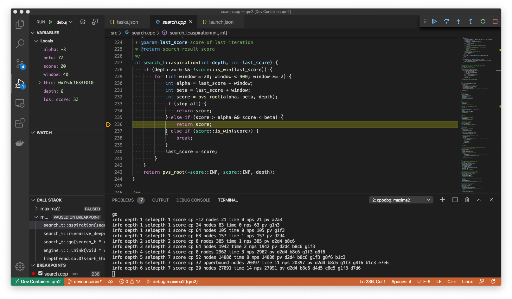

# Maxima project documentation

This is the main technical documentation for Maxima. Keep it current as the
engine evolves. `AGENTS.md` is the quick entry for contributors and coding agents;
optional private context lives in `.context/agents.md`, outside Git.

## Contents

1. [Engine and goals](#1-engine-and-goals)
2. [Engineering conventions](#2-engineering-conventions)
3. [Code layout](#3-code-layout)
4. [Search correctness and caches](#4-search-correctness-and-caches)
5. [Build and debugging](#5-build-and-debugging)
6. [Testing and performance](#6-testing-and-performance)
7. [CLI and local tablebases](#7-cli-and-local-tablebases)
8. [Roadmap](#8-roadmap)
9. [Opening books and persistent experience](#9-opening-books-and-persistent-experience)
10. [Python runner and project CLI](#10-python-runner-and-project-cli)

Keep chapter numbers stable; append new chapters rather than renumbering existing
ones. Use descriptive headings and keep each chapter understandable independently.
Until a dedicated documentation reader exists, list chapters with
`rg '^## ' MAXIMA.md` and locate topics with `rg -n '<term>' MAXIMA.md`.

## 1. Engine and goals

Maxima2 is a C++26 UCI chess engine with bitboard move generation, alpha-beta
search, NNUE evaluation, and experimental royal-losers support.

### Goals

- Improve playing strength, correctness, performance, and reliability.
- Make clean, understandable code a first-class project goal. Preserve clear
  control flow, explicit state ownership, and coherent interfaces as the engine
  gains capabilities.
- Preserve the engine's focus on speed: efficient chess algorithms, high search
  throughput, and compilation tuned for the target CPU.
- Improve NNUE evaluation with correctness tests and measured playing-strength
  gains guiding model and inference changes.
- Standard chess uses NNUE exclusively after passing the equal-time HCE
  comparison gate. The classical evaluator and its caches are removed; retain
  required search metadata, pruning guards, exact draws and tablebase integration.
  Keep a frozen HCE executable for historical comparisons.
  The agreed strength gate is NNUE at least as strong as pure HCE, rather than
  a required positive Elo margin. Use the runner's `--min-elo 0` simultaneous
  confidence rule: pass only when the lower score bound exceeds 50%; a cap
  without a crossing is inconclusive. Exact equality cannot be established by
  a finite match. After a pass, remove HCE in one coherent cleanup, preserving
  independently required search metadata and exact endgame/draw handling;
  incremental HCE removal stages are not requested.
  Defer dual-network routing (cheap material-based selection or a small-network
  screening pass followed by a larger network) and related inference experiments.
  Accept some neural evaluation weaknesses in unusual endgame imbalances;
  tablebases help only for covered material sets within the available piece limit.
- Later, investigate play that exploits weaknesses in other engines' selective
  search, including null-move assumptions in zugzwang and forced-move positions.
  Use targeted positions and paired games against multiple engine opponents to
  establish gains. This is deferred research after the basic NNUE/search work.
- Strengthen endgame play with verified KPK integration and optional tablebases
  that respect draw rules and work with partial, user-selected coverage.
- Add multithreaded search with explicit ownership of worker state, safe shared
  caches, and reliable cancellation.
- Make the code cleaner through focused refactoring: reduce global mutable
  state, encapsulate invariants, clarify interfaces, and remove misleading or
  unused behavior.
- Preserve chess correctness and existing functionality while improving the
  engine.

These goals guide development; they do not select a parallel search algorithm
or require every task to advance every goal.

## 2. Engineering conventions

- Keep code clean, understandable, and maintainable. Judge simplicity by how
  easily behavior and invariants can be understood and changed safely. Prefer
  focused functions, explicit dependencies, and purposeful abstractions. Explain
  the reasoning behind heuristics and subtle invariants where it helps readers.
- Use snake_case for new project-defined identifiers and filenames. Preserve
  externally defined names, such as UCI commands and options.
- Prioritize missing engine fundamentals and substantial measured strength gains
  over complex changes aimed at marginal Elo improvements.
- Keep heuristics understandable and independently testable. Justify added
  complexity with measured benefits.
- During the NNUE search baseline work, use simple documented search rules and
  conservative round margins. Apply this to every pruning/reduction/extension
  under review. Establish a sound empirical baseline before adding adaptive
  tweaks or tuning; cite original references and state heuristic limits.
- Before implementing or substantially changing a chess algorithm, read the
  relevant [Chess Programming Wiki](https://chessprogramming.org/) articles.
  Follow their references to original papers and engine implementations when
  assessing technical details. Treat
  [NNUE](https://chessprogramming.org/NNUE) and
  [Late Move Reductions](https://chessprogramming.org/Late_Move_Reductions)
  as required reading for their respective workstreams; validate designs and
  tuning choices in Maxima.
- Treat performance as a first-class requirement. Preserve useful low-level
  techniques, including intrinsics and assembly; use profiling and benchmarks
  to guide hot-path changes and compiler choices. Compare Release builds with
  identical positions, limits, and compiler flags, checking NPS, time to depth,
  and playing strength rather than assuming any one metric proves improvement.
- Always use curly braces for `if` and `else` bodies, including single returns.
- Prefer incremental changes with clear ownership and explicit dependencies.
- Commit each completed, tested increment with its regressions and relevant
  documentation before moving on. Use a one-line Conventional Commit message
  (`type(scope): description`) with no body or footer.
- Keep board representations, hashes, ply counters, and search stacks consistent
  through operations that own their invariants.
- Validate external input before changing engine state. Assertions supplement
  validation; they do not replace it.
- Use atomics or locks for shared mutable state. `volatile` is not thread
  synchronization.
- Support search and evaluation improvements with correctness checks and
  relevant performance or playing-strength evidence. Distinguish measured
  results from assumptions.

## 3. Code layout

- `src/`: engine, UCI handling, board state, move generation, search, evaluation,
  hash tables, time management, and Polyglot opening-book support.
- `src/w17/`: losers-chess search and evaluation.
- `tests/`: tests for bit operations, move generation, search, static exchange
  evaluation, Polyglot keys, hash tables, evaluation, board flipping, and mates.
- `gen/`: KPK bitbase generator.

CMake generates `generated/maxima/version.h` inside each build directory from
`src/version.h.in`. Do not edit generated headers. The generated include directory
propagates to engine-library consumers; any obsolete source-tree `src/version.h`
is ignored and unused.

- `src/tablebase.*`: Maxima's Syzygy adapter and probing policies.
- `third_party/fathom/`: pinned, unmodified MIT-licensed table decoder.
- `runner/`: independently packaged Python CLI, UCI orchestration, suites,
  tablebase downloads, experience tooling, and their tests.
- `tests/data/syzygy/`: small offline tablebase test fixtures.
- `tablebases/syzygy/`: downloaded user tables, ignored by Git.

## 4. Search correctness and caches

Search owns its configuration and pre-root repetition history. At the actual
root, repetition requires three occurrences. Below the root, the first earlier
match in either game or search history scores as a draw heuristic. Repetition identity excludes en passant squares when no
legal capture is available. Irreversible moves and null moves bound history scans.
Checkmate takes precedence over a fifty-move draw. Standard quiescence detects
stalemate at every tactical depth, including before a stand-pat cutoff; absence
of captures or promotions alone does not imply stalemate. Standard interior
search also verifies legal play before static beta or null-move pruning can
run, so stalemate remains an exact draw with production pruning enabled. The
probe uses a king escape first and fresh move generation when needed, without
changing the active move picker.

`CheckEvasions` is a default-on standard-search checkbox. At checked picker
entry, compute a destination mask for non-king moves: capture the checker or
block its ray in single check, and generate only king moves in double check.
The existing staged capture, promotion and quiet generators apply this mask
before emitting moves; cached TT, killer and countermove hints use the same
restriction. King moves still require search-owned final legality. En passant
remains conservative in single check because its captured pawn is off the
destination square; final legality handles pins and discovered attacks. Castling
is excluded from checked lists. The mask belongs to the search frame and is
restored with same-position verification state.

Each worker snapshots the option. Changing it stops the worker and clears both
TT modes. With it off, the picker retains unrestricted pseudo-legal generation
and search still rejects illegal moves. Ordinary move generation and terminal
probes start unrestricted; royal losers keeps its existing path. Audit builds
report `audit_evasions nodes` and `double_check` picker-entry counts. These are
candidate restrictions, not selective score cutoffs. Picker stage identifiers
consistently use lowercase `snake_case`; "noisy" means capture or promotion,
and quiet checks remain quiet moves under that classification.

Check-evasion validation passed 42/42 Debug and 42/42 Release checks, including
both lifecycle suites, plus six focused ASan/UBSan checks (leak detection off)
and six audit checks. Direct legal-set comparisons covered 2,566 positions;
the independent rules/state oracle covered 4,372 positions and 95,734 legal
children across both variants. All 288 depth-eight probes had legal results;
96 disabled-control signatures matched the parent exactly in nodes, scores,
best moves and full PVs, with LMR on/off and cold/retained history.

A separate same-binary depth-four perft comparison preserved 4,315,290 leaves
and reduced emitted candidates from 4,503,566 to 4,463,759. It includes legality
and make/unmake work, rather than isolating raw generator throughput. Enabled
search nodes changed by +1.67%/-0.74% with cold history and -0.61%/+0.62% with
retained history (LMR on/off). Short CPU samples varied substantially; these
measurements establish neither playing strength nor a general speed result.

`UpcomingRepetition` is a default-on standard-search checkbox. At descendants,
when `alpha < draw_score()`, search checks whether one legal reversible non-pawn
move reaches an earlier position. An immutable two-choice hash table maps key
differences to possible moves; full legality and the resulting repetition key
confirm each candidate. Scans respect available game/search history, the reversible
clock and null-move boundaries. The existing first-match descendant draw policy
applies to both pre-root and in-search matches; the actual root still uses its
normal move search and three-occurrence adjudication.

A confirmed move establishes a draw lower bound before TT lookup and selective
search: raise alpha, cut off if it reaches beta, otherwise continue for a better
score. Preserve that floor through fail-soft returns and reject TT scores below it. A selected draw can
supply a one-move PV; a higher cached score or stand pat cannot use that drawing
move as its PV. Propagate the minimum clock required by the historical match.
Early proof cutoffs do not train ordinary history or store ordinary TT results.
Verification helpers and fixed/aligned audit horizons disable this mechanism.
Ordinary repetition, fifty-move and terminal adjudication remain mandatory with
the checkbox off and at every alpha. Royal losers retains its existing behavior.
Each worker snapshots the option; changing it stops the worker and clears both
TT modes. Audit builds expose `audit_repetition` attempts, hits and cutoffs, with
separate quiescence hit/cutoff counts.

Upcoming-repetition validation passed 41/41 Debug and 41/41 Release checks,
six focused ASan/UBSan checks (leak detection disabled), and six audit checks.
Tests cover all 3,668 lookup edges in both directions and agreement with an
exhaustive legal-move repetition oracle over 320 positions. A quiet-escape
qsearch control changes from -233 cp with detection off to draw with it on.
All 288 depth-eight comparison searches completed with legal PVs; 96 paired
disabled-control signatures matched the parent exactly, with LMR on/off and
cold/retained history. Enabled detection changes nodes in different directions
across these controls; variable CPU samples establish no speed or strength gain.

Standard PVS carries an explicit expected-cut-node flag separately from the
window and returned TT bound. PV children and open-window re-searches are not
expected cut nodes; non-PV children alternate expectations, while reduced scout
searches predict a cutoff. Null children alternate and same-position verification
retains its caller's expectation. Royal losers ignores this standard-only context.

Each standard search frame also tracks whether its static evaluation improved
since the nearest valid same-side position two plies earlier, falling back to
four plies when needed. Equality, missing evaluations and checked positions do
not count as improvement. Artificial null passes block comparisons across their
boundary. Tracking reuses cached static evaluations without extra evaluation
calls; it never uses TT search scores. Child entry and root reset clear stale
trends, and same-position helpers restore their caller's state. Adaptive LMR
uses the improving flag; other pruning policies retain their own guards.

`LMP` and `HistoryPruning` are independent default-on standard-search controls.
At non-PV descendants outside check, a completed legal alternative permits
pruning ordinary quiet moves. LMP's searched-move budget is
`(3 + depth * depth) / (2 - improving)` and applies when the predicted
LMR-adjusted depth is below nine. History pruning applies below seven and
requires learned quiet history strictly below `-2048 * depth`; equality and
neutral history are retained, and killers are protected from history pruning.
The predicted depth is `depth - reduction`, using the same current depth,
move count, history and node context as the subsequent reduced search. With
LMR disabled, this is the unreduced depth. These constants are provisional.

Each move is considered separately: later quiet checks remain available and
picker bonuses never substitute for learned history. Captures, promotions,
castles, advanced passed pawns and singular hints are protected. Require
nonpawn material and a nondecisive window/best alternative; skip IID, verification,
excluded searches, artificial null subtrees, repetition floors and clock 99+.
Confirm legality before a prune and restrict its TT clock domain to at most 98.
Pruned candidates neither advance searched-move counts nor train history.
The first legal move and all legal terminal adjudication retain their contracts.
Both switches are worker snapshots; policy changes stop the worker and clear
both TT modes. Royal losers and artificial audit horizons disable both.
Audit builds expose `audit_quiet_pruning` candidate counts and legal prune counts;
overlapping prunes are attributed once to LMP. Generator batching is unchanged.

Standard LMR varies the reduction with depth, searched legal move count,
learned history and node context. `ContextLMR` defaults true under the `LMR`
and `AdaptiveLMR` masters. At depth three and above, preserve the first interior
move and first two root moves. All move types may receive reduced trials;
checks, evasions, captures/promotions, castling and advanced passers are no
longer blanket exclusions. Singular hints remain protected. Verification/IID
helpers retain their previous eligibility and excluded-move probes never reduce.

The immutable base table is `floor(1 + ln(depth) * ln(searched_moves + 1) / 3)`,
with indices saturated at 63. Start with one extra ply for an expected cut node
and one when not improving; subtract one for a current PV node and
`clamp(learned_score / divisor, -2, 2)`. The divisor is 4096 for tactical moves
and 8192 for quiets, whose learned score combines several components. Read it
in the parent position; material, SEE and picker bonuses are excluded.
Contextual policy adds another cut-node ply, one for a legal tactical TT hint,
and `min(alpha_raises / 2, 2)`. Subtract one each for persistent/current PV
provenance, giving check, evading check, a tactical move, a quiet killer or
countermove, and an advanced quiet passer. Subtract up to two more plies for
correction uncertainty, `min(abs(corrected_eval - raw_eval) / 100, 2)`.
Compute correction and validate a tactical hint once per node, outside the move
loop. Root metadata/correction uses one cached evaluation per iteration when
eligible and outside check. The final reduction stays in `[0, depth - 2]`;
check/singular extensions are applied separately. No LMR-created extensions
or score-dependent shallower verification are used. These round constants are
provisional policy choices, not measured playing-strength gains.

Persistent PV provenance occupies existing TT-entry padding: entries remain
40 bytes. Preserve it when retaining a deeper bound; replace it with a replaced
score, and clear it on eviction. Move-only stores and raw-evaluation attachment
cannot rewrite it. Only a main-search bound with matching position, repetition
context and clock domain supplies this heuristic, even when too shallow to
supply a score cutoff. A qsearch or no-bound entry supplies none. Provenance
never implies an exact score and does not change TT cutoff conditions.

`ContextLMR=false` restores the preceding adaptive interior policy exactly:
first three moves, non-dangerous quiets only, no extra context modifiers and
no root reductions. That same eligibility applies with `AdaptiveLMR=false`,
which restores fixed-one reductions. Both retain the positive-child-depth clamp.

Every reduced result above alpha is re-searched at the original full child
depth and original window, including a reduced result already above beta.
Both passes contribute reversible-clock constraints; cancellation restores the
parent and cannot authorize a cutoff or feedback. A completed verification may
teach continuation history at one, two and four plies: penalize a refuted result
at or below alpha and reward a result at or above beta. An in-window result has
no additional feedback. Use the existing bounded gravity with bonus
`+/-16 * min(depth, 8)^2`; ordinary cutoff learning still applies independently.
This feedback changes neither main nor pawn history. It excludes IID,
verification/excluded searches, null subtrees, repetition floors and cancelled
searches. Each continuation component respects its own enabled policy and root/
null context boundaries.

`AdaptiveLMR`, `ContextLMR` and `LMRHistory` default true and are independent
worker snapshots. Changing any of them clears both TT modes. `AdaptiveLMR=false`
restores fixed-one interior reductions and disables contextual/root LMR;
`LMRHistory=false` retains ordinary cutoff-only history updates. Disabling
`AdaptiveLMR` and `LMRHistory` restores the fixed-one policy, including retained
histories. Additional verification feedback remains interior-only; root ordering
keeps its existing PV/subtree-effort policy.
`LMR=false` disables reductions and their feedback regardless of the new flags.
Royal-losers retains its current policy. Fixed/aligned diagnostic horizons keep
the existing fixed-one `NNUEAuditLMR` behavior and disable the new feedback.
See [CPW Late Move Reductions](https://chessprogramming.org/Late_Move_Reductions)
and [History Heuristic](https://chessprogramming.org/History_Heuristic) for
mechanisms and limitations; reductions remain selective search, not score bounds.

`BroaderFutility` is a default-on, standard-search policy switch under the
existing `BetaPruning` and `FutilityPruning` controls. Workers snapshot it;
changing it stops search and clears both TT modes. False preserves the old
reverse-futility depth1..3 `eval-100*depth>=beta`/return-eval policy and quiet
frontier `eval+300<=alpha` rule, including its material-defined endgame exclusion.
Royal-losers and fixed/aligned diagnostic horizons keep their existing policy.

Broader reverse futility covers interior non-PV depths1..8. Its margin is
`max(25,100*depth-100*improving_without_lower_value_threat+abs(correction)/2)`;
correction here is the difference between corrected and raw clock-scaled static
evaluation. The threat test uses opponent pawn/minor/rook pseudo-attacks on more
valuable own pieces, using the same threat model as quiet ordering. A validated
legal quiet TT hint vetoes this static cutoff. Return `beta+(eval-beta)/3`,
without substituting a TT score for static evaluation. Checked nodes, decisive
scores, missing own nonpawn material, IID, verification/excluded searches,
repetition contexts and clock99 are excluded. Verify legal play before cutting;
stalemate is a draw. Pruned bounds propagate a maximum compatible clock of98.
Current PV exclusion does not represent historical TT-PV status.

Broader move futility uses the existing estimated reduced parent depth. Ordinary
quiet moves require reduced depth<6 and
`eval+100*(1+reduced_depth)+learned_history/64<=alpha`. Nonchecking captures
require reduced depth<8 and
`eval+200*(1+reduced_depth)+victim_value+capture_history/64<=alpha`;
en passant includes its off-target victim. Require a searched legal alternative
with a nondecisive-loss score, ordinary non-PV interior search, own nonpawn
material and nondecisive alpha/beta. Protect promotions, checks/evasions,
castles, advanced passed-pawn quiet moves, IID/verification/excluded/repetition
contexts and clock99. Check each candidate's legality; preserve later tactical quiets
rather than disabling a picker stage. Retain the actual searched best score.
These provisional margins are selective heuristics, not proven bounds on neural
evaluation or measured strength gains. See
[CPW futility](https://chessprogramming.org/Futility_Pruning) and
[reverse futility](https://chessprogramming.org/Reverse_Futility_Pruning).

Outside check, quiescence searches captures and queen promotions with
`see(move) >= -60` and stops at the first noisy move below that bound; quiet
moves are not generated. A valid TT hint is still searched first. Futility skips
a nonchecking, non-recapture tactical move when `eval + 350 <= alpha` and the
move does not win material (`!see(move, 1)`); the best score rises to that
futility value. In check, the first evasion is always searched; after it only
noisy moves passing the quiescence SEE bound remain.

The exchange estimator checks recapturers against current temporary occupancy,
excluding captures that expose their king and king captures onto attacked
squares. It handles changing pins, en passant and promotion gains without
modifying board or search state. Equal-value attackers are ordered by
piece type and source square; recapturing pawns promote to queens. This remains
a least-valuable-attacker material model, with either side allowed to decline;
it does not search alternative move choices or positional compensation.

The overloaded SEE interface supports both full scores and threshold tests:
`see(move)` returns the material score, while `see(move, threshold)` returns
whether that score is at least the threshold. Both share one exchange routine
and its legality checks. The threshold path uses material bounds to stop when
the answer is determined, including possible recapture promotion gains; it
does not build or fold a complete gain list. Threshold arithmetic uses a wider
integer to handle extreme inputs safely. Qsearch and boolean
gain tests use this path; ordering that needs the numeric score retains the
full-score call. This is an implementation optimization, not a pruning-policy
change. Certificate tests compare both interfaces at equality boundaries,
extreme integer thresholds and a broad range of ordinary thresholds.

Standard null-move pruning excludes consecutive artificial passes and runs
endgame and deep-node verification with null pruning disabled throughout its subtree. The
setting and board/history state are restored before handling cancellation;
an interrupted verification cannot authorize a cutoff. Node pruning excludes
mate/tablebase score windows, and artificial null lines cannot supply reserved
mate/tablebase scores as cutoffs. Pawn-only positions retain the non-pawn-material
exclusion. These safeguards do not make selective search an exhaustive oracle.

`Razoring` is an independent standard UCI checkbox, enabled by default and
snapshotted by the worker. At non-root, non-PV nodes with 1–3 plies remaining,
a static score strictly below `alpha - 300 * depth` triggers entry qsearch with
the same null window. Only a completed, nondecisive result at or below alpha
returns a selective fail-low. A fail-high or decisive result resumes full-depth
search. The 300-cp-per-ply margin is provisional and untuned. Checks, endgames,
pawn-only sides, IID/verification/excluded searches, repetition floors,
mate/tablebase score windows and reversible clocks at least 99 are protected.
The caller frame is restored after qsearch, including on cancellation; clock
constraints merge back. Accepted results restrict compatible parent TT clocks
through 98. This return stores no main-depth TT bound; qsearch retains its own
mode-gated cache policy. Disabling razoring skips verification entirely. Fixed
and aligned diagnostic horizons disable it; royal losers retains its policy.
This heuristic can miss quiet tactical resources; correctness checks do not
establish playing strength. Changing the option stops the worker and clears TT.

Same-position IID and verification helpers restore the complete caller frame,
including its picker, PV, evaluation, repetition state, killers and local move
exclusion. Clock restrictions merge back conservatively; work and cancellation
remain visible. Verification also restores its caller's null-pruning, IID and
verification-mode settings on return, cancellation or an exception at the helper
boundary. Null verification disables artificial passes and IID throughout its
subtree. Verification subtrees neither probe/store ordinary main/q TT entries
nor train ordinary history, countermoves or killers.

Move-excluded verification filters one compact move only at its current node;
real and null child entry clear local exclusions. Its root skips whole-position
tablebase results and static/null/quiet-futility pruning and LMR. If no legal
alternative remains, it returns the search alpha as a fail-low result, without
inventing mate or stalemate. Actual draw adjudication retains precedence. The
helper supports the singular-extension policy described below; ProbCut remains
pending. Audit builds expose
`audit_verification` calls, excluded calls, cancelled calls and helper visits.

Static beta and null-move node pruning also stop at reversible clock 99: the
next legal reversible move draws unless it checkmates, while static evaluation
or an artificial pass can incorrectly claim a winning cutoff. Earlier node
pruning restricts its compatible TT clock range through 98; parent entries
inherit that restriction. Legal captures and pawn moves remain searchable.

At the search-stack ceiling, standard PVS and quiescence resolve checkmate,
stalemate, and draws before static evaluation. Royal losers preserves king-only
and draw precedence and resolves checkmate/stalemate wins at its ceiling.
Playable positions, including checks with legal evasions, retain static
evaluation when no further child stack is available. Cancellation retains its
existing precedence; a ceiling evaluation is not a completed deeper search.

Late-move reduction follows the adaptive policy described above. The fixed-one
baseline remains available with `AdaptiveLMR=false`; disable `LMRHistory` too
for the previous cutoff-only learning policy. Both retain the same tactical
protections and full-depth verification. A reduced fail-low remains a heuristic
rather than a proof that the move cannot improve.

Standard quiescence searches captures and promotions at every depth, plus all
legal evasions when in check. Optional quiet checking moves and castling are
excluded, including TT hints. The picker defers quiet generation entirely at
quiescence nodes unless check evasions require it. Main search retains its full
legal move domain.

Main-search TT lookup accepts compatible exact scores in both PV and non-PV
windows. Non-PV lower bounds require `value >= beta`; upper bounds require
`value <= alpha`. All score reuse requires sufficient stored depth, matching
board and search context, and a clock inside the propagated validity interval.
Reused clock constraints enter the current stack and propagate on undo, while
mate/tablebase scores are decoded for the probing ply. Draw adjudication and
tablebase probing precede TT lookup. Incompatible scores may still supply a
matching-board move hint. Exact reuse at non-PV nodes avoids redundant search;
its integration alone is not a measured playing-strength gain.

TT storage keeps matching-board move hints when a new result has no move.
A supplied move can update the hint without replacing a protected score; score
context, clock range and mate-distance encoding remain attached to that score.
Move-only writes cannot overwrite scored entries or evict scored collisions.
Within the same context, clock range and age, a deeper entry survives a shallower
non-exact write. Exact results, new ages, changed score domains and equal/deeper
searches may replace the score. This is a provisional cache-retention policy.
Collisions use empty slots first, then move-only entries, then older and
shallower scored entries. Packed ages wrap modulo 64. These policies share the
existing storage between standard chess and royal losers without changing the
score-compatibility rules.

Quiescence TT entries retain separate entry and deeper tactical mode markers;
both now search captures, promotions and all legal check evasions. The mode
uses the two spare packed bits;
the raw-evaluation fields described below bring entries to 40 bytes. Scores are
reused only within the same mode: main
results do not substitute for qsearch bounds, and neither qsearch mode satisfies
a main-search probe or the other qsearch mode. Move hints cross modes after
validation and filtering to the requested move domain. Valid current main entries retain priority over
q writes in the same score domain; incompatible or aged domains may refresh.

`QsearchTT` is a UCI checkbox, enabled by default and snapshotted by each standard
worker. Disabled means no qsearch bound probes, move hints or bound stores;
raw evaluation reuse is controlled independently by `TTEval`. Changing it
stops the worker and clears cached results. Fixed and aligned diagnostic horizons
disable it to retain their independent search contracts. Royal losers retains
its existing search behavior. Reuse follows cancellation, ceiling, draw and
tablebase handling and propagates clock constraints. Completed beta cutoffs
store lower bounds, other nonterminal completions store upper bounds, and
certified mate/stalemate results may be exact. Interrupted searches store no
unfinished result. Qsearch clears stale PV/best-move state before probing.
Standard qsearch returns fail-soft scores: a completed fail-low retains its best
searched score or optimistic pruning bound below alpha, including for empty
playable tactical lists. Keep alpha separate for move-selection windows and
preserve any established repetition draw floor. This provides useful upper TT
bounds and the score magnitude needed by adaptive tactical verification.

Search-policy options carry their TT invalidation rule beside their declaration.
Changing `NullMove`, `AdaptiveNullMove`, `NullVerify`, `BetaPruning`, `FutilityPruning`, `LMR`,
`AdaptiveLMR`, `LMRHistory`, `Aspiration`, `IID`, `IIR`, `MainSEE`, `Razoring`, `SingularExtensions`, `ProbCut`, `TTHistory`, `TTEval`, `QsearchTT`, draw contempt,
variant or tablebase probing policy stops and joins the worker before clearing both main and quiescence TT
results and move hints. History controls and audit search policies follow the
same rule. Invalid values and unchanged numeric/checkbox policies preserve the
cache. Successful network loads and tablebase-path changes clear it separately.
Clock overhead and other non-search-policy settings retain cached results.

Standard search exposes independent `MainHistory`, `ContinuationHistory`,
`LongContinuationHistory`, `PawnHistory`, `CaptureHistory`, `Countermoves` and
`Killers` checkboxes, all
defaulting to true.
Each worker snapshots them before search. A disabled history table contributes
zero to ordering and receives neither rewards nor penalties. Disabled
countermoves and killers skip hint selection and learning; their moves remain
available through ordinary generation. Standard quiet/capture history and countermoves
remain worker-owned and persist across moves, including dormant entries while
a component is disabled. Re-enabling can reuse those entries; use `ucinewgame`
for a fresh-history comparison. Killers retain their existing search lifetime.
Royal losers keeps its legacy ordering and learning behavior.

Baseline-control validation passed 40/40 Debug and 40/40 Release checks,
five focused ASan/UBSan checks (leak detection disabled), and six audit checks.
All 32 history-control combinations passed controlled scoring/learning tests
and 128 legal depth-six searches. Frozen-parent comparisons matched all 72
paired depth-eight signatures, including nodes, scores, best moves and full PVs,
with both cold and retained history. Short CPU samples had higher candidate
medians (6.25% cold, 9.82% retained), mixed paired directions and substantial
variation; they establish neither a speed benefit nor a reliable isolated cost.
Playing-strength acceptance remains outstanding.

Standard quiet ordering adds parent-position threat context after the earlier
TT, good noisy, killer and countermove stages. A minor uses enemy pawn attacks;
a rook also includes enemy minor attacks; a queen also includes enemy rook
attacks. Escaping earns 4000/8000/12000 ordering units respectively; entering
loses the same amount, and remaining threatened cancels. Pawns and kings have
no such adjustment. These are pseudo-attacks with current occupancy, including
pinned attackers; they guide ordering and do not certify destination safety.
The unions are local to the deferred quiet batch, with no persistent board cache.

Quiet checks, including discovered checks, earn 10000 ordering units only when
`see(move, 0)` passes. Castling retains its learned score without either context
adjustment because it moves two pieces. These provisional constants are not
tuned strength claims. Context scores affect the existing positive-quiet stage
and selection within quiets; they do not change good-noisy SEE classification,
move generation, final legality, or pruning. Available
qsearch quiet checks/evasions use the same scoring without expanding their domain.
`move_history_score` remains learned history only, so contextual bonuses do not
leak into history-based search decisions or get learned as rewards.

`ThreatOrdering` and `CheckOrdering` are independent UCI checkboxes, default true.
Workers snapshot them; changed settings stop/join search and clear incompatible
TT results. Disabling both restores the prior learned-only quiet scoring.
They allocate no tables and leave learned-history persistence/reset unchanged.
Royal losers retains its own picker and both worker flags are false.

An exact TT return can shorten the searched PV because an entry stores a score
and move rather than a complete continuation. Search clears the stale PV before
reuse. UCI text may append TT move hints to a short searched prefix; those hints
are not a completed deeper search or a guaranteed line of the cached score.
Ponder selection uses the searched prefix and can therefore be absent.

Standard root search orders moves like an interior node: D1 keeps the move
picker's legal order, and each later
iteration reorders the root list by running the picker with the previous best
move as hash move. There is no second root sort and no initial SEE/danger bonus.
Royal losers retains its variant ordering. Maxima has no check extensions: the
general interior check extension and the audit `NNUEAuditCheckExtensions` rule
were removed (2026-10-22). Singular allocation is the only extension. Per-root ordering/complexity counters
use signed 64-bit values, add unsigned visited work with saturation, and compare
without subtraction. They are ordering estimates; the separate unsigned visited counter
continues to drive UCI nodes and node budgets.

The UCI boundary validates positions and moves before committing the new FEN and
repetition history. `position fen` requires six fields, bounded nonnegative
counters, one king and at most eight pawns per side, valid rank widths, and
consistent castling/en passant metadata. Invalid move sequences reject the
entire command, including `forward`.
Moves must match a generated legal move; losers mode also enforces compulsory
legal captures. Rejected input reports an `info string` diagnostic and leaves the
previous position/history intact.
Material evaluation also bounds its pawn-count adjustment lookup for internal
boards constructed without UCI validation. Promotions remain supported.

`setoption` requires the `name` header and validates integers against advertised
spin bounds, boolean values, and the supported `Wild` selections before changing
options. Invalid `go` numeric limits are rejected without starting another search;
clock values must fit the engine's integer clock representation, and depth is
bounded by its search stack. Time-budget arithmetic avoids signed overflow for
large valid clock values. These checks validate supported input; they do not prove
that an arbitrary FEN is reachable from the initial position.

The engine supports orthodox castling and does not advertise `UCI_Chess960`.
Requests to set that option report `info string Unsupported option: UCI_Chess960`
and preserve options and the position/history. `go mate` limits are unsupported:
the whole request reports `info string Unsupported go limit: mate`, including
when the limit follows `searchmoves`. Rejected requests preserve the previous
search settings and do not start a replacement search. As with other `go` and
`setoption` commands, an active search is stopped and joined first.

UCI output serializes complete lines from the command and search threads, so
readiness responses and search reports cannot merge into a malformed line.
Protocol logging is buffered and synchronized. Output reaches stdout before
logging; `bestmove` then flushes the log, and a new game resets it after stopping
the prior worker. Per-line file opens/flushes are avoided. Timed UCI searches
start their monotonic budget when `go` enters the command handler, before
logging, parsing, prior-worker joining, allocation, and search setup.
The UCI `Move Overhead` option reserves 50 ms by default (range 0–5000 ms)
from each allocated clock budget for interface and transport delays. Adjust it
in the GUI engine options; for example, `setoption name Move Overhead value 100`.
Budgets saturate at zero when the reserve exceeds the allocation. Explicit
`go movetime` limits retain their requested duration. When UCI supplies
`movestogo 1`, clock-based searches also cap both budgets to leave 5% of the
remaining own clock, capped at 1000 ms, or `Move Overhead` if larger. This
reserve replaces rather than adds to the interface reserve at that cap, and
cannot grant time from an increment before the move is delivered. It scales
with the remaining clock rather than assuming a particular period length:
21363 ms leaves 1000 ms, 7338 ms leaves 366 ms and 5000 ms leaves 250 ms
with a 50 ms interface reserve. Other period moves and sudden death retain
their current allocation. The boundary follows UCI's remaining-move count,
not the board's move number; no next-period time is available until the GUI
credits it. Clock polling tightens
from 5000 visits to 512 within
250 ms of the deadline and to 64 within 50 ms; scheduling or blocking I/O can
still exceed those intervals, so these counts are not a hard real-time guarantee.
Both centipawn and mate scores retain lower/upper-bound qualifiers. NPS uses
reported nodes per second with the reported monotonic elapsed milliseconds; a
zero-millisecond sample uses a one-millisecond denominator. Rates retain unsigned
64-bit range and saturate if that range is exceeded. Reported nodes count moves
made in the search, including quiescence, using the same counter as `go nodes`;
null moves, re-searches of an already made move and pruned moves are not counted. Cancellation suppresses subsequent
full-window re-searches once the first pass has stopped.

Each finished search emits `info string search_result SOURCE completed_depth N
attempted_depth N interrupted 0|1 pruned_moves N`. Sources are `complete`,
`partial`, `fallback`, `book`, `terminal`, or `tablebase`. Completed depth counts
fully finished root iterations; attempted depth can include interrupted work.
The final score and PV depth belong to the selected result, which can remain from
a completed earlier iteration or come from a partially searched root. Partial
root scores use lower bounds; a fail-low score for only a subset of root moves
cannot bound the whole root and is omitted. Only completed root iterations and
terminal/tablebase shortcuts publish exact final scores. Book and legal fallback
moves report depth zero without a score; book selection reports zero nodes.
The engine result snapshot carries the same provenance, bounds and counters.
`interrupted` describes search work, independently of the selected result source;
for example, interruption before evaluating a new root move can leave the previous
completed iteration selected.

Accepted changes to `KingAttackShelter` or `KingAttackPieces` stop and join the
current search, then clear the transposition table before subsequent searches.
Unchanged or rejected values preserve cached scores. Draw contempt remains part
of the TT score context; pawn and material cache entries do not depend on these
king-attack weights and remain reusable.
These are manual UCI tuning weights: 256 preserves the normal contribution,
0 disables it, and 512 doubles it. Search captures the configured values;
the engine does not adjust them automatically during play.

Search deadlines and UCI elapsed times use a monotonic wall clock. Time spent
preparing the search or waiting to run its worker counts toward the budget; a
process pause does not extend the deadline. Pondering suppresses deadline
cancellation until `ponderhit`, preserving elapsed time from the search start.
Explicit zero clocks and `movetime 0` retain a time limit and return a legal
move without requiring `stop`; absent time limits retain untimed search behavior.
`go searchmoves` accepts a nonempty list of legal root moves, including losers'
compulsory-capture rule. It restricts both search and book/experience selection;
illegal or empty lists reject the command. Other supported `go` options can
appear before or after the move list. A search interrupted before evaluating its
first root move returns a legal fallback from that permitted set, rather than
`0000`. This fallback is not a completed evaluation.

In losers chess, king-only wins, checkmate, and stalemate precede draw scoring.
These terminal rules also apply at the UCI root before book lookup: finished
positions report an exact terminal score and `bestmove 0000`. The side to move
wins when both sides have only their kings, matching interior search precedence.
Pondering retains a completed result until `ponderhit` or `stop`; explicit
`infinite` analysis retains it until `stop`, even after `ponderhit`. Depth, node,
and time limits may finish search work but do not authorize these results.
Argument order does not change the limits or infinite intent. This behavior
applies to ordinary searches, terminal roots, and book/tablebase shortcuts.
A bare `go` also waits for `stop`; an explicit depth limit, including 128,
remains bounded. Ordinary bounded searches publish their result when work finishes.
Playable positions reach the fifty-move threshold at 100 halfmoves, including
positions in check; checkmate does not become a draw at higher clock counts.

The transposition table uses 40-byte entries: a full 64-bit position signature,
a 64-bit search-context fingerprint, packed move/score/depth/age/clock/mode
metadata, a full 64-bit evaluation-model fingerprint, a signed 16-bit raw
centipawn evaluation, a PV-provenance flag in existing padding, and alignment
padding. Move hints can survive a context mismatch, but score
cutoffs require compatible context and clock ranges. Standard chess includes
the ten-halfmove damping bucket in that context, so different counters within
a bucket can reuse scores, while other buckets retain only move hints. This
keeps repetition identity unchanged. It is an approximation: descendant bucket
boundaries can differ with the initial clock, even when the initial bucket
matches. Existing propagated terminal-clock ranges remain enforced.
Royal-losers score context
also includes the incoming mate-search mode (automatic, White, or Black), whose
horizon rules differ. A node keeps that identity when it changes mode or reduces
depth locally; incompatible modes retain move hints but cannot reuse scores.
Material and pawn caches and the transposition table still need synchronization
before parallel search.


`TTEval` is a default-on standard-search checkbox. After a miss in the existing
worker-local neural cache, reuse a raw TT evaluation only when the full position
key and immutable model fingerprint match. Cache centipawns before rule-50 damping
and correction history; every read uses the current clock and current correction.
Evaluation reuse is independent of score depth, bound, mode and repetition context.
A raw value never authorizes a search cutoff or supplies a move/PV. The existing
frame cache still holds the uncorrected, clock-damped score and rebuilds metadata.
Skipped inference leaves accumulators lazy under the existing ancestor contract.

Evaluation writes preserve matching search bounds and move hints. On a miss they
use a no-bound entry and cannot evict a scored collision; replacement by another
position invalidates the raw evaluation. Full model identity also protects retained
worker snapshots across model changes. At fixed Hash size, 40-byte entries hold
about 40% fewer positions than the prior 24-byte layout. Saved inference must be
measured against that capacity and lookup cost. The worker-local cache remains.

Each worker snapshots the switch. Changes stop/join the worker and clear both TT
modes. Disabling the TT also disables raw reads/writes; clear and resize discard
raw evaluations. Royal losers and fixed/aligned diagnostic horizons disable this
feature. Raw position/model evaluation may be reused in null, IID and verification
helpers without publishing their search bounds. Audit verification compares the
production raw cache with fresh independent inference; `audit_tt_eval` reports
TT probes/hits and production neural evaluations after local-cache misses. Full audit
inference retains its independent path.

KPK is an embedded win/draw bitbase. Proven draws stop search with the configured
draw score; winning positions retain search because KPK has no distance-to-zero
information. Tests independently verify all legal normalized KPK states.

### Standard NNUE bootstrap

Standard chess uses standalone NNUE evaluation, without classical blending or
fallback. Royal-losers retains its separate material-only evaluator. The HCE
strength gate passed on 2026-10-18; the comparison executable is frozen.
Standard static evaluation applies a separate progress policy to NNUE: ten-halfmove buckets 0–9, 10–19, …, 90–99 retain 100%, 90%, …, 10%
of the score. At 100 it reaches zero; actual draw detection and checkmate
precedence remain search rules. The uncorrected frame value is scaled once before
caching; correction history applies the same decay to its separate adjustment
on each read. Raw neural output and accumulators remain unchanged.

The initial target is pretrained CPU inference, without training or GPU hardware.

Candidate assessment: the current local Stockfish architecture combines HalfKA,
threat and piece-pair features and has substantial position/accumulator coupling.
Other engines' networks require their matching feature sets and inference cores;
`.nnue` does not identify one universal format. The first supported family is
legacy HalfKP, 41024 inputs, two 256-wide accumulators, 512->32->32->1 integer
inference. It has an independently pinned CFish-derived probe for exact reference
checks and a compact board adapter. This is a correctness/bootstrap choice, not
proof of the strongest evaluator or a commitment to this family indefinitely.
These weights were deployed in Stockfish 13's hybrid evaluator. Exact agreement
with its raw neural core does not validate using that core alone as a strong
standalone evaluator. Assess replacement weights with their matching standalone
inference implementation; importing Stockfish's hybrid policy is outside this
target.

Official CC0 bootstrap weights: `nn-62ef826d1a6d.nnue`, full SHA-256
`62ef826d1a6d11b9e814188025aa02a60815c037292e0ef9bbb9bf4f724e5e63`.
Run `python3 tools/download_nnue.py` to fetch and verify them into ignored
`networks/`. Copy or link the downloaded file to `eval.nnue` beside `book.bin` for automatic
loading, or select it explicitly with `EvalFile`. Weight provenance:
https://github.com/official-stockfish/networks. The GPL reference probe revision
and source ownership are recorded in `third_party/nnue_reference/README.md`.

Evaluation contract: standard scores are relative to the side to move, in the
Maxima centipawns, clamped below the tablebase score range. The pinned SF13
core returns internal units: convert with `raw * 100 / 208`, matching its UCI
conversion (`PawnValueEg=208`). Raw/full/incremental inference is checked before
this conversion. Stockfish's separate material, tempo and rule50 scaling is not
imported; any further calibration needs separate strength evidence.
Future Maxima-native networks and offline converted exports should be trained
or calibrated to the 100-cp pawn convention in the model artifact itself. Do
not rely solely on an adapter to conceal a foreign score convention such as
SF13's 208-unit pawn scale. Keep the format and inference clean, minimal and
optimized. Internal weight/activation quantization may use powers of two for
efficient arithmetic; quantization precision is separate from chess score
units. Document the file's output calibration and quantization. Any departure
from the preferred score convention needs a demonstrated performance or
precision reason. Offline conversion of pretrained quantized weights must
check output accuracy and strength rather than assume rescaling is lossless.
The pinned upstream SF13 file is a legacy bootstrap/reference artifact; this
preference governs future model/export work, not an unvalidated rewrite of it.

Search retains checks, terminal/draw/tablebase decisions and material/pawn
pruning metadata. HCE tempo, positional terms and endgame score adjustments
must not be added to NNUE scores. Search captures an immutable model snapshot;
mutable accumulators belong to that search. Evaluator/model changes must prevent
reuse of incompatible TT scores. Invalid loads must retain the previous model.
Correctness gates include full/reference/incremental equivalence, special moves,
null moves, restoration and cancellation. Measure CPU throughput and paired
playing strength before changing the model. Parallel-cache work is separate.

The default model is `eval.nnue`, beside `book.bin`. Initial `isready` loads it
before the chess clock starts. If a client skips readiness, search initialization
still requires a valid model. `MAXIMA_EVAL_FILE` overrides automatic discovery;
otherwise lookup checks the working directory, the executable directory, and its
parent (for the bundled `engine/maxima2` layout). An existing invalid file fails
explicitly. Missing models reject standard searches; there is no HCE fallback.
To select another compatible model:

```text
setoption name EvalFile value /absolute/path/to/network.nnue
isready
```

`UseNNUE`, `KingAttackShelter` and `KingAttackPieces` are removed. Empty or
unsupported `EvalFile` loads report a failure and retain the previous model.
Successful model changes stop/join active search and clear incompatible TT
entries. Search score context fingerprints the model and adapter version, so
retained snapshots cannot reuse another model's score bounds. The fingerprint
is a cache identity, not a cryptographic integrity check; the downloader verifies
the full pinned SHA-256. Royal-losers requires no standard NNUE model.

`src/nnue.cpp` owns the isolated HalfKP loader/inference implementation. Weights
are immutable, accumulators are allocated per search/ply, and updates are lazy.
A changed king refreshes its perspective; captures, promotions, castling and
en passant update the affected non-king features. Null moves exchange output
perspectives without changing features. Unmake restores the parent accumulator.
The loader checks exact size, version and architecture hashes before decoding;
wide affine sums and score clamps keep external weights outside reserved scores.
Native AVX2 feature accumulation and dense inference have scalar fallbacks.
Dense activations are unsigned bytes in their original perspective/lane order.
AVX2 processes 32 inputs with `vpmaddubsw`, immediately widening pair sums with
`vpmaddwd` before int32 accumulation. Clipping to [0,127] bounds every pair to
[-32512,32258], so the saturating instruction is exact even for extreme int8
weights. A 512-product dot fits int32; bias addition remains int64, followed by
the original arithmetic shift, clipping and output scaling. The network file,
loaded weight layout and UCI interfaces are unchanged.
There is no network I/O or Python dependency in the engine or its build.

`test_nnue` runs offline using synthetic weights for load validation, score bounds,
metadata, model lifetime, TT isolation and royal-losers preservation. Standard
search nodes own only the passed-pawn mask and the endgame pruning guard.
Directional bitboard fills reproduce the original passer mask, including its
exclusion of rear doubled pawns; the guard retains the pawn-count/mating-power
predicate. The classical material/pawn caches, their incremental keys, tapered
scores, PSTs, pawn weaknesses, king shelter and positional endgame adjustments
are removed. TT/repetition keys, exact KPK draws, Syzygy decisions and pruning
policies remain. Royal-losers computes its existing material formula directly.

Descendants cannot change a parent's owned values. Tests compare the required
metadata with classical evaluation and an independent square scan, cover legal
special-move children, null/undo, up to 24 games of 100 legal plies plus undo,
and 20,000 synthetic pawn/material configurations, and verify that NNUE metadata
preparation leaves classical cache entries intact. No additional cache or
search-stack fields were introduced. Pruning, reductions and extensions remain
unchanged.
To add real-weight independent-probe and NNUE lifecycle checks, configure either
preset with `-Dmaxima_nnue_test_network=/absolute/path/to/nn-62ef826d1a6d.nnue`.
Those checks compare both accumulators and integer scores across special moves,
seeded legal games, skipped parent evaluation, null moves, cancellation and restart.
Both accumulator arrays are also checked lane by lane against independently
refreshed reference accumulators. Storage-boundary null fixtures exercise the
last allocated ply and restoration. Synthetic constant-output weights check
that material imbalance and move clocks do not trigger classical-score blending
or fallback.
The lifecycle suite also runs with NNUE enabled and tests reload/disable/unload.
The pinned reference is compiled only for these optional tests. Configure with
`-Dmaxima_nnue_test_network=` to return to the model-independent suite.

The 2026-10-16 byte-dot optimization retained exact raw scores and every
accumulator lane against the independent reference. New 32/512-input tests cover
extreme signed weights, unsigned activation limits, unrestricted int32 biases,
rounding/clipping boundaries and scalar/SIMD agreement; a separate build with
AVX2 disabled also passed. The fused copy/update accumulator experiment was
rejected: its median position throughput changed by -0.10%, 11/22 positions
regressed, and depth-ten timings were slower, within roughly 10.7% median
within-position timing variation. Production retains the existing lazy updates.

Performance used the existing 22-position `modern_2026` corpus with its recorded
move clocks, 500,000 visited nodes per position, three alternating frozen
baseline/candidate trials, Hash 64, one worker, pinned network, and books,
experience, pondering and tablebases disabled. Every final score, bound, PV,
bestmove, depth and visited-node result matched. Median position throughput
was 452,033 -> 566,334 NPS; median per-position gain was 26.21% (range
+6.18% to +42.17%, no position-median regressions). Aggregate nodes divided by
total wall time improved 448,446 -> 543,890 NPS (+21.28%). Median within-position
max/min variation was 5.66% / 7.92%, with worst outliers 52.29% / 90.98%; the
large overall gain exceeds typical noise, but individual three-trial estimates
remain imprecise. Three alternating completed-depth-ten trials took median
1.5113 -> 1.2524 seconds at start and 7.0848 -> 5.2239 at Kiwipete, with identical
search work/results. This is local i5-10210U/WSL2 speed evidence, not an Elo gain.
A subsequent four-million-node CPU-clock profile still attributed approximately
55% to NNUE evaluate (including inlined dense/update work) and 12.8% to refresh;
raw sample addresses were mapped to frozen ELF symbol intervals. Baseline,
candidates, exact settings, logs, per-position variations and rejected fused
results are under `.context/baselines/2026-10-16/nnue-byte-dot/`.
Full Debug and Release suites passed 36/36 each, including standard and neural
search lifecycles. Focused ASan/UBSan checks passed 4/4 (NNUE, independent
reference, leaf search and null search; leak detection disabled in this sandbox).
The existing Windows bundle was refreshed with this byte-identical measured
Release binary; all 94 manifest hashes verified. Its Windows launcher loaded
NNUE with a Windows model path, completed depth three, hit a Syzygy root and
exited cleanly. Restart existing GUI engine processes to load the new binary.

A user-requested comparison built unmodified official Stockfish 13 commit
`3597f1942ec6f2cfbd50b905683739b0900ff5dd` with upstream
`profile-build ARCH=x86-64-bmi2 COMP=gcc`, GCC 11.4.0, `-O3`, AVX2/BMI2,
LTO and PGO; all 69 archived upstream files remained byte-identical. Three
alternating runs at five million requested nodes, Threads 1, Hash 64, contempt
zero, pondering/tablebases disabled and the same network measured median
1,188,769 NPS at start and 1,189,871 at Kiwipete with normal `Use NNUE=true`
(the original hybrid policy). Classical mode measured 1,231,572 and 1,279,600.
Hybrid ranges were 994,858–1,276,781 / 1,096,236–1,234,822 NPS; classical
1,215,406–1,275,556 / 871,198–1,350,804. Different search trees, evaluation
policies, compilers and build optimizations mean this comparison does not
isolate NNUE inference cost or measure relative strength. Logs and identities
are alongside the Maxima byte-dot results.

A subsequent NNUE-only comparison used unmodified official Berserk 13 with its
pinned `berserk-d43206fe90e4.nn` network. Source `Evaluate` uses neural
`Propagate` with scaling and material-draw handling, with no classical positional
evaluator switch; all 63 archived upstream files verified unchanged. Built with
upstream `make pgo CC=gcc ARCH=native`, GCC 11.4.0, `-O3`, LTO, PGO and native
AVX2/BMI2. Three alternating fresh-process five-million-node runs per engine,
one worker, Hash 64, contempt zero, books/experience/pondering/tablebases off,
measured median full-budget wall throughput as follows:

| Position | Berserk 13 NNUE | Current Maxima NNUE | Ratio |
|---|---:|---:|---:|
| Start | 1,229,624 NPS | 514,164 NPS | 2.39x |
| Kiwipete | 900,549 NPS | 521,371 NPS | 1.73x |

Berserk polls node limits and does not necessarily print final nodes at bestmove;
its budget/wall figure is approximate and conservatively excludes any small
budget overshoot. Last displayed NPS is recorded separately. Maxima reports
exactly five million visited nodes. Trial ranges were Berserk 1.170–1.231M /
0.874–1.181M NPS and Maxima 0.428–0.530M / 0.503–0.523M (start/Kiwipete).
All 12 best moves were independently checked legal. Different neural
architectures, search/node mixes and compiler/PGO settings prevent attribution
of the remaining gap to inference alone; this is not relative-strength evidence.
Details, source verification, identities and logs are under
`.context/baselines/2026-10-16/berserk-nnue/`. No engine changes were made for
this comparison.

The subsequent 2026-10-16 CPU-cost diagnosis verified that canonical Release and
Windows bundle still share SHA `88ba9f671db821edf71efd172099ffa786261e7fdb54068b3e884accc16b360a`,
with `-O3 -DNDEBUG -march=native`. CPU-clock samples land on actual AVX2 byte-dot
instructions; a no-AVX2 NNUE-object microbenchmark is about 2.4x slower for warm
inference. However, the then-current activation-clipping loop processed one value at
a time. A five-million-node Kiwipete profile attributed approximately 28.17% of
whole-process sampled CPU time to this loop, 21.73% to dense layers/output,
12.66% to full accumulator refresh and 3.89% to incremental updates. Vector
register instructions in the clipping loop handle individual scalar values;
their presence alone does not demonstrate efficient vector packing.

A local packing-only prototype clips/packs 32 lanes at a time with AVX2 while
preserving all clipping, perspective/lane ordering and network arithmetic.
Three rotated five-million-node trials per configuration measured median
ordinary Release / same-source LTO / packing candidate throughput of
526,929 / 542,727 / 764,922 NPS at start and
531,073 / 533,104 / 723,892 at Kiwipete. Packing improved 45.17% / 36.31%; LTO
changes of 3.00% / 0.38% were within local variation. All final search results
and pruned totals matched. Independent reference comparisons passed 3426 cases;
exhaustive int16 clipping/lane-order checks and focused ASan/UBSan passed.
This identifies a specific generated-code bottleneck, not globally inactive
SIMD. At that diagnostic stage, the packing candidate had not undergone full
22-position or complete engine-suite acceptance and had not replaced production
or the Windows bundle. It was subsequently validated and installed as recorded
below. PGO was not tested in this diagnosis.

Counter-only searches additionally found 1,436,003 missing-parent refreshes and
970,943 king-change refreshes across 8,743,108 perspective states at Kiwipete;
4,371,554 raw NNUE evaluations were requested over five million visited nodes.
Search-stack evaluation caching returns before raw NNUE, so zero internal
ready-perspective reuses here does not imply missing search evaluation caching.
Berserk's source explicitly packs vector activations and skips zero first-layer
chunks. Its actual release13 constants define 2x1024 accumulators and
2048->16->32->1 dense layers; the upstream README architecture shorthand repeated
in the earlier private comparison was stale and is now corrected there.
Full diagnostic evidence and prototype source:
`.context/baselines/2026-10-16/nnue-cost/`.

The user subsequently authorized promotion of vector activation packing as the
new baseline. Production `nnue::detail::clip_activations` clips and packs 32 lanes
per AVX2 vector, restores lane order across 128-bit halves, preserves perspective
order and retains the scalar fallback. Permanent tests exhaustively cover every
signed int16 value, asymmetric lanes, both sides to move and scalar/SIMD equality.
Release36/36, Debug36/36 and focused ASan/UBSan4/4 passed, including independent
reference/lane checks and standard/neural search lifecycles. Separate no-AVX2
compilation of the production helper tests also passed.

The accepted three-alternating-trial 22-position/500k-visited-node corpus run
measured median per-position throughput 571,096 -> 845,561 NPS and median gain
48.36% (range +43.08% to +59.09%, no median regressions). Aggregate visits divided
by wall seconds measured 561,149 -> 832,790 NPS (+48.41%). Median within-position
max/min trial variation was 5.91% / 6.63%, worst 26.73% / 35.57%. All final
scores/bounds/PVs/bestmoves/depths/visits and pruning totals matched. Three
completed-depth-ten trials took median start 1.18985 -> 0.81518 seconds and
Kiwipete 4.69869 -> 3.37439 seconds, with identical search work and results.
Settings remained Hash64, one worker, pinned NNUE, contempt zero,
books/experience/ponder/tablebases off; EPD clocks were preserved. No other
task-owned CPU-heavy work ran during timing. These local speed results are not
Elo evidence; do not multiply summaries from different benchmark runs.

Canonical Release, measured candidate and installed Windows engine share SHA256
`448cee5704bcac95b35d5a3980ed4cd60e9e4231e8da8ba64451d32b0f5ceb22`.
All94 bundle manifest hashes verified, and its Windows launcher passed NNUE
Windows-path load, legal depth-three search, direct Syzygy root and clean exit.
Restart existing GUI engine processes to load this new baseline. Prior bundle
files were backed up. Full evidence:
`.context/baselines/2026-10-16/nnue-packed-base/`.

Follow-up diagnostic counters on this baseline confirmed that leaves dominate:
quiescence visits were 70.92% at start / 86.50% at Kiwipete; quiescence plus the
last three main-search plies covered 98.62% / 99.27% of five million visited
nodes. Non-check qsearch entry generated 13,045,793 / 2,291,221 quiet moves;
12,832,864 / 2,202,498 legal non-checking quiet moves were subsequently discarded,
approximately 99% of legal ordinary quiet returns. Those q0 buckets incurred
199,792,445 / 42,428,362 move-selection comparisons across all stages. Deeper
checked quiescence nodes at Kiwipete additionally generated 5,157,213 quiet moves
and incurred 79,904,697 comparisons; quiet evasions must remain searchable.
The exact wall-time gain from specialized checking/evasion generation is not yet
measured. Any candidate must retain check discoveries, ordering, castling,
promotions, evasions, rule50 and stalemate handling; disabling all quiets would
change search behavior and can misclassify stalemate.

An independent counter-only Berserk13 search made 3,078,377 / 2,551,521 raw
neural evaluations over approximately five million visits (start/Kiwipete),
compared with Maxima's 4,492,190 / 4,371,554. Berserk recorded 182,737 / 305,335
quiescence TT score cutoffs and 263,125 / 363,774 cached q static evaluations.
At that stage, Maxima qsearch did not probe TT scores or reuse static neural
evaluations across transpositions; its per-position stack cache remained. Different trees and main/q
node mixes mean these counters do not isolate a predicted NPS gain. Future TT
work must preserve evaluator, history, clock and terminal-draw context. Both
instrumented Maxima searches matched baseline results and pruning totals;
no leaf-policy changes are included in the installed packing baseline. Evidence:
`.context/baselines/2026-10-16/leaf-cost/`.

The next quiet-leaf experiment retained one legal quiet witness when no generated
ordinary quiet could give check, then skipped the remaining selection work.
Checks/evasions and actual search results were preserved, but it still generated,
scored and scanned all quiet moves. Three alternating 22-position trials showed
median gain5.27% amid median max/min variation28.55%/27.84%; a longer five-pair
CPU2-pinned five-million-node follow-up found only1.90% /0.81% process-CPU gains
at start/Kiwipete, with mixed paired signs and larger variation. It was rejected
and the original move picker restored. The narrower pruned-move counts in its
logs reflect skipped unused quiet enumeration, not changed visited-node totals.
Candidate and rejected evidence:
`.context/baselines/2026-10-16/quiet-leaf/`.

A subsequent accepted optimization adds a private cache of undamped neural
static scores to each search. It lazily allocates65,536 entries (1MiB here),
stores the full board/side key and Maxima-centipawn neural score before rule50
damping, and clears on every search initialization. Its model identity is the
search's immutable snapshot. Material/pawn metadata and current clock damping
still run; terminal/draw checks remain before evaluation. HCE/royal-losers do
not allocate this cache. This does not add searched-score cutoffs to qsearch.
Permanent tests revisit the board through a legal knight cycle across clock8->12,
verify cached100cp becomes90cp with current damping exactly once, verify metadata
and skipped inference, and verify cache reset on reinit. Existing model lifetime,
load/unload, score-bound and independent accumulator/reference checks pass.
Release36/36, Debug36/36, focused ASan/UBSan4/4 and both lifecycle suites passed.

Three alternating CPU2-pinned 22-position/500k-visited-node trials used the same
NNUE, Hash64, contempt zero and disabled books/experience/ponder/tablebases, with
EPD clocks preserved and no task-owned concurrent timing load. Final scores,
bounds, PVs, bestmoves, depths, visits and pruning totals all matched. Aggregate
wall throughput improved843,697->906,380 NPS (+7.43%); aggregate process-CPU
throughput863,396->927,900 (+7.47%). Median per-position gains were5.45% wall /
5.06% CPU; median trial max/min wall variation5.46%/3.54%. Four position medians
regressed: corpus4 -3.90%,7 -1.27%,8 -4.40%,14 -3.76%. Keep these limitations
visible rather than claiming universal improvement. Exploratory position-block
bootstrap of paired CPU log ratios suggested geometric gain8.43% with an interval
[4.39%,13.26%]; it was not a predeclared statistical guarantee or strength test.

Three pinned five-million-node pairs measured start essentially flat (+1.22%
CPU), Kiwipete +21.09% CPU (all paired gains19.3–22.8%). Completed depth10
measured start .79270->.81826s with noise, Kiwipete3.25968->2.66846s (+22.16%
throughput, trial ranges1.45%/.71%). Counter-only runs avoided830,219/4,492,190
neural requests at start (18.48%) and1,719,794/4,371,554 at Kiwipete (39.34%).
Score hits can leave accumulators unready: start missing-parent refreshes rose
1,043,574->1,410,370, helping explain its small gain. Compatible-ancestor lazy
updates or cheap accumulator maintenance remain further measured candidates.

The accepted static-score cache is now installed in canonical Release and the
Windows bundle, SHA256
`22d100141fcc61ae01274aeca020c127d519679bc7e53cd1b3db869b98aca422`.
All94 manifest hashes verified; Windows launcher NNUE load, depth-three legal
move, Syzygy root and clean exit passed. Restart GUI engine processes. Full
protocol, per-position results, regression ranges, source identities, diagnostics
and prior bundle backups:
`.context/baselines/2026-10-16/neural-static-cache/`.

The next accepted optimization reuses a ready ancestor accumulator when neural
score-cache hits left the immediate parent unready. Each perspective walks the
active prepared states backward, stopping at a changed king anchor or when the
feature-operation cost reaches a fresh rebuild. It copies the compatible ready
base once and applies intervening feature changes in order. Ancestors remain
read-only; immediate-parent and scalar paths, clipping, arithmetic, model and
search policies are preserved.

The final Release binary passed three alternating CPU2-pinned trials of the same
22-position corpus at500,000 visited nodes per position, Hash64 and one worker,
with books/experience/ponder/tablebases disabled and recorded clocks preserved.
Aggregate wall throughput improved934,839->992,654 NPS (+6.18%); process-CPU
throughput938,708->996,145 (+6.12%). Median per-position wall gain was6.44%,
with no position-median regressions in this final run. Median within-position
max/min variation was1.54%/2.38%. An earlier prototype run gained5.92% overall
but had one position regression (corpus21 -2.46%); three-trial estimates retain
noise. All final scores, bounds, PVs, bestmoves, depths, visits and search-result
pruning/provenance totals matched exactly.

Three alternating five-million-node pairs on the final binary measured median
start796,455->883,009 NPS (+10.87%) and Kiwipete941,584->984,445 (+4.55%).
Process-CPU gains were10.15%/5.39%, with maximum trial ranges below0.8%.
Separate completed-depth-ten medians were start .81159->.71255 seconds and
Kiwipete2.70321->2.55589 seconds. These are local speed measurements, not Elo.

Full Release36/36 and Debug36/36 suites passed. Independent reference tests
passed2642 score/accumulator comparisons, including skipped evaluations through
captures, underpromotion, en passant, castling, king changes, null moves and undo;
a forced no-AVX2 NNUE object passed the same checks. Production-path focused
ASan/UBSan4/4 passed, including both lifecycle suites (sandbox leak detection off).
Audit-mode native NNUE/reference/search-audit tests and search lifecycle passed;
an audit neural-lifecycle run passed30/31 before correcting its timer fixture,
and that isolated corrected case then passed. The fixture now gives a750ms
hard budget under its one-second assertion; its previous1050ms budget could
legitimately exceed that assertion. The cache fixture also explicitly disables
audit verification when checking that a cache hit skips inference. Neither
fixture correction changes production time management or evaluation.

Canonical Release, frozen final candidate and installed Windows engine now share
SHA256 `66675658291b42748ad05cd589ddb863f5c42f7dabb31d08e4bfacaa3e178643`.
All94 bundle hashes verified after backup and installation. Windows launcher
NNUE load, depth-three legal search, Syzygy root and clean-exit checks passed.
Restart existing GUI engine processes to load it. Protocol, per-position results,
source identities, validation logs and bundle backups are under
`.context/baselines/2026-10-16/nnue-ancestor/`.

The next accepted leaf-cost optimization shortens quiet-move selection while
preserving the complete returned sequence. In the final quiet phase of standard
chess, the previous maximum score bounds the remaining frozen scores. Scanning
can stop at its first occurrence, preserving the original first-maximum and
swap-removal tie order; if absent, a complete scan finds the next maximum.
The existing returned-move slot stores this bound, initialized to INT_MAX for
the first scan. No new search state, layout, allocation, generator, evaluation,
legality or search-policy change is included. Other variants retain the original
selection. Direct-only quiet-check generation remains unimplemented here:
filtering unused moves can change the order of equally scored checks.

Independent original-picker shadow checks compared every quiet return and the
remaining list. Ordered SHA256 node traces matched3,715,559 root/PVS/quiescence
entries per side over31fixtures, including all22corpus positions and special
moves, checks/evasions, discovered checks, stalemate and clock99. Each entry
records board key, window, depth, ply, fifty counter and node kind. Permanent
checks compare the original max/swap algorithm across768combinations of history
ties, hash/killer hints, positions and depths. Full Release36/36, Debug36/36 and
focused ASan/UBSan4/4 passed, including both lifecycle suites; sandbox leak
checking was disabled. No sanitizer diagnostics appeared in captured test logs.

The final canonical Release passed three alternating CPU2-pinned runs on the
same22-position modern_2026 corpus at500,000visits each, one worker, Hash64,
unchanged NNUE, contempt0 and books/experience/ponder/tablebases disabled.
Recorded EPD clocks were retained. All final scores, bounds, PVs, bestmoves,
depths, visits and pruning/provenance totals matched. Aggregate wall throughput
improved978,996->1,021,839NPS (+4.38%); process-CPU gain4.38%. Median position
gain was5.00%, with no position-median regressions in this run. Median trial
max/min variation was2.13%/1.57%. The private candidate independently measured
+4.83% aggregate with no median regressions and1.79%/1.75% typical variation.

Longer timings were less stable. The first three five-million-node pairs showed
only1.83%/1.00% wall gains at start/Kiwipete, amid CPU trial ranges8.7–19.1%.
One predeclared five-pair retry measured median871,082->899,906NPS at start
(+3.31%) and978,124->1,012,242 at Kiwipete (+3.49%). Nine of ten paired CPU
comparisons favored the candidate, but one start pair regressed8.74%; within-side
CPU ranges still reached19.7%. No samples were removed or further retries added.
Retain this optimization on the two repeated corpus gains exceeding typical
corpus variation; precise long-run per-position gains remain uncertain.
Completed-depth-ten final medians were .86933->.71817s at start and
2.70787->2.67240 at Kiwipete, but trial ranges14–42% prevent interpreting these
as reliable depth-time gains. These are speed measurements, not Elo evidence.

An earlier maximum/count-field prototype was rejected after matched-flags pilot
CPU changes -1.81%/-1.50%. Initial private-build timings inherited extra conda
flags and were invalidated before acceptance; all retained candidates use the
canonical empty extra C/CXX flags. Original failed/confounded attempts remain
archived. Canonical Release, frozen final and installed Windows bundle now share
SHA256 `dd022848a5c613ccf0b117afcaa34dc618398bd6e75809b5f6d2d2eeac11b6b7`.
All94 bundle hashes verified after backup/update. Windows launcher NNUE load,
legal depth3, Syzygy root and clean exit checks passed. Restart GUI engine
processes to load it. Full protocol, raw logs, profiles, test evidence, source
backups and identities: `.context/baselines/2026-10-17/quiet-order/`.

For paired A/B games, select `--model-a EvalFile=/absolute/path/to/network.nnue`
and `--option-a UseNNUE=true`; engine B can use the same executable with HCE.
The runner applies model options before evaluator-enabling flags, after validating
both complete configurations, and records the model checksum in the match report.

Bootstrap validation on the local Intel i5-10210U: Debug and Release each
passed their 34-check suite; after the explicit SF13-to-centipawn conversion,
all three NNUE checks passed again in both builds. The reference check covers
3169 position comparisons, with bit-identical raw full/incremental/probe scores
and accumulator values. The separately compiled scalar fallback also passed the
reference and loader/contract checks. ASan/UBSan with leak detection passed all
three corrected NNUE checks, including the 31-scenario lifecycle suite (outside
the restricted sandbox so LeakSanitizer can inspect threads). The runner passed
88/88 with real-engine integration enabled.

Seven alternating Release samples of 20000 warmed evaluations measured a median
0.083828 s with the initial scalar dense path versus 0.031709 s with AVX2 dense
inference (2.64x). A separate five-repeat, three-position, 50000-node search
benchmark measured median 1.471M NPS for HCE and 0.431M for NNUE (29.3%). These
are local workload measurements, not general scaling or playing-strength results.
An eight-game, four-pair 2+0.02s correctness smoke after unit conversion scored
1W/5D/2L versus HCE, with 803 independently verified legal plies and no errors,
unfinished games or forfeits. Both smoke runs used already reserved openings and
are diagnostic only; the earlier raw-unit run is not a strength baseline. Neither
run establishes an Elo gain or justifies changing the default. Further work is
pretrained network quality, model/search score calibration and credible paired
strength measurement. HCE tuning and parallel cache refactoring are not required
first. Reproducible scripts, logs, identities and PGNs are private under
`.context/baselines/2026-10-13/nnue-bootstrap/`; reserve these fixtures from training.

Expanded standalone checks passed in Debug, Release and ASan/UBSan with leak
detection: 3426 raw/full/incremental/reference score comparisons, including
independent reference accumulator lanes and the last allocated ply. The suite
and shared model-option checks passed 19/19. Cold-process HCE/NNUE diagnostics
with the same Release binary, Hash64, no book or tablebases, and alternating
evaluator order measured the following solved-target counts:

| Suite | HCE, 200k nodes | NNUE, 200k nodes | HCE, 1s | NNUE, 1s |
| --- | ---: | ---: | ---: | ---: |
| Bratko–Kopec (22) | 15 | 15 | 17 | 18 |
| modern_2026 (22) | 20 | 20 | 22 | 20 |
| corrected WAC (300) | 278 | 263 | 288 | 277 |

All 1376 searches and 17567 PV plies passed the independent report audit,
including inputs, legal moves, evaluator settings and executable/model hashes.
Corrected WAC came from Arasan revision
`207a88358c414c15eec7933774d25ffe24fd4598`, corpus SHA-256
`9bfb7b42cf5bbc7f3d60ff767ca3be460e0ae4d9110ef9a71ddf0bd7071d4d46`.
These are tactical target diagnostics, not a playing-strength result or proof
that alternative moves lose. Light tooling ran during the timed comparisons;
this was not an isolated-machine speed benchmark. The bootstrap has no measured
Elo gain. Keep the paired-game strength gate open. Reports, provenance, scripts,
and a preliminary standalone model assessment live privately in
`.context/baselines/2026-10-13/nnue-sanity/`; reserve these fixtures from training.

A subsequent fixed 200-game, 100-pair match at 2+0.02s and Hash64 used fresh
opening endpoints excluded from all earlier reserved match corpora. Standalone
NNUE scored 37W/103D/60L versus HCE (44.25%, approximately -40 logistic Elo as a
point estimate). The conservative 95% opening-pair Hoeffding score interval was
30.67%–57.83%, so this run does not establish a precise rating or exclude equality.
All 24996 PGN plies, paired openings/colors, terminal outcomes, settings and model/
executable identities passed independent audit; no errors, unfinished games or
forfeits. This short-clock sample shows no strength gain. The inference core was
also compared directly with original Stockfish 13 revision
`3597f1942ec6f2cfbd50b905683739b0900ff5dd`: all 2018 raw full evaluations matched
exactly, including sampled match positions and quiet material-deletion probes.
Only one diagnostic output line was added to its trace; its inference was unchanged.

In the quiet starting-position probes, removing White's queen or c1 bishop
changed NNUE by approximately 540 cp in either case; HCE changed by 932 cp and
280 cp respectively. Original SF13 raw inference reproduces the NNUE responses.
These probes include positional effects, not isolated piece values, and do not
prove a calibration bug or explain the tactical deficit. Maxima's beta/futility
and capture pruning still use fixed margins and classical exchange values;
isolate evaluator/pruning interactions before assigning a cause. WAC at one
second had median 1.31M visited nodes for HCE versus 475k for NNUE, and median
depth 16 versus 14; at 200k nodes both median depths were 12. Inference speed
therefore contributes to the timed deficit but cannot by itself explain the
fixed-node result. Match, raw reference, probe and audit artifacts live privately
in `.context/baselines/2026-10-13/nnue-games/`, reserved from future training.

A later manual Maxima NNUE–GNU Chess game exposed prolonged conversion
shuffling. At its final seven-piece position, one-second normal searches chose
`h6` with Maxima HCE and unrestricted SF13 using the same pure neural evaluator,
but Maxima NNUE chose `Rd5+`. Maxima still maneuvered after eight million visited
nodes. At completed depth eight, separately forced candidates scored `h6` +13.99
versus `Rd5+` +14.25. Live/fresh accumulator, raw score, cached score and metadata
verification passed four 500,000-node searches from this game, with exact
normal/audit search-output agreement. Along one legal HCE variation, the static
neural score dropped from about +13.8 before promotion to +10.4 after queening;
SF13's neural-only evaluator reproduced the drop. This is evidence for a model
response and a search/evaluation conversion weakness, not a decoder mismatch or
a forced-line proof. No speculative scoring or repetition-policy change was made.
The actual game contained no completed threefold repetition; White varied at
eight opportunities to claim one by an intended move. Its final loss had no
termination header; the GUI sent `quit` near clock exhaustion. The preserved
PGN/log and diagnostic fixtures remain reserved from training.

Earlier private progress-policy experiments completed: baseline, first-repetition
scoring, rule50 damping, and both changes together. The first-repetition
candidate cuts a below-root match against either game or search history, while
actual-root claims still require three occurrences. The rule50 candidate uses
SF13's clamped `(100 - halfmove_clock) / 100` static-score factor; modern
Stockfish uses milder damping, so this is not a claimed optimum. The raw NNUE
core remains unchanged. The prototype restricts TT clock validity on evaluation
and cached returns, retaining move hints when scores are unusable.
Exact-clock score reuse is a conservative private prototype policy, not the
Stockfish baseline or an accepted production choice. SF13 reuses across clocks
and guards main-search TT cutoffs at clock90; current upstream uses coarse
clock buckets in its TT key (eight-ply groups starting at clock14), with a
main-search cutoff guard at clock96. These are pragmatic history safeguards,
not exact clock equivalence; quiescence has a separate TT path. The throughput/
reuse cost of our exact-clock candidate has not been measured. Review and test
this tradeoff before production integration.
All four private contract checks passed, covering repetition/null boundaries,
cached scaling, clock validity, ancestor propagation and warm/cold TT agreement.
Twelve saved-game probes changed plans but none chose immediate h6 at the final
position. Those exact-clock prototypes were not promoted. The subsequent
user-requested implementation uses bucketed damping/context instead, integrates
the first-repeat rule below the root, and updates live/fresh audit expectations.
The Windows bundle was subsequently updated and smoke-tested through its
Windows launcher; all 94 manifest-file hashes verified. No strength gain or complete conversion
fix has been established for the new policy.
On three full-history saved-game roots at a 500k visited-node cap, White50
changed Rd3→Rd2, White178 Rh8→Rd8+, and White203 Rd5+→Re5, predicting
`Re5 Rf1 f5 Kc7 f6 Rxf6+ Kxf6 Kb6`. Immediate h6 was still not selected.
All 36 Release checks, two audit/reference checks and three focused ASan/UBSan
checks passed. Audited searches from all three roots exactly matched production
moves/PVs/scores/bounds/depth/work while verifying live/fresh neural state.
A small isolated starting-position throughput check (500k visits, two trials)
showed median HCE 0.3933/0.3935 seconds before/after and NNUE 1.0732/1.0772;
this is not a general speed or strength result. Full replay/configuration/test
artifacts: `.context/gui-tests/2026-10-15/progress-integrated/README.md`.


The fresh current-build NNUE–HCE confirmation completed and passed its audit:
200 games / 100 fresh color-swapped opening pairs, 5+0.05 seconds, Hash64,
one worker, identical ordinary Release binary and production search defaults.
Only the evaluator differed; books, pondering, contempt, experience and tables
were disabled. NNUE scored 73 wins, 89 draws and 38 losses (58.75%). Its
conservative 95% opening-pair interval is 45.17–72.33%, including 50%; this
encouraging result does not establish that NNUE is decisively stronger or
justify deleting HCE. NNUE visited 544,642,560 nodes in 1327.916 charged seconds;
HCE visited 1,770,504,141 in 1317.340 seconds. There were zero errors, unfinished
games or clock forfeits. The audit checked identities, all 25,277 legal plies,
score evidence, node counts and paired statistics. Of 200 games, 105 used the
predeclared 1000 cp / six consecutive plies / move-20 win adjudication, 89 ended
by threefold repetition and six by checkmate. Adjudicated wins cannot establish
conversion skill. HCE remains available and defaults are unchanged.
Private artifacts: `.context/gui-tests/2026-10-15/` and
`.context/baselines/2026-10-15/nnue-hce-current/`.

A new controlled NNUE-versus-HCE match was prepared on 2026-10-17 using the
shared period-reserve Release binary (`2e17702095a9828bb936dbd3d26d6a2c6590270c20477582e31d1259357ba5ad`).
The predeclared cap is 1000 fresh color-swapped opening pairs at 10+0.1 seconds,
Hash64, one worker, Move Overhead100, contempt zero, no books/experience/ponder,
and identical complete five-piece tables. Only NNUE loads the pinned network.
`--min-elo 0` requires a simultaneous 95% lower score bound above 50% before
acceptance; a cap without a crossing is inconclusive. Score adjudication needs
both engines to agree for six plies at 800 cp or more from move20. Such wins
do not establish conversion skill. Failures, time forfeits, illegal moves or
unfinished games invalidate acceptance, rather than counting as strength evidence.
The protocol, frozen runner/dependency/runtime files, openings, games and an
automatic independent legal/statistical audit live under
`.context/baselines/2026-10-17/nnue-hce-strength/`.
`pipeline-status.json`, `results.json` and the eventual `audit.json` are the
authoritative progress/result records. Preparing or starting this match is not
evidence that NNUE has passed the gate. Keep HCE until it passes its audit.
This match subsequently passed: it stopped at the first boundary crossing after
33 pairs / 66 games, NNUE 56 wins, seven draws and three losses (90.15%). The
simultaneous 95% lower score bound was 50.082%, above the predeclared 50% target.
Independent audit passed all 8776 legal plies, configurations, identities,
clock/node records, adjudication evidence and every prior stopping checkpoint.
There were zero errors or time forfeits. Of 66 games, 59 ended by score
adjudication, two by the fifty-move rule, four by repetition and one by stalemate.
The automatic audit initially used the wrong PGN filename; changing only
`games.pgn` to the actual `results.pgn` allowed the unchanged audit criteria to
run successfully. Original logs/source and an explicit correction receipt are
preserved. The protocol and scored games were unchanged. This passes the
requested strength gate under these settings and authorizes the planned HCE
cleanup; it does not establish a general Elo rating or conversion strength.
The subsequent HCE cleanup is described in the current NNUE architecture above;
older experiment sections below retain their historical evaluator settings.
At the user's request, a separate three-game 10+0.1 depth diagnostic then used
the same frozen engines and settings on three unplayed reserved openings,
alternating colors. NNUE won all three by the same score adjudication rule;
these games do not extend the completed strength test. Across 217 searched
moves per evaluator, mean completed depth was NNUE 9.14 and HCE 10.17 plies,
with medians nine and ten. Through move40 the means were 8.91 and 9.39.
All normal search options were explicitly enabled and both engines reported
millions of pruned moves; individual feature invocation counters were not
collected. The depth averages exclude book/direct-tablebase/terminal returns
and unfinished zero-depth iterations (none occurred in this sample). HCE's
late-game depths included 74- and 32-ply iterations with relatively few nodes,
so maximum depth is not representative. Independent replay verified all 482
legal plies, serialized depth comments, sampling coverage and configurations.
Artifacts: `.context/baselines/2026-10-18/depth-three/`.

The separate preliminary screen against the archived pre-counter-correction
HCE executable completed: current NNUE scored 9 wins, five draws and six losses
(57.5%) over 20 games / ten fresh color-swapped opening pairs, 5+0.05 seconds,
Hash64 and each version's native search defaults. Audit passed all 2681 legal
plies, provenance, configuration, clock/node records and adjudication evidence;
zero errors, unfinished games or clock forfeits. Fifteen games used the agreed
1000 cp / six plies / move-20 win adjudication, five ended by repetition.
This shows competitiveness in the small screen, not a reliable strength/Elo
advantage: the conservative paired 95% interval is 14.55–100%, including 50%.
Current NNUE visited 59,770,256 nodes in 137.088 charged seconds; archived HCE
reported 769,514,426 nodes in 135.196 seconds INCLUDING skipped moves. These
node totals cannot be compared as equal counters. The matchup compares complete
historical/current versions and does not isolate an evaluator or pruning gain.
No extension beyond 20 games was started. Frozen protocol, games and audits:
`.context/baselines/2026-10-15/nnue-versus-archived-screen/RESULT.md`.

Live search diagnostics are available in a separate build configured with
`-Dmaxima_nnue_search_audit=ON` and a nonempty `maxima_nnue_test_network`.
The option defaults off and adds no counters or verification to ordinary builds.
The diagnostic evaluator compares live and fresh accumulators lane by lane,
raw output, cached centipawn scores, material/pawn metadata keys and board state;
the first mismatch reports the root, position, move path, model and differing
lanes. Tests deliberately corrupt a lane and a cached score to verify detection.
Search-owned counters distinguish incremental updates, king refreshes and
refreshes caused by an unevaluated immediate parent.

The audit-only `nnue_search_probe` accepts
`MODEL POSITIONS.tsv hce|nnue off|verify|full|replay|fixed|quiet POLICY NODES DEPTH [CUTOFFS.jsonl]`.
Each TSV row is `id<TAB>FEN`; every root starts with cleared caches. Policy bits
enable beta pruning (1), forward futility (2), null move (4), LMR (8), quiescence
futility (16). Normal policy is 31; conservative is 0.
`full` forces fresh inference; `replay` performs one full-window PVS at the
requested depth. Optional beta-cutoff recording is capped at 128 events per
root and restricted to irreversible nodes, allowing FEN replay without relevant
earlier repetition history. Policy controls are diagnostic probe arguments.
Audit builds also expose `NNUEAuditHorizon` with `normal` (default), `fixed` and
`quiet` values. `quiet` works with either HCE or NNUE; `fixed` is active only with
NNUE selected. Active contracts disable heuristic pruning, reductions,
extensions and TT score cutoffs. `fixed` evaluates neural leaves
at exactly the requested ply; `quiet` adds captures, promotions and legal check
evasions, without quiet checks or castling. Probe modes of these names require
NNUE and policy zero. The UCI option is absent from ordinary builds; changing
it stops search and clears TT entries. These are comparison contracts, not
strength configurations or changes to production defaults.
`NNUEAuditNullMove` (default false, audit builds only) re-enables the existing
null-move algorithm in the `quiet` contract while retaining the other
restrictions. Changing it stops search and clears TT entries. Search-owned
attempt/cutoff counters are reported as `info string audit_null ...` in that
contract and in diagnostic probe output. The regression checks active null
cutoffs, live inference equivalence and node-budget cancellation/restoration.
`NNUEAuditBetaPruning` (default false, audit builds only) similarly enables
Maxima's existing reverse-futility rule in `quiet`, independently of null move.
Worker-owned candidate/cutoff counters appear in `info string audit_beta ...`
and probe output. Candidates reflect each engine's own eligibility guards and
must not be treated as identical populations across engines.

`NNUEAuditFutility` (default false, audit builds only) independently enables
the same production frontier-futility rule in the `quiet` contract. Changing
it stops search and clears TT entries. Worker-owned quiet-move candidate/prune
counters are reported as `info string audit_ffp ...` and in probe output.
Tests cover the 299/300-cp boundary, protected tactical moves, first legal move,
PV/deeper-node exclusions and NNUE cancellation/restoration.

`NNUEAuditDelta` (default false, audit builds only) enables the production
quiescence futility rule in the `quiet` contract. Changing it stops search and
clears TT. Worker-owned prune counts are reported as `info string audit_delta`
and in the diagnostic probe. Tests exercise the 350-cp boundary and node-budget
cancellation/restoration.

Audit quiescence uses the same captures/promotions/evasions move domain as
production. The obsolete quiet-check and castling audit options are removed.

Audit builds report `info string audit_work` in `quiet` mode: effective
positive-depth PVS visits, quiescence visits, root-driver calls, made moves,
null moves and full-window re-searches (with root and fail-high subsets).
The depth-zero handoff counts once in quiescence; root-driver calls are
reported separately. Null searches and re-searches count as visited work;
rejected move candidates do not count as visited child positions. Fixed neural
leaves use the quiescence/leaf counter. Work counters are worker-owned and
restart with the node counter when resetting the self-play stack. Ordinary
UCI node counting and search decisions are unchanged by this instrumentation.
The standard-search node count equals `move_visits`.

Internal iterative deepening stays disabled in `fixed`. In `quiet`, the
independent `NNUEAuditIID` flag defaults false. `audit_iid` reports calls; `audit_iid_work` adds eligible candidates,
legal ordering hints, cancellations, helper visits and remaining/probe depths.
A depth-four/no-TT-move regression verifies exclusion when the flag is off.
Each same-position IID helper entry is included in visited work: with other
same-position helpers disabled, visits equal moves + nulls + re-searches + IID
calls.

`NNUEAuditHashMoves` (default false, audit builds only) enables legal TT move
hints in nonroot positive-depth search in `quiet` mode, independently of cached
score usability. Cached search scores never cut off these controlled searches
or replace their static evaluation. Fixed neural leaves ignore the flag, and
quiescence retains its existing no-hash-move policy. Changing it stops search
and clears TT. `audit_hash` reports ordering probes, accepted hints, hints
selected first, rejected hints and TT score cutoffs; the last must remain zero.
Root drivers retain their existing PV and ordering behavior. Matched controls
must explicitly enable main-search hash moves in both engines.

`NNUEAuditLMR` (default false, audit builds only) enables the fixed-one
LMR control without adaptive reductions or verification feedback in `quiet`
mode; other controlled features remain independently selectable. It is ignored in `fixed` mode. Changing it stops search and clears
TT. `audit_lmr` reports eligible candidates, reduced trials, full-depth
verification attempts, refutations and verified cutoffs, plus minimum/maximum
remaining depth and minimum reduced child depth. Normal-mode counters also
report total reduced plies, trials reducing more than one ply, learned-score
reads/hits and positive/negative history modifiers, and continuation feedback
rewards/penalties. Candidates/reductions count accepted legal moves; history
reads occur before make and can include rejected pseudo-legal candidates.
Candidates are counted even with LMR disabled; reduction/verification counts then remain zero. At nominal
depth three no eligible nonroot nonchecking node retains three plies. Tests
verify that boundary and activation at depth four with both evaluators/colors,
certified tactical exclusions, full-depth re-searches and cancellation.

The agreed comparison order is to finish the feature-by-feature depth-three
iteration, then advance to depth four, five, six and onward one step at a time.
At each depth, repeat the established configuration before enabling another
feature. Check actual activation counters and existing rules crossing depth
thresholds; isolate any new gap before increasing depth again. Record
actual feature activity; deeper-only features remain unexercised until their
activation depth. Diagnose a new gap by disabling features selectively at the
same horizon. Fixed nodes can then compare work efficiency; normal builds,
managed clocks and timed games remain the eventual strength gate. Avoid using
expensive live-inference audit builds for timed performance conclusions.

Across 344 tactical roots at 50000 nodes and 33 WAC evaluator disagreements at
200000 nodes, 17576241 live evaluations, including cached returns, passed fresh
verification. Normal, verified and forced-fresh searches agreed exactly on
move, score, PV, completed depth and nodes. On the 344-root run, 32.4% of computed
perspective accumulators required a full refresh; 22.5% were caused by an
unevaluated immediate parent. Walking back to an older ready accumulator is a
performance lead, not an implemented or measured improvement.

On the selected 33 disagreements at 200000 nodes, disabling both beta pruning
and forward futility changed solved targets from 9 to 19 for NNUE and from 24
to 27 for HCE. Fixed-depth ablations also exposed the considerable node cost of
less selective search. Independent conservative depth-one replay found six
false fail-highs among 264 recorded NNUE beta cutoffs. This identifies damaging
heuristic bounds in tested positions, not an inference arithmetic bug or a
proven playing-strength fix; production pruning remains unchanged. Original
SF13's hybrid evaluator selected classical scores on those six diagnostic
positions. That observation alone does not establish that its network requires
a hybrid host.

The diagnostic Release suite passed 35/35, the ordinary Release suite passed
34/34, and the audit, reference and contract checks passed ASan/UBSan with leak
detection. Artifacts and ablation/replay scripts live privately in
`.context/baselines/2026-10-13/nnue-search-audit/`; reserve them from training.

A diagnostic original-SF13 host control returned only its raw neural core when
`Use NNUE=true`, bypassing all classical switches and neural material/tempo/
rule50 adjustments; `false` retained its classical evaluator. Same-binary,
200-game/100-pair play at 2+0.02s and Hash64 scored 76W/102D/22L (63.5%) for
neural-only. Its conservative 95% pair score interval was 49.92%–77.08%, narrowly
including equality. Independent audit verified 34108 legal plies, paired
openings, identities, options and all board-terminal outcomes; six clock
forfeits remained included, with no engine errors or unfinished games. The
openings were reused reserved diagnostic endpoints. This is evidence against
assuming the raw net is useful only in a hybrid, not a clean Elo measurement,
proof of a gain in Maxima or a reason to import classical switching. Source
patch, protocol, binaries, PGNs and audit are private under
`.context/baselines/2026-10-13/nnue-sf13-control/`, reserved from training.

At the user's request, matching nonselective depth-three controls were added
to Maxima's native PVS and a separate original-SF13 build. Both use the pinned
raw network and equivalent centipawn units; heuristic pruning, reductions,
extensions and TT score cutoffs are disabled. The exact-ply neural-leaf control
matched all 344 tactical root scores and 342 moves. The common quiescence
contract (captures, all promotions, check evasions; no quiet checks or castling)
also matched all 344 scores and 340 moves. Forced-move searches verified every
different move as an equal-score alternative in the common score units.

A fixed 100-game/50-pair exact-ply depth-three match then scored 28W/52D/20L
(54%) for Maxima against SF13. All 10960 legal PGN plies and 9360 searched moves,
depth reports, paired openings, outcomes and binary identities passed audit;
no unfinished games or forfeits. Openings are reused reserved diagnostics, and
this exact horizon is not normal depth-three play with quiescence or a rating
estimate. These controls show no unexplained numerical/shallow-PVS deficit in
the tested cases. They do not identify the complete cause of ordinary-search
strength differences. Add selective features back in controlled experiments;
the complexity of another engine's pruning rules alone is not an explanation.
Scripts, source patches, binaries, move records and independent audits are
private under `.context/baselines/2026-10-13/nnue-depth-control/`, reserved from
training. Production scoring and search policy remain unchanged.
The updated audit Release suite passed 35/35 and ordinary Release passed 34/34.
ASan/UBSan with leak detection passed the audit test, including an exhaustive
one-ply neural-leaf comparison and matched-horizon initialization/restoration.

The next controlled step enabled that common unpruned quiescence contract in
both engines, retaining depth three, the same 50 opening pairs, model and Maxima
binary, and all other diagnostic restrictions. Maxima scored 24W/54D/22L (51%)
over 100 games, versus 54% in the exact-ply control. The independent audit passed
10940 legal PGN plies and 9340 searched moves, with all reported depths three
and no unfinished games or forfeits. The conservative 95% opening-pair score
interval is 31.79%–70.21%; the small relative-score change does not establish a
strength difference or measure the gain from quiescence itself. This matched
quiescence step shows no large observed host deficit. Native quiet-check and
castling choices, quiescence pruning and other selective features still need
separate experiments. Scripts, fixed protocol, PGNs and audit are stored beside
the prior controls as `games_quiet.py`, `quiet-games.json` and
`quiet-games-audit.json`. Production behavior remains unchanged.

An HCE sanity check used the same matched-quiescence search, depth three, 50
opening pairs and SF13 NNUE-only opponent. The audit-only `quiet` horizon was
corrected to remain active with HCE; previously its activation required a
loaded NNUE snapshot. HCE and NNUE were then run from the same updated binary.
HCE scored 7W/58D/35L (36%); NNUE repeated 24W/54D/22L (51%), reproducing all
previous NNUE game records and move traces exactly. Both 100-game runs passed
independent audits: HCE 10842 legal PGN plies/9242 searched moves, NNUE
10940/9340, every reported depth three, no unfinished games or forfeits.
This common-opponent diagnostic supports continuing with the current network;
it is not a direct HCE-versus-NNUE match or proof of a normal-search Elo gain.
The HCE initialization/restoration regression, standard and NNUE lifecycle
checks, and ASan/UBSan with leak detection passed. Reports and scripts are
stored as `quiet-hce-games.*`, `quiet-nnue-recheck-games.*` and
`hce-comparison-summary.json` beside the other reserved controls.

NNUE development resumed with a null-move-only comparison at depth three and
the same common quiescence/opening pairs. Four fixed 100-game runs used one
Maxima binary and the pinned network:

| Null pruning enabled | Maxima W/D/L | Maxima score |
| --- | ---: | ---: |
| Neither engine | 24/54/22 | 51% |
| Maxima only | 21/54/25 | 48% |
| SF13 only | 25/54/21 | 52% |
| Both engines | 20/58/22 | 49% |

The separate SF13 null control retained its null reduction/guards but evaluated
null positions directly with NNUE, removing its previous-static-score plus
two-tempos shortcut and TT score substitution into evaluation. This preserves
the pure neural leaf contract; it is not an unmodified SF13 search. All other
heuristic pruning, reductions, extensions and TT score cutoffs remained off.
The new baseline reproduced prior qsearch game records and core move traces.
Counters verified actual cutoffs: Maxima 211910 alone/213341 with both enabled;
SF13 172570 alone/161232 with both. Independent audits passed all 400 games,
41895 legal PGN plies and 35495 searched moves, every reported depth three,
no unfinished games or forfeits. Regression/lifecycle checks passed 3/3 and
ASan/UBSan with leak detection passed the updated audit test.

These small, reserved-opening diagnostics show no large observed deficit from
adding null move at depth three. The small relative-score changes do not prove
a strength loss, and the depth does not exercise deeper null verification.
Production policy remains unchanged. Scripts, source patches, frozen binaries,
declared protocols, move-level counters, PGNs and audits are private under
`.context/baselines/2026-10-13/nnue-null-control/`, reserved from training.

The next isolated step tested reverse futility, with null move off throughout.
Four fixed 100-game/50-pair runs retained depth three, common quiescence, the
pinned network and the same reserved openings. Each engine retained its own
reverse-futility rule: Maxima `eval - 50 * depth`, SF13's improving-dependent
`234 * (depth - improving)` margin in SF units. Both binaries supported runtime
toggles, so every configuration used the same pair of frozen executables.

| Reverse futility enabled | Maxima W/D/L | Maxima score |
| --- | ---: | ---: |
| Neither engine | 24/54/22 | 51% |
| Maxima only | 15/55/30 | 42.5% |
| SF13 only | 24/61/15 | 54.5% |
| Both engines | 22/55/23 | 49.5% |

The baseline reproduced previous qsearch/null-off game records and core move
traces exactly. Counters confirmed actual reverse-futility cutoffs: Maxima
233902 alone/223009 with both enabled, SF13 283495 alone/282773 with both.
Null attempts were zero in every run. Independent audits passed all 400 games,
41500 legal PGN plies and 35100 searched moves, every reported depth three,
no unfinished games or forfeits. The isolated-control, cancellation/restoration
and lifecycle checks passed 3/3; ASan/UBSan with leak detection passed the updated
audit regression. Production scoring and pruning remain unchanged.

Maxima's one-sided point-score drop is larger than in the null-move experiment
and supports investigating its margin, alongside the earlier bad-cutoff
replays. SF13's rule also had a lower point score when enabled alone. These
small diagnostics do not prove normal-search Elo losses: at fixed depth, saved
work cannot buy deeper search, so pruning's accuracy cost receives no depth
benefit. Test any proposed change at equal nodes and time before deployment.
The SF control retains direct neural evaluation and disables TT score
substitution; it is not unmodified SF13. Source patches, scripts, declared
protocols, frozen binaries, counters, PGNs and audits are private under
`.context/baselines/2026-10-13/nnue-beta-control/`, reserved from training.


The combined null-move plus reverse-futility check enabled both features in
both engines, retaining the same depth-three/common-qsearch contract, pinned
network, 50 paired openings and frozen Maxima binary. The SF13 control was
rebuilt from the preceding beta-control source with only its null-move gate
restored. Maxima scored **24 wins, 47 draws, 29 losses (47.5%)** in 100 games.
For comparison, neither feature scored 51%, null move alone in both engines
49%, and reverse futility alone in both 49.5%. No large relative gap appears
in this combined depth-three sample; this does not establish normal-search
strength or guarantee equal results at deeper horizons.

Counters confirmed both features were active: null attempts/cutoffs were
117808/66378 for Maxima and 37182/24902 for SF13; reverse-futility
candidates/cutoffs were 338454/220646 and 530356/283176 respectively. The
independent audit checked every searched move against the full PGN history,
legal moves/PVs, paired openings, terminal results, reported depth three and
frozen model/binary identities. All 100 games passed, with no unfinished games
or forfeits. Other selective features remained disabled; this is the combined
two-feature control, not full production search. Production code and defaults
are unchanged. Source reconstruction, the added SF patch, declared protocol,
frozen SF binary, PGNs, counters and audit are private under
`.context/baselines/2026-10-13/nnue-combined-control/`, reserved from training.


A review before adding further features compared Maxima's null-move and
reverse-futility implementations with the pinned SF13 source. The basic null
window and pass/undo guards are equivalent; Maxima's total reduction of four
matches SF13's base reduction at depths one through three. Both reach common
qsearch there, and neither deep verification policy is exercised. SF13 adds
static-evaluation, improving, prior history-score and TT-PV eligibility guards,
uses dynamic reduction at larger depths and has a different verification
policy. Maxima retains its own legal-terminal, clock and decisive-score guards.
For reverse futility, SF13 returns `eval`, uses the improving-dependent margin
`112.5 * (depth - improving)` in Maxima cp units and allows depths through eight;
Maxima returns `eval - margin`, uses `50 * depth` and allows depths through three.
SF13's depth-one improving margin is zero: it is not always more conservative.

Four exploratory 100-game/50-pair controls changed only Maxima, with both
features enabled in both engines and all other restrictions unchanged:

| Maxima policy | W/D/L | Score | Median searched nodes per move |
| --- | ---: | ---: | ---: |
| Original | 24/47/29 | 47.5% | 1369 |
| Reverse futility returns eval | 24/47/29 | 47.5% | 1369 |
| Reverse-futility margin 112 * depth | 25/51/24 | 50.5% | 1514 |
| Null eligibility requires eval >= beta + 40 cp | 23/54/23 | 50% | 1428 |

The wider margin changes both eligibility and the returned `eval - margin`;
the null cushion is a simple diagnostic, not an exact SF13 guard port. The
original reproduced every previous combined-control game record and move row.
The return-only variant also reproduced all move rows, scores, PVs, nodes and
counters exactly. A static threshold screen of the earlier 264 irreversible
cutoff records retained 162 at the wider margin and rejected five of six false
fail-highs. This screen reuses conservative replay labels, not new searches
under the common-qsearch horizon.

All 400 games passed independent audits: 40216 legal PGN plies, 33816 searched
moves, depth three, no unfinished games or forfeits. Each temporary build passed
live NNUE/cancellation/restoration tests plus explicit witnesses of its return,
margin and null-eligibility behavior; standard/NNUE lifecycle and audit checks
passed 3/3. Changes were confined to temporary source snapshots and aligned
audit mode. No tracked native source or production defaults changed. The two
point improvements remain uncertain: exploratory paired-bootstrap 95% change
intervals were -2.5 to +8.5 percentage points for the margin and -3 to +8.5 for
the null guard. The additional median node cost was about 10.6% and 4.3%; equal
node/time tests and fresh openings are required before selecting a production
change. Do not tune toward an exact 50% score. Review protocols, source patches,
policy witnesses, frozen binaries, PGNs, counters and audits are private under
`.context/baselines/2026-10-13/nnue-pruning-review/`, reserved from training.


The requested 100-game repeat with the implemented round 100/50 policy scored
**22 wins, 60 draws, 18 losses (52%)** against the same frozen SF13 combined
control. It retained both null move and reverse futility in both engines,
the pinned network, depth three/common qsearch and exactly the same 50 paired
openings. The preceding aggressive combined baseline scored 47.5%. The new
4.5-percentage-point improvement is an exploratory point result; its paired
bootstrap interval includes zero, and these reused diagnostic openings do not
establish normal-search Elo.

All 100 games passed independent audits: 10561 legal PGN plies, 8961 searched
moves, every reported depth three, no unfinished games or forfeits. Model and
opening hashes, seeded selection, comparison settings and the exact SF binary
identity were checked against the preceding control. Null attempts/cutoffs
were 91287/63906 for Maxima and 37984/25982 for SF13; reverse-futility
candidates/cutoffs were 349219/149530 and 553594/285132. Maxima's median
searched nodes rose from 1369 to 1518, about 10.9%, at the fixed horizon.
Live NNUE evaluation checks stayed active throughout. The new baseline remains
close to even in this matched control; equal nodes/time and deeper horizons
remain separate checks. Declared protocol, frozen Maxima binary, scripts,
PGNs, counters, audit and comparison are private under
`.context/baselines/2026-10-13/nnue-rounded-control/`, reserved from training.


The frontier-futility depth-three comparison ran four fixed 100-game/50-pair
profiles with null move and reverse futility retained in both engines. Each
profile used the same frozen binary pair, pinned NNUE and reserved openings.
The SF control used the same simple 300-cp frontier rule (624 internal units),
matching tactical and material-endgame exclusions; its native history/LMR/SEE/
move-count/parent-futility block remained disabled. This measures a common
basic futility concept, not SF13's tuned production parent-futility policy.

| Forward futility enabled | Maxima W/D/L | Maxima score | Median nodes Maxima/SF |
| --- | ---: | ---: | ---: |
| Neither engine | 22/60/18 | 52% | 1518 / 1474.5 |
| Maxima only | 22/60/18 | 52% | 1411 / 1474.5 |
| SF13 control only | 22/60/18 | 52% | 1521 / 1384 |
| Both engines | 22/60/18 | 52% | 1414 / 1384 |

Every individual game result matched the baseline across all profiles. The
baseline reproduced the preceding rounded-control game records and core move
rows exactly; enabling Maxima alone also preserved every move, root score and
PV while reducing work. Counters confirmed actual futility prunes: Maxima
599942 alone/599722 with both enabled, SF 508650 alone/508650 with both.
Disabled sides recorded zero candidates/prunes. Independent audits passed
all 400 games, 42220 legal PGN plies and 35820 searched moves, every reported
depth three, with no unfinished games or forfeits. Full release-audit checks
passed 35/35, and ASan/UBSan with leak detection passed the updated selective
and NNUE search tests. The ordinary release binary was rebuilt and exercised
with both HCE and NNUE.

This simple frontier rule introduced no observed depth-three deficit, with
roughly 7% fewer median Maxima nodes when enabled. It is not a timed-strength
claim or a proof of NNUE pruning soundness. Finish the remaining depth-three
features before advancing to depth four and five. Source patches, declared
protocols, frozen binaries, PGNs, per-feature counters, audits and comparison
scripts are private under `.context/baselines/2026-10-13/nnue-ffp-control/`,
reserved from training.


The isolated 200-cp delta step retained null move, reverse futility and simple
frontier futility in both engines, with SEE entirely disabled. Four fixed
100-game/50-pair depth-three profiles used the same frozen binary pair, pinned
NNUE and reserved openings. The SF control used the same plain captured-piece
rule and post-capture material guard in normalized SF units; its native qsearch
move-count, SEE and history pruning remained disabled.

| Delta enabled | Maxima W/D/L | Maxima score | Median nodes Maxima/SF |
| --- | ---: | ---: | ---: |
| Neither engine | 22/60/18 | 52% | 1414 / 1384 |
| Maxima only | 23/58/19 | 52% | 1324 / 1294.5 |
| SF13 control only | 27/55/18 | 54.5% | 1387 / 1286 |
| Both engines | 23/55/22 | 50.5% | 1308 / 1305 |

The baseline exactly reproduced the preceding both-FFP game records and core
move traces. Enabled delta prunes were Maxima 1561383 alone/1707858 with both,
SF 7360991 alone/7503561 with both; disabled sides recorded zero candidates and
prunes. Different candidate populations and move ordering prevent interpreting
these totals as comparative pruning aggressiveness. All 400 games passed
independent audits: 41929 legal PGN plies, 35529 searched moves, depth three,
no unfinished games or forfeits; model/opening identities, seeded selection,
settings and frozen executable identities matched across profiles.

All 35 release checks passed across the full run and isolated rerun. The full
run initially missed one timing-sensitive lifecycle assertion (1.057 seconds
against a one-second bound) while compiling and running sanitizers concurrently;
the isolated lifecycle rerun passed. ASan/UBSan with leak detection passed
NNUE/horizon tests and the additional en-passant/endgame-transition witnesses.
Actual-search boundary tests cover HCE/NNUE and both colors without changing
qsearch's nonvirtual hot-path dispatch. The ordinary release engine was rebuilt
and exercised with both evaluators. The both-enabled score remains near even
in this small fixed-depth sample, not evidence of a timed Elo gain/loss. Keep
200 cp as the documented starting margin; review SEE independently next, then
finish the remaining depth-three features before depth four/five. Source patches,
scripts, protocols, frozen binaries, PGNs, counters and audits are private under
`.context/baselines/2026-10-13/nnue-delta-control/`, reserved from training.

The isolated quiescence SEE step retained null move, reverse futility, frontier
futility and delta in both engines. Four fixed 100-game/50-pair depth-three
profiles tested the guarded negative-SEE rule with the same frozen binary pair,
pinned NNUE and reserved openings. Both used the same capture values and outer
eligibility guards; their existing exchange estimators and move ordering remained
distinct. Other selective features stayed disabled.

| SEE enabled | Maxima W/D/L | Maxima score | Median nodes Maxima/SF |
| --- | ---: | ---: | ---: |
| Neither engine | 23/55/22 | 50.5% | 1308 / 1305 |
| Maxima only | 24/55/21 | 51.5% | 1103 / 1257 |
| SF13 control only | 24/64/12 | 56% | 1227 / 903.5 |
| Both engines | 19/63/18 | 50.5% | 1058 / 898 |

The baseline exactly reproduced the preceding both-delta game records and
existing core move-row fields. Enabled SEE prunes were Maxima 927999 alone/
888652 with both, SF 1156317 alone/1243655 with both; disabled sides recorded
zero candidates/prunes. All 400 games passed independent audits: 42305 legal
PGN plies, 35905 searched moves, every reported depth three, no unfinished games
or forfeits. Frozen identities, model, settings and seeded openings matched.
Full release-audit checks passed 35/35; targeted ASan/UBSan with leak detection
passed 3/3. The ordinary release engine was rebuilt and exercised with HCE/NNUE.

The both-enabled result shows no large relative deficit in this reused sample;
lower node counts do not establish a timed Elo gain. Maxima's existing SEE
can count pinned recapturers: a legal witness labels a free pawn capture as a
225-cp loss because the defending pawn cannot legally move. This witness
motivated the subsequent legality correction below. Complete
the remaining depth-three feature checks before advancing to depth four/five.
Protocols, frozen binaries, PGNs, counters, audits and the witness are private
under `.context/baselines/2026-10-13/nnue-see-control/`, reserved from training.

The SEE legality correction replaces the approximate gain/pawn shortcuts and
pseudo-legal exchange sequence with recaptures checked against each updated
occupancy. The pinned-pawn witness now scores +100 cp and survives qsearch
SEE pruning. No evaluation weights, pruning margins or eligibility guards
changed; root ordering and check extensions can change because they use SEE.

An independent legal-move/material reference supplies 1851 checked-in cases,
including 36 targeted cases covering both colors, dynamic pins, captures along
pin lines, king safety, en passant and promotions. Exhaustive same-square
material minimax agreed on every case in this sample; that does not prove the
least-valuable model universally exact. Native tests verify unchanged board,
hash, clock and stack state, and live HCE/NNUE tests cover qsearch and cancellation.
Full release-audit checks passed 35/35. Targeted ASan/UBSan/leak checks passed
after correcting a historical SEE fixture that lacked a black king. Another
historical exchange label was independently corrected from -600 to -500 cp.
Regenerate certificates with `tests/data/see/generate_legality.py`; `--check`
verifies them. Python-chess is needed only for regeneration.

In an isolated small timing sample, five alternating repeats of 3702000 SEE
calls had median times 0.1912 seconds before and 0.2739 after. Ordinary search
over eight paired opening positions, 100000 nodes each and three balanced
repeats, had median elapsed times 82.43/87.12 ms with HCE and 251.39/252.80 ms
with NNUE (before/after). These include changed search trees and do not establish
universal throughput costs or timed strength.

A fixed 100-game/50-pair depth-three repeat against the same both-SEE control
scored **19 wins, 64 draws, 17 losses (51%)**, versus 50.5% before. Model,
opponent, settings and reused paired openings matched. Independent audits
checked 10961 legal PGN plies and 9361 searched moves, every reported depth
three, no unfinished games or forfeits. This is a correctness fix with no large
observed depth-three deficit; the half-point change does not establish an Elo
gain. Artifacts are private under
`.context/baselines/2026-10-14/see-legality/`, reserved from training.

The shared SEE threshold overload preserves the numeric exchange model and
search policy. All 1851 independent scores and 236928 threshold comparisons
passed, including equality, integer extremes, promotions and king safety;
castling has an additional zero-score boundary check. Full release-audit checks
passed 35/35, and targeted ASan/UBSan/leak checks passed 3/3.

Five alternating repeats of 3702000 predicate calls had median times 0.3187
seconds for full-score comparison and 0.1966 seconds for the threshold overload,
about 38% less time. Ordinary fixed-node comparisons over eight opening
positions, three balanced repeats and both evaluators matched all 48 paired
searches exactly in moves, scores, PVs, reported/selective depths and nodes.
Median paired elapsed ratios (after/before) were 1.0025 with HCE and 0.9859
with NNUE; timings varied across repeats, so no reliable whole-engine speed or
Elo gain is claimed. Protocols, frozen binaries, raw timings and equivalence
checks are private under `.context/baselines/2026-10-14/see-threshold/`.

The first-quiescence-ply quiet-check comparison retained null move, reverse
futility, frontier futility, delta and capture SEE in both engines. Four fixed
100-game/50-pair depth-three profiles used the same frozen binary pair, pinned
network and reserved openings. Ordinary quiet checks require nonnegative SEE,
except at reversible clock 99; checked nodes retain all legal evasions.
Castling remained disabled in this step. Other selective features stayed off.

| Quiet checks enabled | Maxima W/D/L | Maxima score | Median nodes Maxima/SF |
| --- | ---: | ---: | ---: |
| Neither engine | 19/64/17 | 51% | 1061 / 899 |
| Maxima only | 31/64/5 | 63% | 1149 / 837.5 |
| SF13 control only | 14/65/21 | 46.5% | 1114 / 1027 |
| Both engines | 19/75/6 | 56.5% | 1131 / 899.5 |

The baseline reproduced all preceding legality-repeat game records and 9361
move rows exactly. Both-enabled Maxima median nodes increased about 6.6%; this
is a shallow fixed-depth diagnostic, not a timed Elo or throughput claim.
Independent audits and separate castling comparisons are recorded with source
patches, declared protocols, frozen binaries and per-move counters privately
under `.context/baselines/2026-10-14/nnue-quiet-control/`.

The subsequent castling step retained quiet checks in both engines and
independently added all legal castles at quiescence entry, including nonchecking
castles. It reused the both-checks run as its baseline and the same frozen
binaries, network and 50 paired openings for three additional 100-game runs.

| Entry castling enabled | Maxima W/D/L | Maxima score | Median nodes Maxima/SF |
| --- | ---: | ---: | ---: |
| Neither engine | 19/75/6 | 56.5% | 1131 / 899.5 |
| Maxima only | 21/75/4 | 58.5% | 1190.5 / 909 |
| SF13 control only | 15/79/6 | 54.5% | 1130 / 890 |
| Both engines | 17/76/7 | 55% | 1117 / 838 |

A separate paired-root diagnostic searched the same 50 opening FENs with both
engines at depth three. Maxima's median within-position node ratio was 1.0119
when adding checks and 1.0191 when adding castles; the largest sampled ratios
were 1.8133 and 2.8152. Total reported nodes were 108040/89476 in the baseline,
112268/94855 with checks and 112284/103231 with checks and castles (Maxima/SF).
Match medians also depend on the positions reached. Maxima counts search calls;
SF13 counts made moves, with different null/re-search accounting. Cross-engine
node ratios therefore do not directly measure relative efficiency. Neither
these fixed-depth results nor the small point-score changes establish timed Elo.

Independent audits passed all 700 games, 84444 legal PGN plies and 73244
searched moves, with legal PVs, reported depth three and no unfinished games
or forfeits. Counters verified disabled features stayed inactive and enabled
ones actually searched checks/castles. Full Release-audit checks passed 35/35;
focused ASan/UBSan/leak checks passed 3/3. The ordinary Release engine was
rebuilt and exercised with HCE and NNUE. The independent clock-99 horizon and
castling certificates retained their original expectations: an initial SEE
filter lost drawing checks at that boundary, motivating the clock safeguard.
All protocols, source patches, audits and paired-root data are preserved with
the quiet-control artifacts above, reserved from training.

The node-accounting follow-up searched the same 50 opening FENs at depth three
under eight declared profiles, totaling 800 searches. In the baseline profiles,
all 300 prior moves, PVs, depths and reported node counts were reproduced
exactly. Both engines were instrumented for the same effective PVS/quiescence
visits, excluding the root driver. Each controlled search reconciled
`visits = made_moves + null_moves + full_window_researches`. Maxima's existing
reported count equals those visits; the SF13 reported count equals made moves.
These equations are for the present controls: other same-position helper
searches, when restored, require their own accounting.

| Settings in both engines | Visits Maxima/SF, summed over 50 FENs | Median per-FEN Maxima/SF visit ratio |
| --- | ---: | ---: |
| Prior baseline, no optional quiets | 108040 / 90524 | 1.3141 |
| Add quiet checks | 112268 / 95903 | 1.3008 |
| Add entry castles | 112284 / 104210 | 1.2683 |
| Checks/castles, null move off | 120441 / 114636 | 1.2070 |
| Checks/castles, reverse futility off | 118516 / 141046 | 0.9781 |
| Checks/castles, null/RFP/frontier futility off | 139208 / 159266 | 1.0134 |
| Checks/castles, delta/capture SEE off | 175373 / 355062 | 1.0399 |
| Checks/castles, all five tested pruning rules off | 193832 / 467195 | 0.7788 |

The quiet-check SEE filter stays active in these last profiles. Normalizing
accounting changes the both-checks/castles median ratio from 1.2902 to 1.2683,
so it explains only a small part of that difference. Turning reverse futility
off changes the relative visited work substantially; this supports differing
pruning as a cause rather than assuming uniformly worse move ordering.
Actual RFP cutoffs in the both-enabled sample were 1119/3637. Re-searches were
654/433, with zero measured fail-high PV re-searches in these shallow controls.
Quiescence represented about 93% of visits. Aggregate ratios differ from median
per-position ratios because some positions dominate the totals. These are
reserved, fixed-depth diagnostics, not normalized CPU cost or timed Elo.
Protocols, frozen binaries, source patches, per-root counters and independent
audits are private under `.context/baselines/2026-10-14/node-accounting/`.

The independent accounting audit passed all 800 searches and their counter
equations. Focused NNUE audit and standard/neural lifecycle tests passed 3/3;
the additional stack-reset accounting regression also passed. Ordinary node
counting and playing behavior remain unchanged. ASan/UBSan with leak detection
passed the final accounting and played-move stack-reset regression.

The bounded check-extension step ran four fixed 100-game/50-pair depth-three
profiles with all preceding pruning, quiet-check and entry-castling controls
enabled. Both frozen binaries used one-ply nonnegative-SEE check extensions,
including root checks, with a budget of the nominal iteration depth per line.
Other extension/reduction/helper features and TT score cutoffs stayed disabled.

| Check extensions enabled | Maxima W/D/L | Maxima score | Median search visits Maxima/SF |
| --- | ---: | ---: | ---: |
| Neither engine | 17/76/7 | 55% | 1117 / 854 |
| Maxima only | 35/55/10 | 62.5% | 1425 / 965 |
| SF13 control only | 19/61/20 | 49.5% | 1152 / 1080 |
| Both engines | 27/57/16 | 55.5% | 1469 / 1094 |

Visits use the same definition in both engines, including null searches and
re-searches. Native SF reported-node medians were 838, 946, 1066 and 1075 in
the corresponding profiles; Maxima's reported count already equals visits.
The both-enabled match medians rose about 31.5%/28.1%. They include different
positions reached during play and do not establish same-position work growth
or timed strength. On the same 50 opening FENs, total visits changed from
112284/104210 to 120037/105801, about 6.9%/1.5%. The control did not exhibit
an unbounded main-search tree; it remains a provisional extension baseline.

Both engines reached the three-extension line budget in the games. Applied
extensions were 154991/79376, with 484/332 further checking candidates denied
an extension by the exhausted budget. Those moves remain searchable at the
ordinary remaining depth. Maximum positive-depth main-search ply was five
(quiescence entry can be at ply six); maximum quiescence ply was 23/39, also
observed in the extensions-off baseline. Compulsory check evasions remain
searchable independently of the extension budget.

The initial instrumented trial detected extra IID searches after a root check
made depth-three interior nodes reachable. IID had been dormant in the earlier
unextended depth-three controls. That trial was stopped and preserved; the
final four profiles explicitly exclude IID and verify its counter is zero.
The final baseline reproduced all prior castling-control game records and core
move rows exactly. Independent audits passed all 400 games, 48440 legal PGN
plies and 42040 searches, including legal PVs, depth three, counter equations,
budget bounds and no unfinished games or forfeits. The additional 400 paired
root searches also passed independent checks. Full Release checks passed 35/35
and focused ASan/UBSan/leak checks passed 3/3. Protocols, frozen binaries,
source patches, interrupted-trial evidence and all reports are private under
`.context/baselines/2026-10-14/check-extensions/`, reserved from training.

The follow-up removed the per-line check-extension budget in both controls,
retaining the same one-ply nonnegative-SEE rule and all other settings. All four
100-game profiles reproduced the capped run's game records, searched positions,
chosen moves and scores; a few PVs and work counters changed. Scores and median
visits therefore remain exactly as in the table above. With extensions enabled
in both engines, total visits changed from 10791888/13403611 to
10792120/13403800, only +0.0021%/+0.0014%. Maximum accumulated extensions were
five in Maxima and six in the SF13-only profile; positive-depth main-search ply
reached seven/eight respectively. Quiescence peaks remained 23/39. Existing
repetition, draw, cancellation and stack-ceiling handling remains in force.

The same 400 opening-root searches reproduced every capped trace. A separate
sample of 50 positions selected because the earlier games had exhausted the
cap compared each engine's capped and uncapped searches with identical empty
prior histories. Total visits increased 1.03% for Maxima and 0.35% for SF13,
with no chosen-move changes. Median per-position ratios were 1.0, but the
largest increases were 2.08 and 1.52 times: individual checking sequences can
still grow substantially. These targeted diagnostics show little aggregate
benefit from the cap at depth three, not a guarantee at higher depths or a
timed strength measurement. The uncapped rule is the current controlled
baseline; ordinary search behavior is unchanged.

Independent audits passed all 400 games, 48440 legal PGN plies, 42040 game
searches and 600 additional root searches, including legal PVs, counter
equations, depth, identities and zero IID activity. No unfinished games or
forfeits occurred. Full Release checks passed 35/35 and focused ASan/UBSan/leak
checks passed 3/3. Protocols, binaries, source patches and comparison reports
are private under `.context/baselines/2026-10-14/uncapped-extensions/`, reserved
from training.

The depth-four baseline retained every established control and enabled no
additional feature. LMR, IID, other extensions/helpers and TT score cutoffs
remained off. A depth-threshold review found that the opponent's native
aspiration driver starts at iteration four and reduces retry depth after
fail-highs, while Maxima starts aspiration at iteration six. The early trial
was stopped and preserved. The final comparison uses full root windows in
both engines and the nominal iteration depth on every root attempt. Native
move ordering and existing depth-dependent history/context updates remain.

| Controlled horizon | Maxima W/D/L | Maxima score | Median search visits Maxima/SF |
| --- | ---: | ---: | ---: |
| Depth three, preceding uncapped baseline | 27/57/16 | 55.5% | 1469 / 1094 |
| Depth four, no additional features | 25/69/6 | 59.5% | 4644 / 3167 |

The depth-four match used the same 50 paired opening endpoints, model, Maxima
binary and preceding feature settings. Native SF reported-node median was
3122.5; the visit figure includes null searches and re-searches in both engines.
Total game visits were 32876565/27351502, but positions reached in the games
differ from the depth-three run. On the same 50 opening positions, total visits
rose from 120037/105801 to 442334/303072, about 3.69/2.86 times. The median
paired Maxima/SF visit ratio rose from 1.338 to 1.485. Maxima retained a positive
observed match score while searching more work; neither this score nor the
change from depth three establishes timed Elo or a statistically proven gain.

Both engines reached six accumulated check extensions and main-search ply
nine in the games; quiescence peaks were 27/39. IID activity was zero, and the
visit equations reconciled without unexplained helper searches. Every retained
pruning/check/castling rule was exercised. Independent audits passed all 100
games, 11232 legal PGN plies, 9632 game searches and 200 additional opening-root
searches. All 100 depth-three opening traces exactly reproduced the preceding
baseline after disabling the opponent's aspiration driver. No unfinished games,
forfeits or engine errors occurred. Production engine code was unchanged.
Protocols, binaries, source patch, threshold review, interrupted trial and
reports are private under `.context/baselines/2026-10-14/depth-four-control/`,
reserved from training.

The next depth-four comparisons enable one feature at a time with simple,
conservative settings, recording actual activation, work savings, re-searches
and match outcomes before adding another feature. LMR and root aspiration are
separate steps. IID can also be measured at fixed depth: its shallow ordering
search costs nodes but may save more through earlier cutoffs. It was excluded
to isolate features, not because fixed-depth experiments make it invalid.
Distinguish an ordering search from internal depth reduction when comparing
host mechanisms.

A depth-four fixed-position ablation investigated the additional work before
attributing it to move ordering. Seven profiles searched the same 50 opening
FENs in both engines, retaining uncapped check extensions, entry quiet checks
and castles, with LMR/IID/aspiration still off. Disabling reverse futility alone
changed the median paired Maxima/SF visit ratio from 1.485 to 1.008; total
visits changed from 442334/303072 to 616825/715404. With all three main-search
prunes off (reverse futility, null move and frontier futility), the median
ratio was 0.997. With all five tested prunes off, including capture delta and
capture SEE, it was 0.750. Quiet-check SEE filtering and check-extension
eligibility remained active in these profiles.

This identifies reverse-futility selectivity and its interactions as the main
measured explanation of the typical work gap in this sample, not proof of a
blanket move-ordering deficit. In particular, the opponent's improving
adjustment can make its depth-one reverse-futility margin zero, whereas
Maxima retains a 100-cp allowance. Other margins and guards differ too;
conservative behavior is contextual. Disabling a feature changes subsequent
ordering, windows and pruning opportunities, so these effects are not additive
percentages or a playing-strength recommendation. Independent audits passed
all 700 searches, including exact reproduction of the 100 baseline opening
traces, identities, legal moves/PVs, depth, disabled-feature counters and visit
equations. No engine source or search defaults changed. Scripts and reports
are private under `.context/baselines/2026-10-14/depth-four-pruning/`, reserved
from training.

Keep the current reverse-futility baseline unchanged while completing the
stepwise search comparisons. More aggressive reverse futility is a deferred
strength experiment: compare candidate margins and guards against this
baseline, then validate playing strength with managed-time games. Fewer nodes
alone are not sufficient evidence to adopt a change.

The conservative LMR step ran four 100-game/50-pair depth-four profiles using
the same reserved opening endpoints, raw network and preceding feature flags.
Both controls use the declared nonroot one-ply quiet reduction after the first
three searched moves, with remaining depth at least three and full-depth
verification above alpha. Native host PVS verification-window handling remains;
the opponent's adaptive post-LMR history feedback is excluded. Reverse futility
is unchanged, and IID, aspiration, other helpers and TT score cutoffs stay off.

| LMR enabled | Maxima W/D/L | Maxima score | Median search visits Maxima/SF |
| --- | ---: | ---: | ---: |
| Neither engine | 25/69/6 | 59.5% | 4644 / 3167 |
| Maxima only | 24/60/16 | 54% | 4035 / 3388 |
| SF13 control only | 34/60/6 | 64% | 5062 / 2945 |
| Both engines | 31/57/12 | 59.5% | 4080 / 2769 |

Native SF reported-node medians were 3122.5, 3338, 2909 and 2724 respectively;
visits use the common accounting definition including null searches and
re-searches. Both-enabled median visits fell about 12.1%/12.6%; total game
visits changed from 32876565/27351502 to 30565000/25717318. Game positions differ,
so these are not same-position savings. On the same 50 opening FENs, total
visits changed from 442334/303072 to 367160/232788, about 17.0%/23.2% fewer.
The observed both-enabled score held up, while each one-sided profile scored
less for the engine using LMR than its LMR-off baseline. This illustrates the
fixed-depth work/coverage tradeoff, not a managed-time strength verdict.

In the both-enabled games, Maxima/SF applied 282730/257714 reductions and
started 15453/2827 full-depth verifications. Of those, 10540/1627 were refuted
and 1559/485 produced verified beta cutoffs. Every reduction was at remaining
depth three with a one-ply trial child. Maximum main-search ply was eight/nine
and maximum quiescence ply was 27/42. An additional 100 depth-three opening
searches with LMR enabled reproduced all prior traces and made no reductions.
The LMR-off depth-four profile reproduced every previous game record and core
move trace exactly. Independent audits passed all 400 games, 44321 legal PGN
plies, 37921 game searches and 500 additional opening searches, with legal PVs,
identities, depth, counter equations and LMR guards checked. No unfinished
games, forfeits or engine errors occurred in the accepted runs.

An independent move-trace check in the opponent control verified 45 reduced
ordinary quiet moves and 61 protected advanced passed-pawn pushes across both
colors. A preliminary guard-order error in that experimental control was
corrected before accepting results; affected trials were stopped and preserved.
Earlier runs exceeding the runner's 30-second response deadline were also
excluded. The final fixed-depth protocol uses a 120-second response deadline.
A slow-position replay reproduced the same 1278837 nodes and move with the
previous control, the updated control with LMR off, and LMR on; LMR had no
eligible candidates there, and almost all work was in quiescence. Such outliers
explain the longer response allowance without changing the search horizon.

Ordinary Release checks passed 34/34. All 35 audit checks passed across the
suite and an isolated NNUE lifecycle timing recheck. ASan/UBSan with leak
detection passed selectivity/search-contract checks and both lifecycle suites,
with an isolated ponder-deadline timing recheck; strict wall-clock assertions
initially failed under concurrent work, and sandbox restrictions required
running LeakSanitizer outside it. Original failures and recheck logs remain
preserved. Protocols, frozen binaries, source patches, interrupted trials,
move traces and independent audits are private under
`.context/baselines/2026-10-14/lmr-control/`, reserved from training. Timed games
with ordinary optimized builds remain the strength gate.

Root aspiration uses a 50 cp half-window around the previous completed
iteration from depth four. Only the failed bound widens, with a doubling
increment; every retry retains the requested depth. Decisive scores use a full
window. `Aspiration=false` disables this driver independently of LMR. Root
fail-low work searches every alternative before retrying; an interrupted
fail-low reports a legal provisional move without an unsupported score.
The controlled quiet-horizon option `NNUEAuditAspiration` enables the same
policy independently, and its counters record attempts, failures, completed
windows, cancellation and requested depths. Fixed-horizon controls keep it off.

The aspiration step retained LMR and all preceding controlled features in
both engines, with reverse futility unchanged and IID/TT score cutoffs off.
Four depth-four 100-game/50-pair profiles used the same reserved openings:

| Aspiration enabled | Maxima W/D/L | Maxima score | Median search visits Maxima/SF |
| --- | ---: | ---: | ---: |
| Neither engine | 31/57/12 | 59.5% | 4080 / 2769 |
| Maxima only | 34/55/11 | 61.5% | 3804.5 / 2737 |
| SF13 control only | 29/58/13 | 58% | 4137 / 2965 |
| Both engines | 28/58/14 | 57% | 4062 / 3028.5 |

Both-enabled total visits were 27634159/24356932, versus 30565000/25717318
with aspiration off. These game totals include retries and different reached
positions. On the same 50 opening FENs, visits changed from 367160/232788 to
355075/232234, about 3.3%/0.2% fewer, with no chosen-move changes. The measured
work savings are modest; the 57% both-enabled score remains above even, versus
59.5% with aspiration off, without establishing managed-time strength.

Both-enabled Maxima/SF made 1684/1814 retries across 4517/4528 narrow-window
iterations. Counters verified every retry stayed at requested depth four.
Maximum main-search ply was 10/9 and maximum quiescence ply was 27/42.
Independent audits passed all 400 games, 44710 legal PGN plies and 38310 game
searches. The aspiration-off run reproduced all 100 previous game records and
core move traces exactly. Another 500 opening searches passed: 100 depth-four
traces with aspiration off matched the preceding baseline, and 100 depth-three
traces with it enabled matched the prior control with zero aspiration counters. Independent
window traces verified the declared bounds and retry depths in 50 opening
searches. No unfinished games, forfeits or engine errors occurred.

All 35 ordinary Release checks passed across the suite and an isolated NNUE
lifecycle recheck; an initial ordinary-time-budget assertion missed its
one second deadline by 57 ms. The full audit Release suite passed 36/36. Focused
ASan/UBSan/leak checks passed, including interrupted root fail-low restoration.
Failure and recheck logs, frozen binaries, protocols, source patches, move
traces and independent audits are private under
`.context/baselines/2026-10-14/aspiration-control/`, reserved from training.
Managed-time matches with ordinary optimized builds remain the strength gate.

When `IIR=false`, IID uses one ordering helper at nonroot PV nodes with no hash move and at
least four plies remaining. It searches two plies shallower, without nested IID,
and accepts a legal helper move only when the helper score exceeds alpha.
The main search always retains its original depth; the helper score, including
a mate score, cannot replace it. The search frame is restored before continuing,
and cancellation returns immediately. `IID=false` disables it independently.

Standard search defaults `IIR=true`. At PV or expected cut nodes with remaining
depth at least six and no legal TT move, internal iterative reduction subtracts
one ply from the whole node. Root searches, checks, same-position IID helpers,
verification subtrees, excluded moves and reversible clocks at least 99 are
protected. Normal TT, draw, terminal/tablebase and static/null decisions precede
this reduction. The TT lookup requests the original depth; subsequent child
searches, LMR, history bonuses and TT stores use the effective searched depth.
A legal shallow TT hint suppresses IIR; an invalid or self-check hint does not.
IIR is selective and can miss deeper tactics; node savings do not prove strength.

`IIR=true` takes precedence over `IID` at every node, including nodes below the
IIR depth threshold. Both true therefore selects IIR alone. `IIR=false` restores
the existing IID policy; both false disables both mechanisms. Each worker
snapshots the option, and changing it clears incompatible TT entries. Royal-losers
and fixed/aligned audit horizons retain their previous IID policy with IIR off.
The depth threshold and reduction are provisional, awaiting integrated strength
validation. See [CPW Internal Iterative Reductions](https://chessprogramming.org/Internal_Iterative_Reductions).
`test_search_iir` covers effective child/TT depths, upper/exact/lower bounds,
IIR/IID precedence, shallow hints, cancellation, board/hash/frame/clock restoration,
terminals and worker/variant/audit isolation. Audit counters record reductions by
PV/cut context, depth range, reduced-node cutoffs, terminals and cancellation.
The threshold keeps one-ply ordering probes out of shallow search. At nominal
depth four it is eligible mainly after a root check extension preserves four
plies; ordinary interior nodes become eligible at depth five.

Standard search defaults `MainSEE=true`. At non-PV nodes with one through six
remaining effective plies, SEE pruning can skip a move after at least one legal
alternative has completed search. A capture must meet `-100 * depth`; a quiet
must meet `-50 * depth * depth`, in the 100-cp pawn scale. Equality passes.
A node that began PV stays protected even if its alpha rises to one point below
beta. These simple provisional margins use full effective depth independently
of LMR and history. SEE models exchanges on the destination square, so this heuristic can
miss tactical sacrifices and still needs integrated playing-strength validation.

Root nodes, checks and checking moves, promotions, castles, advanced passed
pawns, pawn-only sides, endgame metadata, IID helpers, verification subtrees,
excluded moves, decisive windows and clocks at least 99 are protected. The
searched best value must exceed the negative mate/tablebase band. A failed SEE
also requires final legality before recording a skip. Skips do not enter the
searched-move history list. At least one searched legal alternative preserves
terminal handling and a real best move; completed results retain ordinary PVS
bound handling. Legal skips cap the propagated TT clock interval at 98.

Workers snapshot `MainSEE`; disabling it skips both tests and pruning, and
changing it stops the worker and clears incompatible TT entries. Royal losers
and fixed/aligned audit horizons keep it disabled. Existing qsearch SEE retains
its own policy. `test_main_see` covers margins, eligibility, controlled child
sets, bounds, clock-safe cache reuse, cancellation, restoration and worker
ownership. Audit counters distinguish pseudo-legal candidates from legal
capture/quiet skips and record their depth range. See
[CPW Static Exchange Evaluation](https://chessprogramming.org/Static_Exchange_Evaluation).

The following IID comparison and earlier quiet-horizon cross-engine match
tables used different main-search hash-move policies: Maxima excluded TT lookup,
while the opponent retained hash-move ordering. They are historical diagnostics,
superseded for comparisons claiming aligned hash-move settings. A new depth-four
baseline and IID matrix with hash-move ordering enabled in both engines follow
below. Neural-core equality checks remain unaffected.

The IID step kept aspiration, LMR and all preceding controlled features on
in both engines, with reverse futility unchanged. Four depth-four 100-game/
50-pair profiles used the same reserved opening endpoints:

| IID enabled | Maxima W/D/L | Maxima score | Median search visits Maxima/SF |
| --- | ---: | ---: | ---: |
| Neither engine | 28/58/14 | 57% | 4062 / 3028.5 |
| Maxima only | 29/57/14 | 57.5% | 4076 / 3054 |
| SF13 control only | 28/58/14 | 57% | 4062 / 3028.5 |
| Both engines | 29/57/14 | 57.5% | 4076 / 3054 |

One draw became a Maxima win when its IID was enabled. Both-enabled total
visits were 28142027/24843078, versus 27634159/24356932 with IID off; game
positions and lengths differ. Median visits increased only about 0.3%/0.8%,
so this step did not produce a large tree expansion. On the same 50 opening
FENs, visits changed from 355075/232234 to 353042/232234, about 0.6%/0% fewer,
with no chosen-move changes. These shallow results do not establish timed Elo.

In the both-enabled games, Maxima made 886 helpers, installed 768 legal hints
and visited 94540 positions inside helpers, already included in its normal
visit count. The opponent made 14 helpers with 14 visits and installed no hint.
Existing host move ordering is retained: the quiet Maxima control excludes
TT lookup, whereas the opponent retains hash-move ordering. The same IID
eligibility rule therefore does not imply equal helper activity. Every helper
used remaining depth four and probe depth two. The opening sample triggered
two Maxima helpers and none in the opponent. A separate cold-table diagnostic
searched those 50 openings without the first three root iterations and
exercised four opponent helpers with independently legal hints; that diagnostic
binary and its results are excluded from all games and paired-root comparisons.

Independent audits passed all 400 games, 43630 legal PGN plies and 37230 game
searches, with legal PVs, requested depths, identities, feature guards and
work equations checked. The IID-off profile reproduced the preceding 100
aspiration-baseline game records and core move traces exactly. Another 500
opening searches passed, including 100 exact depth-four baseline traces and
100 unchanged depth-three traces with IID enabled but inactive. No unfinished
games, forfeits or engine errors occurred. Ordinary Release checks passed
36/36, audit Release 37/37, and focused ASan/UBSan/leak checks passed 2/2.
Protocols, frozen binaries, source patches, traces and independent audits are
private under `.context/baselines/2026-10-14/iid-control/`, reserved from
training. These results retain the unequal hash policy described above.

The replacement depth-four comparison enables legal main-search hash moves in
both engines, while keeping TT score cutoffs and cached search-score
substitution off in both. Qsearch hash moves remain off. All matches use the
same pure NNUE model, reserved 50 paired openings and preceding search features;
only IID varies. Native TT replacement and root ordering remain unchanged.

| IID enabled | Maxima W/D/L | Maxima score | Median search visits Maxima/SF |
| --- | ---: | ---: | ---: |
| Neither engine | 26/61/13 | 56.5% | 3627 / 3026 |
| Maxima only | 26/61/13 | 56.5% | 3627 / 3026 |
| SF13 control only | 26/61/13 | 56.5% | 3627 / 3026 |
| Both engines | 26/61/13 | 56.5% | 3627 / 3026 |

All four profiles have identical game records and every searched move, score
and PV. Both-enabled total visits are 28159143/29032517. Maxima installs
1357526 legal hash hints and searches 1308660 first; the opponent installs
996663 and searches 906605 first. Neither records a TT score cutoff. IID
makes only 26/13 probes, each visiting one position and producing no hint,
with remaining depth four and probe depth two. It has no playing effect in
this sample; broader eligibility starts at depth five. The previous 886-to-14
probe disparity was caused by unequal hash-ordering settings.

On the same 50 opening FENs, enabling Maxima hash ordering reduces its visits
from 353042 to 315689 (10.6%); the opponent remains at 232234. One Maxima
chosen move changes. All four aligned IID profiles have identical opening
traces and no IID calls. Median paired Maxima/SF visit ratio is 1.405; game
medians describe different positions and must not be used as a same-position
work ratio. The aligned control is the baseline for subsequent depth steps.

Independent audits passed all 400 games, 47012 legal PGN plies and 40612 game
searches, with identities, legal PVs, requested depths, hash/IID guards and work
equations checked. Another 700 opening searches passed, including 100 exact
legacy depth-four traces and 100 unchanged aligned depth-three traces with
IID enabled but inactive. No unfinished games, forfeits or engine errors
occurred. Ordinary Release passed 36/36. Audit Release passed 37/38 initially;
one lifecycle timing check exceeded its one-second budget by 54 ms, then the
entire lifecycle suite passed in isolation. All 38 checks passed across those
runs. Focused ASan/UBSan/leak checks passed, including live hash-ordering and
cancellation coverage. HCE is covered only by shared-search correctness tests;
all playing comparisons remain pure NNUE. Protocols, frozen binaries, source
patches, logs and independent audits are private under
`.context/baselines/2026-10-14/hash-aligned-iid/`, reserved from training.
The subsequent depth-five baseline retains every established flag, the same
frozen engines, pure NNUE model and 50 opening pairs. Only requested depth
changes. Maxima scores 33 wins, 63 draws and 4 losses (64.5%), compared with
26/61/13 (56.5%) at depth four. Both engines deepen, so this is a diagnostic
comparison rather than an isolated feature gain or Elo result. Independent
audits pass all 100 games, 12925 legal plies and 11325 searches at completed
depth five; no unfinished games, forfeits or engine errors occur.

On the same 50 opening FENs, total search visits rise from 315689/232234 at
depth four to 809319/617296 at depth five (Maxima/SF). Each engine changes
19 chosen moves. The median paired Maxima/SF visit ratio changes from 1.405
to 1.365. Another 200 searches pass independent audits, including exact
reproduction of all 100 preceding depth-four traces. Neither engine calls
IID on these opening roots, despite broader depth eligibility. During the
games IID makes 96/551 calls, supplies 15/404 legal hints and visits
772/62869 positions in its helpers; remaining depths range from four to five.
Equal feature settings do not imply equal TT hits, move ordering or trees.

Game search visits total 78278264/82249420, with medians 8365/7331.5 over
different game positions. LMR operates at remaining depths three and four,
with 3176286/2935502 reductions and 33520/21690 full-depth re-searches.
Aspiration has 3720/4339 failed attempts across depths four and five, all
retried without cancellation. Decisive previous scores can bypass an
aspiration window; auditors allow that full-window fallback while requiring
completed depth five. Peak main-search plies are 13/12 and quiescence plies
28/42. Legal hash hints remain enabled, and TT score cutoffs remain disabled.

Maxima's existing endgame null-move verification requires more than five
plies remaining and searches the original position at `depth - 6`, with null
moves disabled in that subtree. Current one-ply check extensions preserve
remaining depth, so this verifier remains inactive at nominal depth five.
The matched feature switches do not imply identical pruning policies. The
private SF control retains reverse futility through remaining depth eight,
with a margin of `112.5 * (depth - improving)` cp; Maxima uses `100 * depth`
cp only through remaining depth three. Ordinary non-PV nodes with four plies
remaining become reachable at nominal depth five, allowing an additional SF
pruning level. The control also retains its native null-move guards and
adaptive reduction. ProbCut, native internal reductions, adaptive LMR,
main-search history/SEE pruning and singular extensions are explicitly disabled.
A source and runtime investigation of these differences is separate from the
unchanged baseline. A review of basic verified-null alternatives is also
separate. Frozen protocols, traces and successful audits are private under
`.context/baselines/2026-10-15/depth-five-baseline/`, reserved from training.
A subsequent fresh-position depth-five run exposed a material-cache collision:
a descendant replaced the cache entry still referenced by a parent with a
cached evaluation. The NNUE value and accumulators were correct, but retained
material metadata belonged to another position. That entire partial match was
invalidated. The repair stores completed pawn/material metadata in each search
position, keeping the live pawn entry available until shelter evaluation has
finished; both cache hits and misses publish an owned snapshot. Search rules,
options and network weights are unchanged.

The repaired engine reproduces all 43 Maxima searches preceding the abort,
then completes the formerly failing root at depth five. More importantly,
all 5673 recorded Maxima searches across the original 100 depth-five games
reproduce exactly in move, score, PV and work counters; SF is unchanged.
The original 64.5% result is therefore retained for that sample. This review
covers depth five only; earlier depth results have not been revalidated for
this defect. Final ordinary Release passes 36/36, Audit Release 38/38, and
focused ASan/UBSan/leak checks 3/3. All printed HCE components match the original
binary over 100 evaluations of the 50 new FENs. Forced cache replacement tests
cover HCE/NNUE and cache misses/hits. A short sequential 30-pair 50k-node check
per evaluator measures median repaired/original time per node of 0.900 for HCE
and 0.949 for NNUE; this is a local speed check, not playing-strength evidence.
Repair provenance, failed attempts and checks are retained privately under
`.context/baselines/2026-10-15/depth-five-metadata-fix/`.

The repaired depth-five pair then completes one fixed fresh sample of 100
games from 50 positions, each with engine colors reversed: 25 middlegames and
25 endings (10 rook, 10 minor and 5 queen endings). Starts come from the CC0
official Stockfish development books pinned at
`65815ccdbc7727cd4f6aee252ba8f67fb740e92f`. Selection seed 20261016, structural
phase filters, exclusion of 40105 earlier played position keys and an independent
SF19 cold 50k-node finite absolute-score screen of at most 150 cp were frozen
before games. The repaired run reuses exactly the first attempt's starts and
order; no input is replaced based on its outcome. Both engines request depth
five with the original model, options and SF binary. Maxima contains only the
metadata ownership repair.

| Depth-five sample | Maxima W/D/L | Score | Maxima search visits | SF search visits |
| --- | --- | --- | --- | --- |
| Original opening sample | 33/63/4 | 64.5% | 78278264 | 82249420 |
| Fresh sample, all 100 | 15/75/10 | 52.5% | 57063295 | 53290471 |
| Fresh middlegames, 50 | 8/34/8 | 50.0% | 41047739 | 40104350 |
| Fresh endings, 50 | 7/41/2 | 55.0% | 16015556 | 13186121 |

Visits sum positive-depth and quiescence entries in both engines. Independent
audits pass all 100 games, 9270 legal plies and 9270 completed depth-five searches,
including input/source/binary/model/options identities, legal PVs, terminals,
pairing and work equations. No crashes, unfinished games or forfeits occur.
No SF same-position null-verification entries occur in this sample. Castling
search counts are zero because every selected start has no castling rights.
The original failed attempt and a superseded repair attempt are excluded entirely.
The fresh sample does not reproduce the 60%+ score. Its deliberately different
phase mix tests generalization, rather than an identical-distribution opening
repeat; it neither proves the original score was luck nor establishes Elo.
No result-dependent extension or new feature experiment is added. Protocols,
source archives, frozen inputs/binaries and audits are private under
`.context/baselines/2026-10-15/depth-five-fresh-sample-fixed/`, reserved from training.
The subsequent depth-six checkpoint retains the exact repaired Maxima and SF
binaries, pure NNUE model, options and the fresh 50 FENs in the same order.
Only both requested depths change from five to six. ProbCut and other deferred
heuristics remain disabled. Null move remains Maxima's fixed three-ply reduction
plus the pass, with its established 50 cp cushion and safety guards; SF retains
its native adaptive null policy. At an ordinary remaining-depth-five node,
Maxima's null trial now searches one positive-depth ply. Maxima's endgame null
verification still cannot activate at nominal six under the existing root and
check-extension rules. This is a sequential checkpoint, with no feature change.

| Same starting sample | Depth | Maxima W/D/L | Score | Maxima search visits | SF search visits |
| --- | --- | --- | --- | --- | --- |
| All 100 | 5 | 15/75/10 | 52.5% | 57063295 | 53290471 |
| All 100 | 6 | 24/73/3 | 60.5% | 218237855 | 152606533 |
| Middlegames, 50 | 5 | 8/34/8 | 50.0% | 41047739 | 40104350 |
| Middlegames, 50 | 6 | 13/35/2 | 61.0% | 135963286 | 90340539 |
| Endings, 50 | 5 | 7/41/2 | 55.0% | 16015556 | 13186121 |
| Endings, 50 | 6 | 11/38/1 | 60.0% | 82274569 | 62265994 |

The automatic game/audit pipeline passes all 100 games, 9057 legal plies and
9057 completed depth-six searches, including exact baseline identities/options,
legal PVs and work equations. No errors, unfinished games or forfeits occur.
LMR operates at remaining depths three through five; IID calls total 157/1770
and helper visits 2258/198145 at parent depths four through six (Maxima/SF).
Aspiration has 3466/5051 failed attempts at depths four through six, with no
cancellation. No same-position null-verification accounting entries occur.
Maxima uses 43.0% more total visits than SF in this sample. Aggregate game work
covers diverging positions, so it does not isolate an ordering/pruning cause.
This fixed-depth result is not an Elo estimate. Engine source is unchanged;
prior native validation applies to the exact frozen binaries. Protocols,
automation, frozen inputs/binaries and audits are private under
`.context/baselines/2026-10-15/depth-six-baseline/`, reserved from training.
Managed-time games remain the strength gate.

The depth-seven continuation completed all100games on the same50FENs, color
order, seed, model, options and exact frozen restricted controls as depth6.
Only both requested depths changed6to7; the installed faster playing binary
remains separate. Results were17wins/82draws/1loss (58.0%), compared with
24/73/3 (60.5%) atdepth6. Middlegames scored9/41/0 (59.0%) and endings8/41/1
(57.0%). White scored9/40/1, Black8/42/0. The lone loss was White in game7,
rook_endgame-08, ending in checkmate after72plies.

All8878legalplies and completed depth-seven searches passed independent
PGN/PV/depth/identity/options/work audits, with zero unfinished games or forfeits.
Maxima's existing endgame null verification became reachable:3535calls were
proved by counter-only same-policy warm replay of3169Maxima searches, all
matching move/PV/cp/mate/fullwork exactly. SF had zero accounting residual.
LMR operated atremaining3..6, IID atparents4..7 and aspiration atdepths4..7,
without cancellation. Total visits were479570393/408657742 (Maxima/SF), a17.35%
excess versus43.01% atdepth6; diverging game paths prevent interpreting this as
an isolated pruning improvement. The shared network, aligned features and
endgame-heavy sample make frequent agreement plausible, but these factors were
not separately ablated. This is not unrestricted Stockfish or Elo evidence.
Protocols, immutable identities, games, audits and summaries are private under
`.context/baselines/2026-10-17/depth-seven-baseline/`, reserved from training.
No engine or GUI settings changed. Quiet-check generation remains next.

## 5. Build and debugging

The default build uses C++26 and requires a compiler that supports that mode
(tested with GCC 16), CMake 3.30 or newer, and Ninja. Engine lifecycle tests need
Python 3.7+ with its standard library. Configure with `-DBUILD_TESTING=OFF`
to build the engine without Python or test targets. The separately packaged
runner needs Python 3.8+; see chapters 6.1 and 10. Standard-chess tests require
the pinned network (download with `python3 tools/download_nnue.py`), or an
explicit `-Dmaxima_nnue_test_network=/absolute/path/to/network.nnue`. CTest
supplies `MAXIMA_EVAL_FILE` to isolate model discovery from its working directory.
Release builds retain `-O3 -DNDEBUG -march=native`; Debug builds retain assertions
and debug symbols. Fathom is compiled separately as C11; a C compiler is also required.
Native CPU tuning means the binary targets the build machine.

With those tools on your PATH:

```bash
cmake --preset cpp26_release
cmake --build --preset cpp26_release --parallel
ctest --preset cpp26_release
./build/cpp26/release/src/maxima2
```

Use `cpp26_debug` for the corresponding Debug configure, build, and test commands.
Its executable is `build/cpp26/debug/src/maxima2`.

For an isolated Linux toolchain, install [micromamba](https://mamba.readthedocs.io/en/latest/installation/micromamba-installation.html), then:

```bash
export MAMBA_ROOT_PREFIX="$PWD/.tools/mamba"
export XDG_CACHE_HOME="$PWD/.tools/cache"
micromamba create -y -p .tools/cpp26 -f cpp26_environment.yml
micromamba run -p .tools/cpp26 cmake --preset cpp26_release
micromamba run -p .tools/cpp26 cmake --build --preset cpp26_release --parallel
micromamba run -p .tools/cpp26 ctest --preset cpp26_release
micromamba run -p .tools/cpp26 ./build/cpp26/release/src/maxima2
```

This workspace's local micromamba executable is `.tools/bootstrap/bin/micromamba`.
The compiler environment lives under `.tools/` and is excluded from Git.
The isolated build links to the C++ runtime in `.tools/cpp26/lib`.
C++26 is required by default; CMake will fail rather than silently select an older
standard. An explicit compatibility build can select `-DCMAKE_CXX_STANDARD=17`.

You can use [Visual Studio Code](https://code.visualstudio.com/) to develop and debug Maxima2 by installing the
[Remote Development Extension](https://marketplace.visualstudio.com/items?itemName=ms-vscode-remote.vscode-remote-extensionpack) and [Docker](https://www.docker.com/).



### Windows GUI with the WSL build

The local Windows GUI bundle lives at `C:\dev\maxima`. Add
`C:\dev\maxima\maxima.exe` in En Croissant's Engines page. This executable
is a Windows UCI bridge: it launches the bundled ordinary Linux Release engine
through WSL distribution `Ubuntu`. WSL remains required; this is not a native
standalone Windows engine. The bundle is tied to this directory and the CPU
where the engine was built, but does not require the source checkout to run.

The bundle includes the NNUE weights, opening book, immutable experience file,
290 installed three/four/five-piece Syzygy WDL/DTZ tables (about 984 MB), and GCC runtime libraries.
The bridge translates single Windows drive paths for `EvalFile`, `BookFile`,
`ExperienceFile` and `SyzygyPath` to Linux `/mnt/<drive>/...` paths.
`eval.nnue` beside `book.bin` loads automatically; `EvalFile` selects alternative
networks. Use `C:\\dev\\maxima\\syzygy` for `SyzygyPath`, with
`SyzygyProbeLimit=5` and `SyzygyProbeDepth=1`. The complete five-piece set is bundled.
`BookFile` is `C:\dev\maxima\book.bin` and `ExperienceFile` is
`C:\dev\maxima\experience\experience.bin`. The frozen HCE baseline remains available through its separate launcher. The bundle's README lists the configuration.

The separate development launcher `C:\dev\uci-engines\maxima-new.exe` (also
available at `C:\dev\maxima\maxima-new.exe`) runs `engine/maxima-new` from the
same bundle. The 2026-10-21 package was refreshed to engine revision `7fee1d1`,
including ProbCut, TT history feedback, depth/context-aware quiet pruning, raw
static-evaluation TT caching, richer correction history and adaptive null move.
It shares the existing model and chess data; the original standard and frozen HCE
launchers retain their existing backends. See `README-new.txt` in the bundle.
The remaining baseline features and playing-strength acceptance are still pending.

Launcher source/build artifacts remain local under ignored `.tools/windows/`.
Copied assets are SHA-256 verified in the bundle's `SHA256.json`. Checks through
the copied Windows executable loaded NNUE/book/experience/Syzygy using Windows
paths, completed a legal depth-three search, and reported a Syzygy root hit.
GUI interaction itself requires the user's Windows desktop.

For Cute Chess, the user's engine folder is `C:\dev\uci-engines`. It contains
`maxima.exe` and `gnuchess.exe` copies of the existing UCI launchers. These still
start their bundles at `C:\dev\maxima` and `C:\dev\gnuchess`; keep those asset
folders in place. A separate `maxima-hce.exe` launcher was added on 2026-10-17
for a manual NNUE-versus-HCE game. It now starts the preserved `engine/maxima-hce2` comparison executable,
independent of updates to the NNUE engine. Add it as UCI, name it Maxima 2 HCE
and leave its legacy `UseNNUE=false`. The current NNUE entry needs no evaluator
switch; refresh saved engine options after the cleanup. `MAXIMA-HCE.txt` in the engine folder lists matching
Hash64, contempt zero, book/experience off and five-piece Syzygy settings.
Both launchers passed concurrent depth-four legal searches with their respective
evaluators; this is a launch check, not a playing-strength result. Artifacts:
`.context/gui-tests/2026-10-17/nnue-hce-cute/`.
The first manual HCE-white/NNUE-black game flagged Black at move 80. The observed
last command supplied 7338 ms and `movestogo 1`; the engine reported 7251 ms,
leaving only 87 ms before unmeasured bridge/GUI delivery. Cute's saved NNUE
profile lacked `Move Overhead` entirely, while HCE retained 50 ms. Configure
200 ms explicitly in both profiles; refresh/re-add a stale NNUE profile if the
option is absent. Do not treat this time forfeit as evidence of evaluator
strength. Full GUI transport timestamps were unavailable, so delivery latency
is an inference rather than a measured cause. No engine change was made.
The return game (NNUE White) also flagged before completing move 40. Its final
command supplied 21363 ms and `movestogo 1`, and search stopped at 21313 ms,
exactly the default 50 ms reserve. Saved Cute profiles had since been set to
100 ms; saved values therefore do not establish what a running process used.
Restart the engine processes after changing this setting and verify the UCI
`setoption name Move Overhead value 200` command in Cute's debug output.
Fresh Windows-launcher checks on that root with a scaled 2136 ms clock and an
explicit 100 ms setting stopped at 2036 ms in both trials; end-to-end margins
were about 73 and 78 ms. Four checks with explicit 100/200 ms settings returned
legal moves before expiration. These checks do not guarantee margins under all
Windows scheduling delays. Evidence is in
`.context/gui-tests/2026-10-17/hce-nnue-time-loss/`.
The user subsequently chose 100 ms interface overhead and requested a reserve
specific to the replenishment boundary. The final clock policy described above
uses 5% of the remaining clock, capped at one second, when `movestogo 1`;
the earlier 200 ms GUI recommendation is superseded for this setup.
The period-boundary update passed final Release 36/36 and Debug 36/36 checks,
including both evaluator lifecycle suites, plus focused ASan/UBSan 2/2 checks
for UCI clock allocation and search lifecycle. It was installed in the shared
Windows engine with all 314 bundle manifest hashes verified. Both Cute launchers
passed a replay of the return game's move-40 root with a scaled five-second
clock and a separate five-piece root-draw probe. These searches stopped before
their hard caps; they are not worst-case delivery-latency measurements or a
strength result. Restart both GUI engine processes. Current installed SHA-256:
`2e17702095a9828bb936dbd3d26d6a2c6590270c20477582e31d1259357ba5ad`.
The previous frozen HCE/NNUE comparison binary is retained; a new shared-clock
comparison executable is frozen separately before any automated strength test.
Artifacts: `.context/baselines/2026-10-17/period-reserve/`.
The Maxima bundle now contains the tested first-repeat and
bucketed rule50 Release engine, SHA-256
`3abd5b49db1564e23701de9bde92ee7787822546847f0aeaec4086a57c0f6f6f`.
Its manifest/README were refreshed, prior replaced files backed up privately,
and NNUE loading with Windows paths, depth-three search and a Syzygy root hit
passed through both launcher locations. Restart existing GUI engine processes
to load the replacement. Private update/verification artifacts:
`.context/gui-tests/2026-10-15/windows-bundle-update/`.


The bundled engine was byte-identical to the ordinary Release executable:
`-O3 -DNDEBUG -march=native`, search auditing off, with AVX2 NNUE instructions
verified in the object file. A short diagnostic on one fixed middlegame,
300,000 nodes and two trials per configuration, measured median reported NPS
of 1.15M HCE / 0.391M NNUE with a Linux temporary working directory, versus
1.05M / 0.388M with a Windows-mounted working directory. This is a small
throughput diagnostic, not a playing-strength result or a general speed ratio.
UCI logging currently opens and flushes a file for each line, so filesystem
and protocol latency still matter near clock exhaustion; the current clock
manager reserves only 50 ms. No timing or logging behavior was changed here.
A later Cute Chess `40/300` game (2026-10-16) flagged Maxima before White's
40th move. Its complete GUI handshake subsequently showed `UseNNUE=false`:
that game used HCE despite being named “Maxima 2 NNUE”. Loading EvalFile alone
does not select neural evaluation. The earlier automated NNUE matches explicitly
enabled NNUE and are unaffected.
 The GUI correctly supplied `movestogo 1`, `wtime 13683`; it sent
`stop` at 13483 ms of reported search, followed by Maxima's `bestmove f2e4`.
Across the preceding four moves the GUI charged 146–362 ms beyond reported
search time, exceeding the 50 ms reserve. This is evidence of inadequate
end-to-end margin; the individual latency source is not yet isolated and no
timing fix has been applied. The candidate Ne4 was not played, and the next
control had not been reached. Preserved evidence:
`.context/gui-tests/2026-10-16/time-forfeit/`.

A second Cute Chess game flagged before White80: the supplied clock was3804ms,
and final engine elapsed3781ms left only23ms before delivery; the preceding
two moves had89–90ms of GUI-charged time beyond engine elapsed. Its endgame
was within installed coverage from White66 (KBPvK), then KPK from White72.
The root shortcut's reversible-history exclusion caused normal searches after
otherwise instant capture-reset probes. This is a concrete integration limitation;
removing that exclusion requires repetition-aware move selection. Preserved log
and clock analysis: `.context/gui-tests/2026-10-16/second-time-forfeit/`.

The subsequent reliability repair accepts unique reversible histories for direct
DTZ play, resolves zero-clock WDL outcomes consistently across search windows,
and counts command handling/setup in the clock budget. Protocol logging is now
buffered after stdout delivery and deadline polling tightens near expiry; the
50 ms reserve is unchanged. All 15 covered White roots in the second game,
in both HCE/NNUE modes, now use direct tablebase moves (30/30; previously4/30).
White71 selects Kf3 rather than offering the bishop, and White80 selects g7.
A DTZ continuation from actual White66, using both sides and checking each
position independently, ended in checkmate after19plies without losing the
bishop. This is one continuation, not a fastest-mate or longest-defence claim.

Release36/36, focused ASan/UBSan3/3, and concurrent-output ThreadSanitizer1/1
passed. Three forced300ms searches on the final position with tablebases disabled
finished at312.36–314.60ms through the old Windows launcher versus300.61–300.69ms
after repair. The real final position with tablebases enabled returned g7 in
2.87ms through the updated launcher. The earlier89–90ms excess was not reproduced;
a full GUI game remains necessary. The Windows bundle was updated and all94
manifest entries verified. Evidence and frozen before/after binaries:
`.context/gui-tests/2026-10-16/reliability-fixes/`.

The next full Cute Chess NNUE game at40/300 ended with72.Qa5# (1–0), with
all White moves49–72 selected directly from tablebases. For moves49–71,
successive GUI clock readings minus engine elapsed times give0–2ms excess,
median1ms. The last move has no following clock reading. Longer searches
show negative differences between the two clocks, so this log does not
establish exact interface latency throughout the game. The clock reserve is
now configurable through `Move Overhead`, default50ms, range0–5000ms.
Evidence: `.context/gui-tests/2026-10-16/move-overhead/`.


A subsequent starting-position `go depth 14` test, one fresh process per mode
with the same Hash64/options, completed in 1.810 seconds for archived HCE,
11.330 seconds for current HCE, and 25.970 seconds for current NNUE. Current
completed-depth metadata confirmed depth14 with no interruption; the old
unlimited-depth14 command finished normally. Current HCE visited 13,943,212
nodes; NNUE visited 10,297,207. Old output reported 10,892,953 including skipped
moves, so it is not directly comparable to those visited totals. The 6.26x
HCE time-to-depth increase is real on this workload and independent of NNUE or
node reporting. Historical/current search selectivity and trees differ; one
position/trial at equal nominal depth does not establish equal strength or a
general regression. The policy causing the difference has not been isolated.
Full logs/results: `.context/gui-tests/2026-10-15/post-reboot/depth14-results.json`.

Controlled post-reboot follow-up (2026-10-15) supersedes the inference in the
user-observation note below that low NNUE rates necessarily came from system
sluggishness. Three fresh-process trials per mode/position, rotated order,
Hash64 and one million visited-node budget, produced these medians:

| Position | Evaluator/version | Reported nodes | Reported NPS | Wall seconds |
|---|---|---:|---:|---:|
| Start | Archived HCE | 5,940,819 | 7,325,300 | 0.812 |
| Start | Current HCE | 1,000,000 | 1,272,264 | 0.787 |
| Start | Current NNUE | 1,000,000 | 461,893 | 2.166 |
| Kiwipete | Archived HCE | 4,641,576 | 4,506,384 | 1.032 |
| Kiwipete | Current HCE | 1,000,000 | 1,302,083 | 0.769 |
| Kiwipete | Current NNUE | 1,000,000 | 452,284 | 2.212 |

NNUE was explicitly loaded and enabled; HCE explicitly disabled NNUE. All 18
searches exited successfully. Books, pondering, contempt and tables were off;
working directories were empty Linux temporary directories. Old totals include
skipped moves; its stopping budget counts visits. Policies/search trees differ,
so this is not equal-depth or strength evidence. Load averages were low and the
old 7–8M starting-position rate reproduced. Nevertheless, current NNUE measured
0.45–0.46M on these workloads, rather than the user's observed 1.3M. Their exact
position/settings were not captured, so that discrepancy remains unresolved.
Do not assume which evaluator they used, or interpret these two positions as a
universal/optimal speed baseline. Protocol, hashes, logs and results:
`.context/gui-tests/2026-10-15/post-reboot/`.

Post-reboot correction (2026-10-15): the user observed the archived engine
return to 7–8M reported NPS and current NNUE reach approximately 1.3M visited
NPS. Before reboot, even the archived engine had fallen to 1.82M and typing was
sluggish. The exact resource culprit was not identified. Earlier 0.4–0.5M NNUE
measurements and the profile below came from that suspect pre-reboot environment;
they must not be treated as healthy-machine absolute rates or evaluator speed
ratios. Post-reboot figures are user observations, without a captured matching
position/settings protocol. For future performance claims, check system health
and repeat matched workloads. The different old/new node conventions still
prevent directly comparing 7–8M with 1.3M.

Historical HCE figures around 7.6–7.8M NPS used the older reporting convention
that added pruned moves to visited nodes, corrected in `05a3c4d`. Replaying the
archived pre-correction binary and current HCE with a 500,000 visited-node
budget, Hash16, three alternating trials per position, reproduced old reported
NPS of 7.80M at the start and 5.06M in the middlegame. Its reported node totals
were 3,074,301 and 2,383,642, including pruned moves. Median wall times were
395/366 ms (old/current) at the start and 472/359 ms in the middlegame; current
reported totals were 500,000 and NPS 1.37M/1.40M. The lower displayed NPS does
not demonstrate a matching HCE throughput regression. Different search trees
and depths prevent interpreting these fixed-visit timings as equal strength
or equal time-to-depth. NNUE's separately measured inference/search cost remains.
The old skip count included quiet moves discarded in quiescence; it was not a
measurement of the fraction of a hypothetical full tree pruned away.

A subsequent single-position CPU profile used four million visited nodes per
evaluator on ordinary Release: HCE took 3.209 engine seconds (1.246M NPS),
NNUE 9.006 seconds (0.444M NPS). Approximately 64% of NNUE user-space self
samples mapped to neural evaluation, including the AVX2 affine loops, and 10%
to accumulator refresh. Sampling offsets were mapped to the executable's text
symbols; percentages are approximate, without callstack attribution. These are
different search trees, not equal-depth or strength results. They locate
neural work in that pre-reboot run; fresh measurements under healthy machine
conditions are needed before drawing performance conclusions. Private profile data and symbol mapping:
`.context/gui-tests/2026-10-15/cpu-profile-functions.json`.


GNU Chess 6.3.0 is also bundled locally at `C:\dev\gnuchess`; add
`C:\dev\gnuchess\gnuchess.exe` as a second UCI engine. It uses the same
WSL `Ubuntu` launcher approach and includes its Linux engine, small opening
book, GPL license and launcher source. The copied executable completed a legal
depth-three UCI search. No measured Elo is claimed for this particular build.
For comparisons, use equal time/hash settings and disable `OwnBook` on both
engines unless supplying a controlled opening book.

### 5.1 Optional Release LTO and GCC PGO

Ordinary builds keep their existing flags. Enable LTO explicitly with
`-Dmaxima_lto=ON`; CMake checks compiler/linker IPO support. LTO applies to
Release targets and allows optimization across source files. GCC PGO is
selected with `-Dmaxima_pgo_mode=generate` or `use` (default `off`) and
`-Dmaxima_pgo_dir=/absolute/path`. PGO requires Release and GCC for both C and
C++. It instruments the engine and Fathom, uses atomic profile counters, and
supplies the profiling runtime to executables linking the engine library.

Start with an isolated LTO build:

```bash
cmake -S . -B build/cpp26/lto -G Ninja \
  -DCMAKE_BUILD_TYPE=Release -DCMAKE_C_FLAGS= -DCMAKE_CXX_FLAGS= \
  -Dmaxima_lto=ON
cmake --build build/cpp26/lto --parallel
ctest --test-dir build/cpp26/lto --output-on-failure
```

Use the toolchain prefix and cache environment from chapter 5 when needed.
Each configuration owns its generated version header in its build directory,
so configuring Debug, Release, or profiling builds cannot overwrite another
configuration's revision/build-type metadata. Freeze each playing binary with
its hash and build settings. Revision metadata is captured at configure time;
reconfigure from the intended clean revision before freezing a baseline binary.

PGO has three steps: build an instrumented engine, train it with representative
searches, then rebuild with the recorded profile. For example, from the repository
root with the compiler environment active:

```bash
cmake -S . -B build/cpp26/pgo -G Ninja -DCMAKE_BUILD_TYPE=Release \
  -DCMAKE_C_FLAGS= -DCMAKE_CXX_FLAGS= \
  -Dmaxima_pgo_mode=generate -Dmaxima_pgo_dir="$PWD/build/cpp26/profiles"
cmake --build build/cpp26/pgo --target maxima2 --parallel
./maxima suite:run --engine build/cpp26/pgo/src/maxima2 \
  --suite /path/to/training.epd --nodes 500000 --timeout 60
cmake -S . -B build/cpp26/pgo -Dmaxima_pgo_mode=use
cmake --build build/cpp26/pgo --parallel
ctest --test-dir build/cpp26/pgo --output-on-failure
```

The suite runner requires its Python environment. Its standard-chess EPD input
requires a legal `bm`; these moves are suite targets, not instructions selecting
compiler optimizations. A bounded UCI corpus driver can train other variants
without that EPD scoring requirement. Training must wait for each search result
and quit cleanly so GCC writes the `.gcda` profiles. Do not use correctness tests
as the training workload. Configuration rejects an empty profile directory;
compilation rejects missing and incompatible profiles rather than silently
falling back to untrained optimization.

Include openings, early and late middlegames (quiet and tactical), queen, rook,
minor-piece, pawn, and promotion endgames, with both sides to move. Include
royal-losers searches if that variant will use the optimized binary. Keep books,
experience, and tablebases disabled when training search/evaluation code, and use
fixed hash/search options. This search-only workload does not exercise tablebase
decoder probing paths; assess tablebase performance separately before adopting a
production profile. Keep a separate held-out corpus with the same stage coverage
for measurement.

Keep the same source, compiler, build directory, and ordinary optimization
settings between profile generation and use. Save the training corpus and build
metadata with the profiles; start with a fresh profile directory when changing
source/compiler/LTO settings. To test PGO+LTO, repeat both PGO steps in another
build/profile directory with `-Dmaxima_lto=ON` from the start. Do not reuse the
plain PGO profile as evidence for the combined configuration.

Compare ordinary Release, LTO, PGO, and PGO+LTO only after builds and tests stop.
Pin identical C/C++ flags in all four configurations: compiler environment
activation can supply extra flags, while the ordinary presets clear them. The
examples above match the preset's empty additional flag settings.
Use repeated fixed-work searches and alternate execution order, preserving wall
times, search results, and variation by game stage and variant. Instrumented
engines are training tools, not performance candidates. Node/NPS reporting has
the limitations described in chapter 6.1; compiler optimization alone establishes
neither a speedup nor an Elo gain. Keep these build modes opt-in until measured.

See [GCC profiling](https://gcc.gnu.org/onlinedocs/gcc/Instrumentation-Options.html)
and [GCC optimization](https://gcc.gnu.org/onlinedocs/gcc/Optimize-Options.html)
for the underlying flags.

Measured compiler experiment, 2026-10-17: all four configurations used the
same frozen source, GCC 16, ordinary Release flags, and unchanged NNUE network.
Each passed the full Release suite (36/36), including independent NNUE checks
and search lifecycle tests. Each PGO configuration trained from fresh, separate
profiles on 104 searches: 64 NNUE, 16 HCE, 16 royal-losers, and eight four-piece
tablebase probes. Training covered eight game stages, both sides to move, and
72 distinct roots; measurement roots were held out.

The primary measurement used the existing 22-position NNUE corpus, 500,000
visited nodes per position, three rotated rounds, one worker and Hash 64.
Books, experience, pondering and tablebases were disabled for these searches.
Results below compare wall throughput with ordinary Release; positive means
faster. Trial variation is the median across positions of the three-run
maximum/minimum timing spread, expressed as a percentage.

| Build | Aggregate gain | Median position gain | Trial variation | Positions with slower medians |
| --- | ---: | ---: | ---: | ---: |
| Release | baseline | baseline | 24.22% | — |
| LTO | +4.53% | +3.75% | 19.87% | 7/22 |
| PGO | +1.07% | +3.95% | 24.26% | 7/22 |
| PGO+LTO | -2.65% | +6.25% | 43.19% | 7/22 |

A bounded confirmation on another pinned CPU repeated the complete NNUE corpus
for Release, LTO and PGO+LTO. Aggregate gains were +1.46% and +1.94%, median
position gains +2.94% and +3.40%, with trial variation 26.07%/34.05%/27.40%.
Eight LTO and seven PGO+LTO position medians regressed. CPU-time measurements
closely tracked wall measurements. No samples were discarded.

Longer start-position/Kiwipete searches used five million visits, three rounds.
Initial aggregate gains of +12.67%/+11.30%/+17.95% for LTO/PGO/PGO+LTO did not
repeat: confirmation gave -0.56% for LTO and +2.19% for PGO+LTO, with both
candidates slower at each position's median. Completed-depth-10 confirmation
looked better (+4.72%/+5.04% aggregate), but the conflicting longer searches and
large variation prevent accepting those numbers as a general speedup.

Across 792 initial and 234 confirmation searches, all compared builds/repeats
matched bestmove, scores, PVs, depth, visited nodes, pruning/result provenance,
and every reported unbounded scored iteration. Bestmoves and reported PVs were
independently replayed for legality. Initial coverage also included HCE,
royal-losers and tablebase roots; tiny root-probe latencies do not establish a
decoder speed improvement. No new Debug/sanitizer run was needed for this
Release-flags-only experiment; the preceding source checks remain separate.

Disassembly confirms AVX2 byte dot products in every configuration. Compiler
reports show cross-module inlining with LTO and specialized copies/cold code
partitions with PGO. PGO+LTO includes inlined SEE calls in search routines;
these observations do not isolate a cause of speed improvement. Reporting-only
relinks were byte-identical to the measured binaries. No source-level hints or
manual inlining were introduced from these observations.

Decision: no stable overall NNUE gain exceeded the observed noise. Keep LTO and
PGO opt-in and retain the installed ordinary Release, SHA-256
`dd022848a5c613ccf0b117afcaa34dc618398bd6e75809b5f6d2d2eeac11b6b7`.
The Windows bundle remains unchanged; all 94 manifest hashes were verified.
No playing-strength claim follows. Private commands, raw per-position results,
regressions, profiles, compiler reports and hashes are retained under
`.context/baselines/2026-10-17/compiler-nnue/`.

Source efficiency review, 2026-10-17 (analysis, no implementation or speed
claim): prioritize separating NNUE search metadata from classical scoring.
`evaluate()` still calls material/pawn evaluation before NNUE: hash hits avoid
full calculation, but misses calculate unused pawn weakness, king shelter and
other classical scores. Normal search consumes the endgame flag and passed-pawn
mask; a compact NNUE path must reproduce those exactly and retain owned parent
metadata. HCE cache entries must remain complete. A passer-only cache can avoid
invalidations from king/castling changes in the current classical pawn key.
Other concrete candidates are exposing tiny move setters/copies for inlining
(real generator calls remain in ordinary Release), lazily caching qsearch's
repeated opponent-material count, a legal-move existence generator that stops
at its first witness, precomputed immutable TT-context terms, and blocking a few
NNUE output rows together to reuse activation loads. No speedup is established.

The local i5 reports 32 KiB L1 data/instruction caches per core, 256 KiB L2 per
core and 6 MiB shared L3. Compiler-derived search frames are 8,112 bytes and
accumulators 1,088 bytes; unused portions are not automatically fetched. Evaluate
cache lines actually accessed, instruction footprint, register spills and branch
behavior before adopting layout/inlining changes. Allocated hash/model sizes
alone do not prove cache misses. The private review, assembly evidence, layout
probe and hardware report are in
`.context/baselines/2026-10-17/code-efficiency-review/`.

Current NNUE optimization scope (user decision, 2026-10-17): remove unused
classical evaluation calculations, including pawn-weakness and king-shelter
scoring, from the NNUE path. Preserve useful pruning, reductions, extensions,
legal-terminal handling and their exact required metadata. This is a performance
cleanup, not authorization to remove search guards or change the searched tree.
Prioritize compact NNUE metadata preparation, then measure the other source
candidates separately with CPU/cache effects and exact-result checks. Keep the
classical evaluator available through the existing interface.

Future research, explicitly deferred: learned search control. A small network
could predict whether a move merits a check extension, full-depth search or a
reduction, conditioned on the position, move, remaining depth and search window.
Study decisions above the leaves, where inference cost might be amortized over
a large saved subtree. Train against deeper searches, measure missed critical
moves and inference cost, and start with reductions plus re-search safeguards
before considering outright pruning. A current position-value NNUE does not
provide a proven extension/pruning decision; feasibility and strength gains
remain unestablished. This requires separate training/model/search experiments
and is outside the present exact-tree optimization pass.
Relevant precedents: [Giraffe, chapters 5–6](https://arxiv.org/pdf/1509.01549),
[Leela policy-guided search](https://lczero.org/dev/lc0/search/alphazero/), and
[Learning Control of Search Extensions](https://staff.ru.is/yngvi/pdf/BjornssonM02.pdf).
These cover related learned search allocation, not a validated replacement for
Maxima's current pruning/extension rules.

NNUE metadata implementation accepted and installed, 2026-10-17. Ordinary
GCC 16 Release, LTO/PGO off, unchanged model and search policy. Release and Debug
each passed 36/36 tests. Focused ASan/UBSan checks passed 5/5 with leak detection
disabled, including both lifecycle suites and the independent NNUE score/lane
reference. Ordered traces matched 3,715,559 entries per binary across 31 fixtures.
All 528 performance comparison searches matched bestmove, scores, PVs, visited
nodes, depth, pruning/result provenance and reported unbounded scored iterations;
bestmoves and PVs were independently replayed for legality.

The initial run used 22 NNUE positions, 500,000 visits, three alternating pairs,
one worker, Hash 64, and books/experience/ponder/tablebases off. A single bounded
confirmation used the same positions at two million visits and reversed the
starting order, giving three baseline-first and three candidate-first rounds
over both passes. No samples were discarded. Initial coverage also included
16 HCE, 16 royal-losers and eight four-piece tablebase roots, three pairs each.

| NNUE corpus | Aggregate visited NPS, before → after | Aggregate gain | Median position gain | Median three-trial spread, before / after |
| --- | ---: | ---: | ---: | ---: |
| 500k visits | 950,354 → 988,332 | +4.00% | +4.86% | 10.66% / 18.24% |
| 2M confirmation | 883,646 → 957,505 | +8.36% | +5.06% | 37.51% / 26.40% |

Median complete-corpus throughput across the three rounds was 960,218 → 982,854
NPS initially and 885,847 → 943,554 NPS in confirmation. CPU aggregate gains
were +4.01%/+8.38%. Paired round gains were +4.35/+2.36/+5.23% initially and
+6.51/+3.68/+14.23% in confirmation. Both passes had 20/22 faster position medians
and 54/66 positive paired CPU comparisons; paired CPU median gains were
+5.63%/+4.80%. An exploratory joint position/trial bootstrap for confirmation
had a positive interval (+2.37% to +17.08%); initial data alone did not exclude
zero (-1.86% to +9.09%). This supports retention on repeated paired results,
while substantial host timing variability prevents a precise universal gain.
Report roughly 5% typical position improvement, not a guaranteed 8% upgrade.

Retain individual regressions: initial modern-12 -9.74%, modern-18 -22.31%;
confirmation modern-13 -13.38%, modern-3 -1.10%. No position regressed in both
passes. The larger regressions coincided with very wide timing spreads (up to
85%); their isolated magnitudes remain uncertain. All raw results are retained.
HCE/royal timing changes were small relative to variation; no fallback speed
claim. Tablebase-root latencies do not establish decoder throughput.

Five-million-visit start/Kiwipete searches, three alternating pairs, gained
+4.79% aggregate. Position medians were -2.01% for start and +5.19% for Kiwipete;
trial spreads were 10.88/20.95% and 1.53/14.92%, respectively. Completed-depth-10
median times were 0.8693 → 0.6560 s for start and 2.9095 → 2.6203 s for Kiwipete,
with wide trial spreads (start 43.99/19.51%, Kiwipete 17.43/17.06%). These do not
establish precise per-position or depth-time speedups. No playing-strength gain
was measured.

Installed SHA-256:
`5616d5986ac21679b0b8e8313d23e8bfbff29a11c84a9db13950ef19aa63a300`.
The previous installed baseline was
`dd022848a5c613ccf0b117afcaa34dc618398bd6e75809b5f6d2d2eeac11b6b7`.
The Windows bundle was backed up and refreshed; all 94 manifest hashes passed.
The existing Windows launcher loaded the unchanged model through its Windows
path, completed a legal depth-three search, hit root Syzygy and quit successfully.
Restart any existing GUI engine process to load the new executable. Commands,
focused source patch, validation, original fixture failure/correction, all
per-position results, hashes and backups are under
`.context/baselines/2026-10-17/nnue-metadata/`.

### NNUE-only cleanup — 2026-10-18

After the completed strength gate, standard HCE and its caches are removed in
one cleanup. The network, raw inference, score damping, pruning policies and
TT/repetition identities remain unchanged. The frozen HCE comparison binary is
preserved separately. The automatic model is `eval.nnue`, beside `book.bin`;
`EvalFile` selects alternatives. Initial readiness loads the model outside the
chess clock. Missing models reject standard search; invalid replacement loads
retain the previous network. Royal-losers retains its material-only formula.

Removed material/pawn tables free 72 MiB: at Hash64 after model readiness,
baseline/candidate RSS was 166064/92360 KiB (one process each). Board frames
shrink from 40 to 24 bytes and search frames from 8112 to 7848 bytes. Search
metadata consists only of the passed-pawn mask and endgame pruning guard.

Release and Debug checks pass 36/36 each, after replacing obsolete HCE score
thresholds and color-flip symmetry assertions with neural reference/restoration
checks. Exact KPK draws and promotion certificates remain. The horizon test
separates an existing approximate reverse-futility cutoff from its exhaustive
oracle; frozen/current NNUE search agrees on that fixture. Focused audit checks
pass 7/7, ASan/UBSan checks 6/6 (leak detection disabled), and runner checks
87 pass with nine skips. No new race-detector run. An auxiliary trace comparison
matches all 3,715,559 ordered root/PVS/q entries over 31 fixtures against the
earlier validated NNUE trace executable, whose search source matches the frozen
pre-cleanup source; node budgets omit clock allocation. The current frozen binary
is independently compared below.

Performance protocol: ordinary Release, pinned CPU2, one worker, Hash64, pinned
unchanged model, books/experience/ponder/tablebases off except explicit tablebase
roots. Three alternating baseline/candidate rounds, 22 modern positions at
500,000 visited nodes each, 16 royal-losers positions at 100,000 nodes and eight
five-piece root probes. Start/Kiwipete also use 5M nodes and completed depth10.
All score/PV/nodes/completed-iteration/provenance signatures match exactly and
all reported PVs replay legally. No builds/tests ran alongside the benchmark.

| Workload | Baseline median round NPS | Candidate median round NPS | Aggregate time gain | Round NPS range, baseline/candidate |
| --- | ---: | ---: | ---: | ---: |
| 22 NNUE positions | 1,086,329 | 1,095,742 | +0.75% | 5.13% / 3.59% |
| 16 royal-losers positions | 4,068,370 | 4,091,977 | -0.17% | 2.84% / 1.19% |
| Start/Kiwipete, 5M nodes | 1,062,764 | 1,018,795 | +0.12% | 13.82% / 1.91% |

Repeat range is `100 * (max/min - 1)` across three runs. Aggregate gain compares
summed times; medians can differ when a repeat is noisy. Positive gain means
less elapsed time for the same work. These measurements
support the cleanup and memory reduction; small timing differences within the
observed variation do not establish an additional NPS improvement. No extra
inference optimization is promoted from these measurements. Per-position medians
and full min/max repeat ranges follow; negative gains identify regressions.

| NNUE position | Baseline/candidate median seconds | Gain | Repeat range, baseline/candidate |
| --- | ---: | ---: | ---: |
| modern-1 | 0.4725 / 0.4720 | +0.11% | 5.65% / 1.16% |
| modern-2 | 0.5098 / 0.4970 | +2.57% | 6.63% / 3.53% |
| modern-3 | 0.4848 / 0.4794 | +1.13% | 3.01% / 2.93% |
| modern-4 | 0.4616 / 0.4630 | -0.31% | 7.86% / 8.03% |
| modern-5 | 0.5034 / 0.4886 | +3.02% | 11.25% / 5.17% |
| modern-6 | 0.4696 / 0.4664 | +0.68% | 11.64% / 10.31% |
| modern-7 | 0.5102 / 0.4975 | +2.55% | 0.93% / 10.31% |
| modern-8 | 0.5409 / 0.5461 | -0.96% | 8.93% / 8.06% |
| modern-9 | 0.4866 / 0.4746 | +2.54% | 3.88% / 17.50% |
| modern-10 | 0.4380 / 0.4338 | +0.97% | 2.16% / 4.92% |
| modern-11 | 0.4423 / 0.4385 | +0.86% | 13.94% / 4.30% |
| modern-12 | 0.5089 / 0.4939 | +3.03% | 1.88% / 4.34% |
| modern-13 | 0.4934 / 0.4833 | +2.09% | 6.50% / 6.88% |
| modern-14 | 0.4707 / 0.4709 | -0.05% | 6.52% / 6.21% |
| modern-15 | 0.3516 / 0.3577 | -1.71% | 4.48% / 16.93% |
| modern-16 | 0.4567 / 0.4630 | -1.36% | 5.29% / 2.69% |
| modern-17 | 0.4735 / 0.4721 | +0.30% | 7.18% / 4.77% |
| modern-18 | 0.4438 / 0.4284 | +3.60% | 1.85% / 9.19% |
| modern-19 | 0.4742 / 0.5028 | -5.69% | 8.31% / 5.73% |
| modern-20 | 0.3980 / 0.3859 | +3.12% | 11.12% / 6.44% |
| modern-21 | 0.3509 / 0.3371 | +4.11% | 5.39% / 17.94% |
| modern-22 | 0.3551 / 0.3531 | +0.58% | 29.24% / 5.21% |

| Completed depth10 | Baseline median seconds | Candidate median seconds | Gain |
| --- | ---: | ---: | ---: |
| kiwipete-long | 2.2956 | 2.2657 | +1.32% |
| start-long | 0.6055 | 0.6069 | -0.23% |

corpus-losers negative median cases: losers-late_middle-8 -1.58%, losers-minor_endgame-8 -0.96%, losers-minor_endgame-9 -3.71%, losers-pawn_endgame-8 -4.75%, losers-promotion_endgame-9 -2.31%, losers-queen_endgame-8 -0.08%, losers-rook_endgame-8 -2.36%.

long-nnue negative median cases: kiwipete-long -1.58%, start-long -3.36%.

depth-nnue negative median cases: start-long -0.23%.

Tablebase root correctness matches; zero searched nodes make root-probe NPS
inappropriate as a throughput metric. Full results, per-position variation,
CPU times, logs, source snapshots and initial/final test reports are retained at
`.context/baselines/2026-10-18/hce-removal/`. Benchmark executable SHA-256:
baseline `2e17702095a9828bb936dbd3d26d6a2c6590270c20477582e31d1259357ba5ad`,
candidate `f1734529fd7561b772d926bba13f9285479e950e5400cf08f7284c5c5feab889`. Model SHA-256:
`62ef826d1a6d11b9e814188025aa02a60815c037292e0ef9bbb9bf4f724e5e63`.

The Windows bundle uses the candidate as `engine/maxima2`, the frozen baseline
as `engine/maxima-hce2`, separate NNUE/HCE launchers, and `eval.nnue` at bundle
root. Refresh saved NNUE options and restart engine processes. The frozen HCE
entry retains its legacy `UseNNUE=false` setting. The bundle manifest and both
launchers passed independent smoke checks: legal depth-three searches, automatic
NNUE loading only for the current engine, five-piece Syzygy root probes and clean
exit. All 318 bundle hashes verify. The GUI desktop itself was not driven.

### Final search audit and depth-eight checkpoint — 2026-10-18

A second source/symbol audit after HCE removal found unused board endgame
classifiers and their bishop-pair helper/enum, plus stale tapered-score comments.
These are now removed. Standard static scores come from NNUE centipawn conversion
and rule50 damping, without classical positional scoring or a fallback. Passed-
pawn masks and the existing material-based endgame pruning guard remain.
Piece values still support SEE, capture ordering and delta limits; exact dead-
position certificates, KPK draws, Syzygy and royal-losers material evaluation
also remain. This is neural positional evaluation with heuristic search, not a
claim of heuristic-free search.

After this final deletion, Debug and Release each pass all36 checks, including
both search lifecycles and independent neural reference checks. A46-fixture
before/after comparison (22 NNUE,16royal-losers,eight tablebase roots) matches
scores/PVs/depth/nodes/completed iterations/result provenance, with legal PV
replay. No new speed gain is claimed. Prior focused ASan/UBSan6/6 and audit7/7
covered the same active paths before this unused-code deletion; they were not
rerun for the deletion. Artifacts: `.context/baselines/2026-10-18/search-clean-d8/`.

The D7 loss review reproduces Maxima's first eight decisions in game7,
`rook_endgame-08`, with exact warm moves/scores/PVs/work. At139, the frozen
restricted Maxima control chooses `f6+` at cold depths7/8 (-156/-166cp), and
`Rh7+` at depths10/12 (-154/-141cp). An independent SF19 cold two-root search
with a2M-node budget retains `Rh7+` -24cp versus `f6+` -519cp at its deepest
common completed MultiPV iteration, depth19. The preceding500k-node comparison
was -25/-520cp atdepth15. These are search estimates from different models,
not a certified draw or proof of the first mistake. Greater depth changes the
choice; no pruning bug or causal mechanism is established, and no search policy
was changed to repair this game. Raw searches, legal PVs and limits are retained
under `search-clean-d8/loss-review/`.

The final depth-eight controlled checkpoint completed100games/50pairs on the
same D7 starts/order/model/options and frozen restricted controls:22wins,
72draws,6losses, scoring58.0% (D7 also58.0%). Independent lightweight audits
passed all8335legal PGN plies and recorded searches, legal PVs, completed depth,
input/binary/model/options identities and recorded work totals. No unfinished
games or forfeits occurred. Recorded visits (main plus quiescence entries) were
1,843,446,272 for Maxima and1,204,039,061 for SF13:53.1% more for Maxima.
Positions diverge during play, so this is aggregate workload, not isolated
same-position efficiency or a causal feature comparison. No NPS/Elo inference.

Only nominal search depth7->8 changed; the external response bound rose120->600s
as an administrative failure limit. The natural terminal/draw policy remained,
without books, engine tablebases or experience. These frozen restricted controls
are separate from the current NNUE-only source and unrestricted managed-time
strength. Artifacts are under
`.context/baselines/2026-10-18/depth-eight-baseline/`.

The original full accounting pipeline was stopped at the user's request during
its expensive exact counter-only null-verification replay. Its interrupted status
and logs remain preserved; that replay did not pass and is not required for the
user's intended approximate total-node comparison. The separate completed
`both/node-count-audit.json` and `node-count-summary.json` record the lightweight
acceptance scope explicitly, without claiming completed instrumented replay.
No additional feature-on/off matches are requested for this comparison.

The requested D1 and D2 backfills also completed100games/50pairs each on the
exact D8 binaries/model/options/starts/color order and natural terminal policy.
Only nominal depth changed. Legal PGN/PV/depth/options/identity and recorded-total
checks passed all6185/5792plies respectively, without unfinished games or forfeits.
IID, aspiration and positive-depth LMR remained inactive, as required. An initial
D1 auditor inherited a requirement for frontier-futility activity from deeper
runs; its zero candidates are legitimate at D1. That activity-only assertion was
removed, preserving the failure log and all games; no engine or game was rerun.

| Controlled depth | Maxima W/D/L | Score | Maxima visits | SF13 visits |
| --- | --- | --- | --- | --- |
| D1 backfill | 6/87/7 | 49.5% | 279833 | 700275 |
| D2 backfill | 9/82/9 | 50.0% | 967926 | 1010332 |
| D8 final | 22/72/6 | 58.0% | 1843446272 | 1204039061 |

These totals include main-search and quiescence visits; games reach different
positions, so they do not isolate search efficiency. Results/scripts/PGNs are in
`depth-one-backfill/` and `depth-two-backfill/` beside D8; acceptance files are
`both/node-count-audit.json` and `node-count-summary.json`. Instrumented replay
was omitted per user request. Queue `shallow-depth-backfill/node-count-status.json`
passed both stages. No D9 continuation is scheduled. Review and commit the
validated baseline; no push is implied.

Next, the user authorizes a paired managed-time match of current production
Maxima against unrestricted SF13 with its default search and evaluation. Hold
threads, Hash, time control, openings/color swaps, book and tablebase policies
constant and record all effective settings and binary/model identities. This
tests practical strength, not equal-depth work. Do not assume a loss or infer
a tuning cause from WDL alone. If a gap appears, use targeted feature ablations
with evaluation held fixed to distinguish search effects from SF13's default
evaluation policy; account for feature interactions and sampling uncertainty.
Specify the concrete match protocol before starting; finish D8, its audits and
the reviewed baseline delivery first.

The baseline is committed locally (no push): runner1091cf0, preserved HCE-capable
source0398037, final NNUE-only cleanup65bac1a. The latter's generated version
identifies65bac1a; CMake rebuilt it without editing generated headers. After the
previous complete Debug/Release36/36 and46exact fixture checks, the committed
Release passed all four search/NNUE lifecycle and UCI smoke checks. The focused
runner match tests passed27with1skip. Windows engine/maxima2 was atomically
refreshed to SHA256f7a5d64d22e21c7d6fc3c4322dd3d6eeb2d80fbc6a5794fd5d7f4eb978af8a8f;
all318bundle manifest hashes and both Windows launchers' legal depth3/five-piece
root/clean-exit checks passed. Frozen HCE2, model, launchers and100ms overhead
were preserved. Restart existing GUI engine processes to use the update.

The unrestricted timed pilot was started under
`.context/baselines/2026-10-18/unrestricted-sf13/`:100games/50paired starts,
same D8 endpoints/order/seed20261016,10+0.1seconds, Hash64,oneworker,100ms overhead
and zero contempt on both sides. Both probe the complete shared five-piece set;
books, experience and pondering are off. Both use their native production search
with all default pruning/reductions/extensions/TT score cutoffs. There are no
fixed depth/node limits or audit modes. SF13 is the unmodified optimized official
sf_13 commit3597f1942ec6f2cfbd50b905683739b0900ff5dd, profile-build BMI2 GCC11.4,
binary SHA256fd2a5fa7e21518e4897efbc47b88d17848e145f7ed97b92b483610d025b3f294;
all pinned upstream source-file hashes and the previously measured binary hash
were checked. Its default Use NNUE=true hybrid evaluator uses unchanged62ef
weights; Maxima uses its production NNUE-only evaluator with those same weights.
Neutral contempt/resources/clock overhead are explicit shared overrides rather
than claims that every UCI setting equals its factory default.

The fixed sample ends naturally or under the earlier user-authorized800cp
agreement for6consecutive exact-score plies afterfullmove20; no external TB
referee is used. Keep all forfeits/outcomes, with a600-new-ply safety limit and
no optional extension. Record actual settings/defaults, binary/model/input/TB
identities, reported depths and approximate UCI node totals. Use lightweight
legal PGN/result/configuration/identity checks, with no expensive feature replay.
Native reported-node conventions and interrupted depth reports can differ.
This practical test includes speed, time management, evaluation-policy and TB
effects; its outcome cannot isolate a search feature's contribution or establish
absolute Elo. The initial launch failed the runner's required standard-variant
input label before any game; that format and the empty-option spelling were
corrected with initial logs preserved. Production preflight passed and games
have started. The user then requested a native fixed-depth comparison before
managed-time games. The timed pilot was stopped after16completed games
(0wins/8draws/8losses for Maxima); all games/logs remain preserved and status.json
records the interruption. This incomplete pilot is not a completed fixed-sample
result. No continuation or replacement openings have been selected by outcome.

The replacement completed under
`.context/baselines/2026-10-18/production-depth-seven/`:100games/50pairs at requested
D7 on exactly the controlled D7 starts/order/seed/model file. The user explicitly
chose D7 as the cheaper diagnostic, instead of D8 or a proposed D16. There is no
D16 run. Both use their native production search, including TT score cutoffs,
reductions/extensions/pruning; no audit restrictions or matching search rules.
opponent retains its default hybrid evaluation, Maxima production NNUE-only, so this
compares joint native search/evaluation policies and does not isolate pruning.
Hash64/oneworker/zero contempt and books/experience/ponder/tablebases off match
the controlled D7 resource/terminal policy. Natural outcomes/claimable draws,
600-new-ply safety bound, no score or TB adjudication. The600s response bound is
an administrative limit, not thinking time. Requested D7 is nominal: native
reductions/extensions differ; legal mate/terminal shortcuts are separately
recorded rather than presented as full D7 searches. Not every deeper feature
can activate at this horizon. Record per-move reported depth/seldepth/PV/nodes,
source/result metadata and approximate total UCI nodes, followed by lightweight
legal PGN/PV/result/identity checks; no feature accounting replay. Only after
reviewing this comparison should managed-time testing resume.

Production D7 completed76wins/21draws/3losses (86.5%). All9334legal plies/searches
passed lightweight checks, with both engines reporting7throughout. Maxima's4687
searches reported757799218nodes (median37943); opponent's4647reported8298094
(median1380). Controlled D7 had Maxima479570393reported nodes (median47029)
and controlled opponent 405742751reported nodes (median37461.5); normalized controlled opponent visits were
408657742. Use native reported figures consistently when presenting all four.
These separate matches reached different positions. Their totals do NOT compare
the two Maxima builds on identical work or establish a TT effect. Nominal D7
also does not imply equal effective horizons under native reductions/extensions.

At the user's request to resolve that ambiguity, a bounded same-position test
searched the exact50D7starting FENs at D7 with both Maxima binaries. Each root
had fresh newgame/TT, empty prior history, identical Hash64/network and no
books/experience/ponder/tablebases; execution order alternated. Both completed
D7 and every returned move/PV was legal. Controlled Maxima visited4541362nodes;
production3996518, a12.0%reduction. Production used fewer nodes on45/50roots and
more on5; median paired production/control ratio0.8945;46/50best moves matched.
Artifacts: `.context/baselines/2026-10-18/maxima-same-position-d7/` (protocol,
per-root rows, identities and results). This answers the workload question for
these starts, not strength or a causal TT-only attribution.

The builds differ beyond TT score cutoffs. Both include production quiet-check
SEE filtering, guarded capture SEE/delta, frontier/reverse futility, null move,
one-ply LMR, IID and aspiration. Production enables TT score cutoffs; controlled
turns those off. Controlled additionally extends eligible root checking moves,
requires nonnegative SEE even for discovered-check extensions, and restricts qsearch
castling to entry; native production does not extend at root, always permits
its discovered-check extension, and allows qsearch castling below entry. The frozen
control predates production's rule50 score damping and removal of classical
metadata calculations (neither blends HCE into NNUE). These distinctions were
not communicated clearly when the match totals were initially compared. No
engine code changed during this clarification. User requests one step at a
time; do not resume timed games or start further matches until this distinction
and the same-position result are reviewed.

The user then requested decisions one rule at a time before establishing the
production baseline and resuming matches. TT score cutoffs must remain ON;
rule50 damping stays and HCE-only calculations stay removed. Root-check
extensions remain unchanged pending review. Correction to the earlier table:
`board_t::gives_check()` returns2for an exposed/discovered check, not a count of
checking pieces. The native unconditional extension branch concerns discovered
checks, not double checks. Direct checks already require SEE. opponent itself allows
qualifying root-check extensions and separately exempts discovered checks from
the SEE requirement; this is an implementation example, not an industry mandate
or proof of the appropriate policy for Maxima. See official sf_13 search.cpp.

An isolated10-position D7 TT test used one private binary with only the existing
TT score-cutoff return block toggled; TT probes/stores/move ordering remained
unchanged. ON exactly reproduced production scores/PVs/depth/nodes and complete
iteration signatures on every root. OFF visited820469nodes; ON754584 (-8.03%).
ON used fewer nodes on9/10roots, more on1; all10best moves matched (one ponder
move differed). Keep TT cutoffs ON. Artifacts: `tt-score-cutoff-only/` beside D8.

Private single-rule probes next held TT cutoffs ON. Requiring SEE for discovered
extensions saved28nodes from754584 (-0.0037%) on the same10roots:63discovered
extension candidates included5negative-SEE candidates; all10scores/best moves
matched. This is NOT a speed gain: the extra SEE calls cost work, and the private
coverage probe deliberately evaluates SEE even in its baseline, so its timings
cannot measure the net production cost. Current discovered-check policy stays
unchanged while broader evidence is collected. On10roots with castling rights,
entry-only qsearch castling used992860vs1088066nodes (-8.75%);9/10best moves and
7/10scores matched. The changed best move had equal reported score; one other
ponder move changed. These are node diagnostics, not strength verdicts.
Artifacts: `selective-rule-probes/`. All baseline signatures exactly matched
production; no installed engine/source policy was changed by these probes.

At the user's request for variety, `search-rule-variety/` completed a fixed
61-unique-position D7 diagnostic: all22filtered BK and22modern roots, ten endings
(3rook/3minor/4queen), plus ten castling-rights roots with duplicates removed.
BK03/09remain excluded and BK07uncertainty remains annotated. Expected targets
are diagnostics, not mandatory correctness assertions. Each root compares
production against the exact-equivalent private baseline, then toggles only one
of TT cutoffs OFF, discovered-check SEE ON or qcastling entry-only ON, with fresh
process/TT, Hash64, same62efnetwork, books/experience/ponder/TBoff. Record legal
moves/PVs, completed D7, nodes/scores/bestmoves/target hits and actual rule
coverage. No expensive replay or strength claim. Production stays unchanged;
review full results before deciding remaining rules or starting another match.

The61-root variety diagnostic passed: every private baseline exactly reproduced
production's full score/PV/depth/node/iteration signature, all searches completed
D7, all returned moves/PVs were legal and all frozen input hashes remained exact.
Current production visited3444556nodes. Isolated alternatives were:

| Single changed rule | Nodes | Change vs current | Same best move / score |
| --- | --- | --- | --- |
| TT score cutoffs OFF | 3828113 | +11.135% | 60/61 /56/61 |
| Require SEE for discovered-check extensions | 3444789 | +0.0068% | 61/61 /61/61 |
| Castling only at qsearch entry | 3345649 | -2.871% | 60/61 /58/61 |

The unchanged baseline encountered629discovered extension candidates,55with
negative SEE. Requiring SEE saved no total work here and adds SEE cost; retain
the production unfiltered discovered-check extension rather than promote this
candidate as an optimization. This does not prove its strength superiority.
TT score cutoffs remain ON (about10.0%fewer nodes relative to OFF). All modes hit
35/44diagnostic target moves, with the known target-label limits above. Entry-only
castling is a separate candidate: it saved nodes primarily where castling was
available; its one changed best move was tied at the reported score, but three
scores changed. Node savings/unchanged target count are not a strength test.
No production code or installed binary was changed; root extensions remain off,
rule50 damping stays and HCE-only routines remain removed. No new match is
scheduled while the user resolves remaining baseline rules one at a time.

User decision after reviewing the variety test: retain native qsearch castling
at entry and below; do not add SEE filtering to discovered-check extensions;
retain TT score cutoffs ON. "SEE goes" refers only to the proposed discovered-
check extension filter. Existing capture/quiet-check/direct-check SEE filters
remain. These decisions match the current installed production behaviour, so
no source or binary change is required. Rule50 damping remains enabled and HCE-
only calculations remain removed. Root extensions remain at their current OFF
setting; any further change requires its own explicit decision, not inference
from the discarded filter proposal.

The user next requested a source-backed review and isolated test of root-check
extensions, including why checks should be extended rather than recaptures.
CPW describes check and recapture extensions as neutral forcing-sequence/horizon
heuristics, not evaluation bonuses. Check extensions may be applied when giving
or evading check, and SEE/depth/node-type/budget guards differ between engines.
Recapture extensions are documented, often restricted to the same square or PV
nodes; qsearch already resolves many exchanges but does not make all main-search
recapture extensions equivalent or redundant. There is no demonstrated universal
root policy from this review.

Superseded 2026-10-22: Maxima has no check extensions at all (see the
reference-baseline note under move ordering). Historical record follows.
Maxima kept root check extensions disabled. Giving-check and evasion-based
extensions are different policies; a root guard alone does not establish an
equivalent effective horizon. Algorithm reading and pinned source comparisons
are retained in the private development records.

The private root-check-extension probe uses the same61FENs at D7, changing only
root application of the already-decided native extension rule (unfiltered
discovered checks, SEE-filtered direct checks). All prior production decisions
remain fixed. An initial probe read root_move_t::gives_check, which is boolean
and loses discovered/direct classification. Its preliminary artifacts are
preserved in `root-check-extension/initial-boolean-root-flag/`; the corrected
probe recomputes brd.gives_check(move) before calling extension. Production root
extensions are off, so this was a private probe issue, not a production change.
Require exact production OFF signatures and completed-depth/legal-PV/input-hash
checks before accepting corrected results. The corrected61-position D7test
passed: OFF3444556nodes vsON3456132 (+0.3361%), same best move61/61, same score
59/61, diagnostic target hits35/44in both. The root extension actually fired on
9positions (67applications across iterative deepening/retries). OFF exactly
reproduced every previously verified production baseline signature; legal
moves/PVs/completed D7/input hashes passed. The discovered/direct classification
correction changed no final result on this particular sample; its superseded
preliminary run remains preserved. No playing-strength conclusion is established.

The source review did not establish a universal root-extension policy or a
measured benefit for Maxima. Root check extensions remain off in this baseline.

The user explicitly decided to leave root-check extensions OFF and confirmed
that these decisions establish the production "all-in" baseline. Settled policy:
TT score cutoffs ON; root check extensions OFF; discovered-check extensions
without a new SEE filter (other existing SEE filters retained); qsearch castling
at entry and below; rule50 damping ON; HCE-only routines removed while active
search metadata remains. All decisions match current production code, so no
experimental source change or replacement binary is needed. Source identities
remained exact during diagnostics. Current Release, installed Windows engine
and the production D7 match binary are byte-identical SHA256f7a5d64d22e21c7d6fc3c4322dd3d6eeb2d80fbc6a5794fd5d7f4eb978af8a8f,
built from engine-source commit65bac1a. Therefore the already audited production
D7 result76W21D3L applies to this settled baseline. It does not establish equal-
time strength against opponent. Receipt: `search-clean-d8/all-in-baseline.json`.
No further match was started by recording this decision; no push is implied.

Production same-position D5 node diagnostic (2026-10-18): on the exact same50
starting FENs/order as the same-position D7 diagnostic, current all-in Maxima
and unmodified optimized opponent searched requested depth5 with native policies.
Fresh ucinewgame/TT per position, empty history, alternating engine order,
one worker/Hash64, same62ef network file, books/experience/ponder/tablebases off.
opponent retains default hybrid evaluation; Maxima is NNUE-only. All100 searches
completed D5; independent hash, FEN/order, legal bestmove/PV and node-total checks
passed. No engine source, options baseline or installed binary was changed.

| Position group | Positions | Maxima nodes | opponent nodes | Maxima/opponent |
| --- | --- | --- | --- | --- |
| Middlegame | 25 | 444739 | 14807 | 30.04x |
| Queen endings | 5 | 28595 | 3011 | 9.50x |
| Minor-piece endings | 10 | 68011 | 7118 | 9.55x |
| Rook endings | 10 | 46362 | 4771 | 9.72x |
| Total | 50 | 587707 | 29707 | 19.78x |

Maxima used more nodes at all50 roots; median paired ratio15.69x, same bestmove
29/50. Native UCI totals use each engine's counting convention; nominal depth
is not equal effective horizon. This is a node diagnostic, not a played match,
strength test or isolated attribution of the gap to pruning. Artifacts:
`.context/baselines/2026-10-18/production-same-position-d5/` protocol/results/audit.
Source inspection against byte-exact official opponent search.cpp (3597f1942ec6)
identifies candidates: adaptive depth/move-count/history-based LMR versus
Maxima's fixed one-ply reduction, late quiet-move count pruning, continuation-
history pruning, shallow main-search SEE pruning and broader futility rules.
These rules exist in opponent; their contribution to this measured gap remains
unisolated. opponent's no-TT-move PV depth reduction requires remaining depth>=6,
so it cannot run in an unextended D5 tree (extensions may make it reachable).
Next investigation should isolate one candidate at a time; no ablation or new
match was started automatically.

D5 causal node diagnostics (2026-10-18): private opponent copies at official revision
3597f1942ec6 add process-fixed switches for individual pruning rules. Same50FENs,
order, fresh ucinewgame/TT, empty history, Hash64/one worker/model/resource policy
as the production D5 diagnostic. Two private builds with every switch OFF each
reproduced all50 original opponent signatures exactly (nodes/depth/bestmove/score/PV).
The source archive is unchanged except declared private search.cpp/evaluate.cpp
patches. Production Maxima source, frozen executables/model/inputs are unchanged.
All1350 D5 searches passed independent FEN/order, legal bestmove/full-PV, totals,
summary and identity checks. These are node experiments, not throughput/strength
measurements; build optimization/PGO differences are controlled by exact baseline
node signatures, with no timing conclusion. No deployed search change follows.

| Single opponent change from native default | Total nodes | Relative to default |
| --- | --- | --- |
| None (original-equivalent baseline) | 29707 | 1.000x |
| Disable main quiet-move count pruning | 51994 | 1.750x |
| Disable main capture/continuation-history pruning | 33505 | 1.128x |
| Disable main SEE pruning | 36192 | 1.218x |
| Disable parent-node futility | 31068 | 1.046x |
| Disable reverse futility | 41244 | 1.388x |
| Fixed one-ply LMR trial reduction | 30417 | 1.024x |
| Zero LMR trial reduction | 39120 | 1.317x |
| Disable null-move pruning | 34225 | 1.152x |
| Disable ProbCut | 29707 | 1.000x |
| Disable PV no-TT-move depth reduction | 29707 | 1.000x |
| Disable qsearch TT score cutoffs | 28595 | 0.963x |
| Disable qsearch move-count pruning | 31539 | 1.062x |
| Disable qsearch delta/futility bounds | 31582 | 1.063x |
| Disable qsearch generic SEE pruning | 38405 | 1.293x |
| Disable qsearch continuation-history pruning | 29067 | 0.978x |
| Remove HCE fallback (keep opponent NNUE scaling/tempo/rule50) | 28461 | 0.958x |

Interactions are substantial, so individual effects cannot be added or multiplied
as independent contributions. Removing the three additional main-search
mechanisms (quiet-move count, capture/continuation-history and SEE pruning)
together gives159103nodes (5.356x), with more nodes on all50 roots. Also removing
parent and reverse futility gives289988 (9.762x), again more on all50. Compare
unchanged Maxima587707: this experiment finds a large causal effect of opponent's
main-search selectivity, but does not fully explain the remaining difference
or isolate a unique fraction of the original gap attributable to each rule.
Maxima already has narrower futility rules, so the five-rule bundle removes
more than just mechanisms absent from Maxima. Other mechanisms remain native.

With that five-rule bundle disabled, fixed-one LMR gives217606nodes; zero LMR
gives464662; disabling null instead gives475100. With just the three additional
rules disabled, fixed-one LMR gives128371 and disabling qsearch TT cutoffs instead
gives156984. Five-rule bundle plus disabled qsearch TT cutoffs gives306827.
Thus LMR effects depend on pruning context; neither fixed-one LMR nor missing
qsearch TT score cutoffs explains the original20x gap by itself on this sample.
Disabling a rule can reduce nodes by changing ordering/scores/other cutoffs.

The hybrid control retains all original NNUE material/clock scaling, tempo,
rule50 damping and clamping but always selects NNUE instead of HCE. It gives
28461nodes alone; removing the five main-pruning mechanisms in that same NNUE-
always mode gives292439 (10.275x relative to its own NNUE-always baseline).
The large main-search pruning effect therefore persists without HCE fallback.
This is not identical evaluation to Maxima, which has its own output scaling
and rule50 policy. Unchanged totals for ProbCut/PV depth reduction are measured
no-effects here, not proof of their general irrelevance or non-execution.

The quiet-count switch disables only the move picker's quiet-skipping argument;
its moveCountPruning hint remains available to LMR. History switch covers both
capture-history and quiet continuation-history pruning in the main move loop.
LMR switches change only trial depth, preserving reduction-block guards/history
updates; fixed-one is not a complete port of Maxima's eligibility rules. Qsearch
TT switch disables direct score cutoffs, retaining probes/eval reuse/order/stores.
Qsearch delta switch retains move-count pruning; generic SEE is a separate switch.
Default qsearch SEE removal alone is1.293x, not sufficient to explain the gap.
Bestmoves/scores often change: main quiet-count OFF preserves26/50bestmoves and
1/50scores; the five-rule bundle preserves31/50bestmoves and1/50scores. Node
savings do not establish preserved strength or correctness. The first candidate
for a separate Maxima experiment is conservative late quiet-move count pruning;
no production implementation or match has been started as part of this study.
Private diagnostic records retain sources, patches, protocols, per-root results,
build/run logs and the independent combined audit.

D1-D5 same-position follow-up (2026-10-18): the user requests finding the search
work difference, accepting that selective search changes shallow scores/moves
and may buy deeper search. No candidate strength match or production pruning
change is requested in this study. Before the proposed detailed opponent/Maxima
limit alignment was started, the user asked whether the gap already exists at
D1 and suggested qsearch as a possible cause. Ran D1-D4 with the unchanged
production binaries on exactly the same50FENs/order/settings/empty history/fresh
TT as D5; only the requested depth changed.

| Requested depth | Maxima nodes | opponent nodes | Maxima/opponent |
| --- | --- | --- | --- |
| D1 | 2656 | 2046 | 1.30x |
| D2 | 16653 | 4155 | 4.01x |
| D3 | 75753 | 7463 | 10.15x |
| D4 | 227866 | 14427 | 15.79x |
| D5 | 587707 | 29707 | 19.78x |

D1 is only29.8% more aggregate work, median paired ratio1.182x (36rootsmore,
11less,3equal). It is not a pure isolated qsearch comparison: root ordering,
root check extensions, re-searches, evaluation and the positions reached differ.
The much larger gap emerges above D1; the depth ladder alone does not attribute
all of it, since qsearch tree size and frequency also change with main search.

Reused the preserved private opponent diagnostic binary to isolate rules at the
first large jump, D2. Native4155nodes; main quiet-count OFF7019; history OFF4273;
main SEE OFF4530; parent futility OFF4175; reverse futility OFF5914; qsearch
SEE OFF5848; direct qsearch TT score cutoffs OFF4103. Disabling the main quiet-
count/history/SEE trio together gives8932; additionally disabling parent and
reverse futility gives13453, compared with Maxima16653. These are the exact
switch semantics documented above. No qsearch rule changes in the five-rule
bundle, so the main-search pruning effect is already substantial at D2.
It changes how many branches reach the leaves. Maxima itself retains narrower
futility rules, so the bundle is diagnostic, not an exact Maxima policy replica.

All900 new searches plus the100 existing D5 records passed independent identity,
FEN/order/config, complete-depth, legal bestmove/full-PV and total checks.
Private D2 baseline reproduces all50 original D2 opponent signatures exactly.
No public source changes, new opponent build, candidate deployment or strength/time
match. Receipts: `production-depth-ladder/results.json` and private diagnostic records
under `.context/baselines/2026-10-18/`, plus per-depth production-same-position
folders. The earlier proposed limit alignment remains unstarted, superseded by
this shallow-depth diagnostic; future work remains focused on explaining the
search difference rather than requiring altered candidates to keep exact scores.

D1 leaf-work isolation (2026-10-18): user paused the move to D2 and requested
settling the D1 cause first. Scope remains D1; accepts a modest30-50% work gap
and prioritizes explaining larger gaps rather than preserving shallow candidate
scores. Optional short5+.1(or shorter) clock match is authorized later, not
required to identify D1 work; no timed match was started during this study.

Private counters in otherwise unchanged Maxima and official opponent reproduced
all100 original D1 signatures exactly (nodes/depth/bestmove/score/fullPV) on the
same50FENs, fresh TT/history, one worker/Hash64 and existing evaluation settings.
Worker-owned thread_local counters measure qsearch calls, entries from main
search, recursive qsearch moves, root re-searches and extension/main work.

| D1 work across50 positions | Maxima | opponent |
| --- | --- | --- |
| Native reported nodes | 2656 | 2046 |
| Actual qsearch calls, including repeated calls | 2656 | 2144 |
| Entries into qsearch from main/root search | 1441 | 1473 |
| Recursive moves inside qsearch | 1215 | 671 |
| Of those, evasions | 261 | 215 |
| Of those, non-evasion quiet checks | 38 | 76 |
| Of those, non-evasion captures/promotions | 916 | 380 |
| Root moves tried | 1338 | 1338 |
| Root re-searches | 103 | 109 |
| Nonroot positive-depth main-search calls | 0 | 15 |
| Checking-root-move extensions applied | 0 | 11 |

All50 starting FENs have no castling rights, so no qsearch castling contaminates
this decomposition. Maxima enters qsearch32 fewer times but recursively searches
544more moves: +536 non-evasion captures/promotions,+46evasions,-38quiet checks.
This yields512more actual qsearch calls. It is extra continuation work rather
than more initial qsearch entries or more quiet checks. Native UCI counting
conventions differ: actual qsearch calls differ23.9%, versus29.8% native reported
nodes; opponent's qsearch call count must not be equated to its native node count.
D1 here still includes root policy/order/evaluation differences and opponent check-
extended main work, rather than being identical qsearch input trees.

Isolated opponent D1 qsearch switches using the already validated private binary:
native2046; generic SEE OFF3221; move-count OFF2098; delta/futility OFF2108;
continuation-history OFF2046; direct TT score cutoffs OFF2041; HCE fallback OFF
(with native NNUE scale/tempo/rule50)2022. Move-count+SEE OFF3350; move-count+
delta+SEE OFF4078. Broad SEE is therefore a concrete large contributor in opponent,
whereas move-count/delta independently are only~3% here; interactions remain.

Direct private Maxima diagnostic leaves all existing qsearch rules in place,
adding an optional earlier SEE filter only for non-evasion captures, excluding
promotions and decisive negative evals. Two independent switches cover
nonchecking captures (ignoring the original endgame/material/advanced-pawn
eligibility restrictions) and checking captures (normally exempt). Default OFF
reproduces all50 original Maxima signatures exactly. Results:

| Private Maxima D1 diagnostic | Nodes | Same bestmove as Maxima default |
| --- | --- | --- |
| Unchanged capture SEE eligibility | 2656 | 50/50 |
| Broader SEE on nonchecking captures only | 2403 | 50/50 |
| SEE on checking captures only | 2464 | 49/50 |
| Both additional capture SEE filters | 2243 | 49/50 |

The two filters together remove413nodes (15.55% of Maxima's total), narrowing
the native node ratio from1.298 to1.096 against unchanged opponent. They explain a
substantial part of D1's excess via Maxima's more protective SEE eligibility;
this is a diagnostic, not a complete opponent qsearch port. Evasions, quiet checks,
promotions, existing delta/SEE and ordering remain governed by Maxima's rules.
The nonchecking probe removes several guard conditions together, so it does not
identify a unique independent contribution for each endgame/material/pawn guard.
No production candidate or installed binary was changed. Altered shallow
scores/moves are observations, not an equality requirement on experimental rules.

All750 new D1 searches passed independent legal PV/depth/total/identity checks,
including200 exact original baseline signatures and q_calls=q_entries+q_moves
per root. Unmodified public source guards pass. Private diagnostic Maxima search
object was compiled with its counter build's flags and placed in a copied archive;
original source/archive/binary inputs remain unchanged. Artifacts:
`.context/baselines/2026-10-18/d1-leaf-work/` counters, sources, patches, build/run
logs and combined audit; sibling private diagnostic records and `d1-maxima-see/` preserve
all individual/private-candidate results and build commands. No new D2 work was
started after the user's D1-only correction.

D1 residual follow-up (2026-10-18): the user explicitly rejects dismissing the
remaining~10% reported-node gap. Replayed unchanged original opponent counters and
the broader-capture-SEE Maxima diagnostic, requiring all100 saved signatures
exactly. Filtered Maxima has2243qsearch calls,1442entries,801recursiveqmoves,
176evasions,38quietchecks,104root re-searches and zero nonroot main calls.
opponent remains2144qsearch calls plus15nonroot main calls,109root re-searches.
Both try1338root moves across50roots; root-call totals50each are omitted from
both comparable totals. Maxima therefore has2243comparable visits versus opponent
2159:84extra(+3.89%). Of197extra native reported nodes (2243-2046),113are the
net counting-convention difference; opponent increments its native nodes in
Position::do_move rather than every re-entry into search. Do not interpret the
previous9.6% reported-node ratio as9.6% additional search calls. This does not
measure the relative execution cost of calls or erase per-position differences.

The residual is not uniform: comparable visits by group are Maxima/opponent middlegame
1284/1068, minor endings419/429, rook endings325/348, queen endings215/314.
Three middlegame roots with large differences (07,11,22) were traced in private
copies. All6 full trace signatures match recorded filtered-Max/original-SF
results. Logged qsearch FEN/windows/evals, candidate SEE decisions, searched
moves and opponent count/SEE pruning. Traces show opponent rejects concrete bishop-for-
knight captures that Maxima accepts on identical boards: Bxf6 (b2f6) in07,
Bxf6 (d4f6) in11, Bxd4 (e3d4) in22. Source confirms Maxima's SEE uses equal325
bishop/knight values; opponent Position::see_ge uses PieceValue[MG], bishop825 and
knight781, making simple defended bishop-for-knight exchanges slightly losing.
These are exchange material values, separate from neural position evaluation.
opponent's qsearch move-count rule also rejects nonlosing captures Maxima searches,
e.g. e2c4 and b3c4 in the traced07 lines. Traces demonstrate rules and matching
positions, not an additive attribution of every residual visit.

A further private Maxima control keeps the two broader capture-SEE switches
ON and changes only their bishop-captures-knight threshold from0 to1 when a
third flag is ON. This rejects previously SEE-neutral BxN captures without
changing global piece values, neural evaluation or other move types. It is a
proxy to isolate the equal-minor-value tie, not full opponent SEE/value equivalence.
Default-OFF again matches all50 broader-SEE signatures exactly. D1 result:
2243->2016nodes (-227/-10.12%), against unchanged opponent's2046reported nodes.
Worst traced roots07/11/22 reduce119/87/84->63/44/45 respectively. Bestmove and
score each match49/50broader-SEE roots; equal shallow scores are not an
acceptance requirement on the experimental rule.

This removes the remaining aggregate reported-node excess in this diagnostic,
but does not make the trees equivalent: against native opponent,28roots still use
more nodes,18less,4equal (median paired ratio1.027); against comparable opponent
visits,20roots use more. Root order, evaluation policy, extension policy and
other qsearch rules still differ. The tie result demonstrates another material
source of search work; it does not identify a unique exhaustive causal split or
validate a production piece-value/SEE change. Original production remains2656
D1nodes: all capture-SEE/tie modifications are private diagnostics, not deployed.

All206 new searches passed independent D1/identity/legal-PV/counter/total checks,
including156 exact prior signatures (100counter replays,6traces,50tie-OFF).
Public source and installed/frozen engine inputs are unchanged. Sources, patches,
trace events and build/run commands are preserved in
`.context/baselines/2026-10-18/d1-residual/` and `d1-minor-tie/`; combined receipt
`d1-residual/audit.json`. No D2 or timed match was started in this follow-up.

Deferred timed-test queue from D1 (user confirmed2026-10-18): preserve current
production as the comparison baseline. Separately test broader SEE eligibility
for nonchecking captures, SEE filtering of checking captures, then the
bishop/knight SEE-value distinction (including interactions only after isolated
results). The current threshold-one BxN probe is a diagnostic, not the proposed
final piece-value implementation. Qsearch move-count pruning is also a recorded
follow-up idea. Evaluate completed depth, actual time/node throughput and paired
game outcomes under common clocks; shallow score/move equality is not required
for experimental pruning rules. Short5+.1or cheaper matched clocks are authorized
when a timed test is useful; no timed test is started by adding this queue.
User now explicitly resumes D2-only diagnosis of the larger first-main-ply gap;
do not proceed to D3 or promote a D1 candidate as part of that investigation.

D2-only resumed diagnosis (2026-10-18): after recording the D1 ideas in the
future timed-test queue, the user explicitly requested the next depth because
the native node ratio grows from1.298atD1 to4.008atD2. Kept production unchanged,
the same50positions/order/model/settings/fresh TT/empty history and requested D2.
Reused private counters to distinguish frontier entry frequency from the D1
capture-continuation rules; the D1 diagnostics remain experimental controls.

| D2 profile | Native reported nodes | Nonroot main calls | Qsearch entries | Qsearch calls | Comparable visits |
| --- | --- | --- | --- | --- | --- |
| Native opponent | 4155 | 1416 | 1848 | 2942 | 4358 |
| Native Maxima | 16653 | 1414 | 7081 | 15239 | 16653 |
| Maxima broader capture SEE | 14196 | 1413 | 6985 | 12783 | 14196 |
| Maxima broader capture SEE + minor tie control | 12755 | 1406 | 6925 | 11349 | 12755 |

All totals include iterative deepening through D2;100root calls/2676root moves
occur in every profile. Comparable visits count nonroot positive-depth main
calls plus qsearch calls. opponent has203more comparable visits than its native
reported move count. The native gap is3.821x comparable visits rather than4.008x
reported nodes. Native main-call totals are almost equal; the much larger
frontier-entry difference (7081vs1848) shows more branches entering qsearch,
in addition to more continuations per entry. Applying the D1 capture controls
lowers qsearch work but leaves6925entries and a2.927x comparable-visit ratio.
These are diagnostic controls, not perfectly matched evaluation/order/horizons.

Reused prior isolated opponent D2 rules and added a same-binary two-rule control.
Native4155; main quiet-count OFF7019 (+68.9%); reverse futility OFF5914 (+42.3%);
both OFF10052 (+141.9%). These are interventions within opponent with native qsearch
unchanged, not an additive fraction of Maxima's excess. Prior main history OFF
4273, main SEE OFF4530 and parent futility OFF4175 still record other effects;
the prior five-main-rule OFF bundle13453 remains a broader diagnostic than the
rules absent from Maxima. No such bundle is treated as an exact Maxima replica.

A new private opponent source control isolates reverse-futility margin shape:
original margin234*(depth-improving) in internal units; improving atdepth1 can
make it zero. Maxima's native margin is100cp*depth at remaining depths1..3.
The control uses208*depth internal units (100UCIcp*depth) while preserving all
other opponent reverse-futility eligibility, evaluation and search rules. This is
margin-only alignment, not a complete Maxima policy port. A second control
uses234*depth (removes only the improving discount). All private default-OFF
signatures reproduce the original D2 opponent results exactly.

| opponent D2 reverse-futility/quiet-count control | Nodes | RFP tests | RFP cutoffs |
| --- | --- | --- | --- |
| Native-equivalent | 4155 | 1289 | 1166 |
| Fixed100cp margin per ply | 5175 | 1297 | 780 |
| Remove improving margin discount | 5281 | 1297 | 738 |
| Quiet-count OFF + fixed100cp margin | 9349 | 1401 | 430 |

Every recorded reverse-futility test/cutoff here is at one remaining ply.
Native1090tests/1074cutoffs have improving=true;199tests/92cutoffs have it false.
The fixed100cp control raises nodes24.55% while reducing actual cutoffs386;
removing the improving discount raises nodes27.10%. Because the tree changes,
these are measured totals rather than paired identical-position cutoff counts.
The two strongest identified D2 contributors are therefore opponent's quiet-move
count pruning and its more aggressive improving-dependent frontier cutoff.
Other pruning, evaluation, ordering, check extension and D1 qsearch differences
remain; this study does not claim exhaustive attribution or a measured depth/
strength gain from changing Maxima. No candidate is deployed or promoted.

All500 new searches passed independent FEN/order/depth/legal-full-PV/hash/total/
counter checks, including200 exact original signatures. Public source guards
pass; original private/production sources/binaries/models remain unchanged.
Artifacts: `.context/baselines/2026-10-18/d2-cause/` (combinedaudit),
`d2-sf-pair/`, `d2-rfp-margin/` (private source patch/build commands/per-root
counters). No D3 or timed game was started. The D1 future timed-test queue is
recorded separately above; D2 findings are diagnostic inputs to later choices.

Timed-test opponent and D3 scope (user steering2026-10-18): record D2 quiet-move
count pruning and reverse-futility margin/improving policy as later timed-game
candidates, alongside the D1 SEE ideas. First timed comparisons should be frozen
production Maxima versus a single-change private Maxima candidate, with paired
openings/colors and common clock/resources. This targets marginal improvements;
opponent remains an external reference. The user expects opponent to be too strong for
a useful initial comparison, but no completed unrestricted match here proves
opponent would win every game. No timed match, candidate code or deployment is
requested by this note; the user now asks which ideas come into scope at D3.

D3 source inspection identifies root LMR as the first new eligibility difference:
opponent's shared root/interior search permits reduced trial searches when remaining
depth>=3 and moveCount>1+2*rootNode, subject to its additional capture/history/
PV adjustments. Thus later root moves (after the first3) can become reduction
candidates at nominal D3. Eligibility is not proof of a positive actual reduction;
that must be measured. opponent's adaptive reduction can be clamped back to full depth.
Maxima's separate pvs_root applies no LMR. Its interior reduction() requires
remaining depth>=3, searched_moves>=3 and a nondangerous move, then returns1.
With production root check extensions OFF, ordinary nominalD3 starts children
at remaining2; interior check extensions add at most1 while making a move, so
remaining depth cannot grow above2. Therefore Maxima's interior LMR cannot run
in this standard D3 setting. Do not describe both engines as actually applying
LMR at D3 just because their interior threshold is3. The D3 idea for later
experiments is selective root LMR with a full-depth re-search on a promising
reduced result; eligibility/actual use/node effect remain to measure.

Existing D2 rules also become relevant at two remaining plies: quiet-count
thresholds and reverse/forward futility now affect another main-search level.
These are extensions of already identified policies, not newly activated
algorithms. Maxima and opponent aspiration first begin at nominal iteration4;
Maxima IID needs nonroot remaining depth4; opponent ProbCut requires remaining>4
at non-PV nodes and singular extensions remaining>=7. They are not ordinary
new D3 mechanisms, though extensions can make remaining-depth thresholds
reachable earlier than nominal-depth labels suggest in later experiments.
No new D3 searches were run for this source-only scope review. Existing D3
same-position totals remain75753Maxima/7463 opponent , a joint-policy observation
rather than an attribution to root LMR. Next D3 diagnostic should first measure
actual root LMR use/effect, then keep earlier pruning-policy effects separate.

Active time-control baseline and later feature audit (2026-10-18): the user asks
first for unchanged Maxima versus full unmodified opponent at managed time, then
single-change Maxima-versus-frozen-Maxima timed tests, keeping demonstrated
improvements and periodically retesting against opponent. The first external score
target is40%; it is an objective for future tests, not a current measured score
or guarantee. Prioritizes this baseline before new D3 experiments/self-play.
Prepared/started fixed20games10pairs5+.1, one worker/Hash64,100ms overhead each,
shared full5piece Syzygy, no books/experience/ponder, contempt0. Ten starts are
stratified5middlegame/2minor/2rook/1queen, reused diagnostic positions, seed20261018,
colors swapped. Same unchanged Maxima f7a5d64 and official opponent fd2a5fa binaries,
shared62efweights; opponent default hybrid/Maxima NNUE-only; all native search rules.
Prior user-agreed800cp/6consecutive exact-score plies aftermove20 adjudication,
natural/claimable draws otherwise,600newply cap. Retain all failures/forfeits;
fixed sample regardless interim results. Small reused sample is not an absolute
Elo or causal feature test. Folder private diagnostic records.
Private runner copy adds telemetry only (completed/attempted/interrupted Maxima
fields and latest exact-score PV depth for opponent); no public runner or engine
changes. opponent proxy is explicitly not an internal completed-depth counter.
All engine/model/TB/private-runner hashes frozen. D3 private SF counter build
completed before games; no further builds/benchmarks run concurrently.

Feature catalogue status: D1/D2 have measured interventions. D3 source review
and a built private root/interior LMR counter probe exist, but D3 measurements
are deferred until after this timed baseline. Higher-depth entries below are
source-based leads, not measured gains or a completed exhaustive activation audit.
The user initially caps the first catalogue atD7; D8+ are future entries only.
Ordinary nominal thresholds below assume no extensions; check extensions may
make remaining-depth gates reachable earlier, and TT/PV/material guards may
prevent activation even when a depth threshold is met.

| Ordinary nominal iteration | Source-based lead for later controlled/timed tests |
| --- | --- |
| D3 | opponent root LMR eligibility, positive trial reductions/re-search cost to measure; Maxima root remains full depth. Earlier pruning acts at remaining2. |
| D4 | Maxima interior LMR becomes eligible at remaining3; adaptive/history-based reductions versus fixed-one. Both engines already start aspiration at iteration4, so window/retry tuning is a separate idea, not a missing Maxima feature. |
| D5 | Maxima PV/no-TT-move IID becomes eligible in ordinary nonroot remaining4; test ordering benefit versus helper-search cost. |
| D6 | opponent capture ProbCut becomes eligible in ordinary non-PV remaining5; capture confirmation versus additional search cost. |
| D7 | opponent PV/no-TT-move depth reduction at nonroot remaining6; Maxima endgame null verification at remaining6. Candidate policy/gating tests, not assertions of useful activation. |
| D8 (future) | opponent nonroot singular extension/associated multicut logic needs remaining>=7, lower-bound TT data and other guards. |
| Higher (future) | Wider-depth LMR/pruning interactions, low-ply history updates at remaining>12; opponent null verification normally at remaining>=14, with a decisive-beta exception. |

opponent's PV no-TT-move reduction condition itself lacks an explicit root exclusion,
but its root ttMove comes from the current root PV move, so the missing-move gate
ordinarily fails at root. Do not call nominalD6 guaranteed activation of that
rule. Existing Maxima check/root/castling/TT decisions remain settled; this list
is not authorization to reopen them or replace the model. No fixed depth alone
proves every feature runs. Actual counters, then one-change Maxima-versus-Maxima
managed-clock tests, are required before claiming a benefit.

Completed timed opponent baseline and D3 measurements (2026-10-18): the unchanged
5+.1/Hash64/one-worker/shared-five-piece-TB match finished all20games/10pairs.
Maxima1W5D14L=17.5%; zero engine errors, time forfeits or unfinished games.
Audited1759legalplies:15win adjudications,3insufficient-material draws,
1threefold,1stalemate. Engine/model/TB/options/openings/colors/clock/node and
adjudication evidence passed. Small reused diagnostic sample, not an Elo
estimate or reliable point-strength boundary. Native reported nodes were
159438029Maxima/211601011 opponent  across880/879searches. The conservative10-pair
95% Hoeffding interval is0..60.45%, so do not interpret17.5% as a precise strength
estimate or statistical proof of a particular40% gap.

Depths with at least10pieces (562Maxima/561 opponent searches): authoritative Maxima
completed-depth median9, mean8.918, p10/p90=7/11, range4..17; opponent latest exact-
score PV depth proxy median17, mean17.537, p10/p90=15/21, range12..32. These are
nominal depths under different selective searches, not equivalent horizons.
Maxima completed>=7 on523/562such searches. Across all positions,75Maxima
searches had depth0/direct returns and are separated from positive-depth means;
positive-depth median9/18Maxima/opponent. See the private depth-summary.json for all
piece-count groups and sources. An initial audit assumed a nonexistent top-level
hash_mb report field and failed before game validation; corrected to the frozen
protocol field while retaining every per-engine Hash64 assertion. Initial audit
code/log preserved; no games rerun. Final status/audit/depth summaries passed.

D3 opponent root-LMR hypothesis was then measured in a private counter/flag build.
Default mode reproduced all50 original opponent nodes/depth/bestmove/score/PV
signatures exactly. Across50D3searches,1168root LMR-block trials produced894
positive reductions (897total plies subtracted),274full-depth trials and10LMR
full-depth re-searches;48/50positions had positive root reductions. Interior
LMR had12trials/9positive reductions/1re-search, due extension context. Same-
binary trial-depth controls preserve block gates/history updates:

| D3 opponent control | Nodes | Versus native |
| --- | --- | --- |
| Native-equivalent | 7463 | baseline |
| Root trial reductions disabled | 8302 | +11.24% |
| Interior trial reductions disabled | 7482 | +0.255% |
| Both disabled | 8320 | +11.48% |

Root-OFF increased nodes on30roots, unchanged20, fewer0;43/50bestmoves and44/50
scores match. Root LMR saves10.106% relative to its disabled control, not11.24%
(the latter is the increase on disabling). These are node effects in opponent,
not a measured Maxima speed/strength gain. All200D3searches passed legal-PV,
depth/identity/totals/counter checks with50exact baseline comparisons;
`.context/baselines/2026-10-18/d3-lmr/audit.json`. Maxima source still has no root
LMR and cannot reach its interior LMR threshold in ordinary D3 with root check
extensions OFF. Root LMR is now a measured lead for later Maxima timed tests.

D4-D7 investigation completed before candidate strength games (user request):
private Maxima normal-policy audit build exposes existing counters with expensive
live-reference NNUE checks disabled; public engine remains unchanged. Added only
a null-verification counter. Private opponent counter/flag copy measures existing
root/interior LMR, aspiration, ProbCut, PV/no-TT depth reduction, singular/multicut
and null verification. Every default probe reproduces native production results
exactly at each depth; no instrumented throughput claim. Same50FENs, order,
fresh TT/empty history, shared62efmodel, Hash64,one worker,noTBbookexperienceponder.
Counts below are cumulative iterative-deepening searches through the requested
nominal depth, not only that final iteration.

| Requested depth | Native Maxima nodes | Native opponent nodes | Maxima positive LMR trials | Maxima IID calls | Maxima null-verification calls |
| --- | --- | --- | --- | --- | --- |
| D4 | 227866 | 14427 | 2698 | 0 | 0 |
| D5 | 587707 | 29707 | 31830 | 0 | 0 |
| D6 | 1727978 | 53796 | 80615 | 0 | 0 |
| D7 | 3996518 | 100401 | 239160 | 0 | 13 |

Maxima LMR-OFF totals292205/1005358/3495353/10233239, respectively+28.235%,
+71.064%,+102.280%,+156.054%: preserve this useful existing optimization.
Aspiration-OFF totals224522/585678/1736869/4080398 (-1.468%,-0.345%,+0.515%,
+2.099%). Native aspiration attempts56/109/159/209 over50/100/150/200narrow-window
searches; byD7only5fail-lows/4fail-highs. IID candidates and actual calls were
zero throughout this sample despite source eligibility from remaining4; skipped
its OFF runs rather than reporting a guessed benefit. This is absence of use on
these50cold roots, not proof IID is universally unreachable or irrelevant to
actual games/deeper searches. D7 NullVerify-OFF3996505 removes only13nodes here;
no recommendation to discard the endgame protection follows.

| opponent actual use through requested depth | D4 | D5 | D6 | D7 |
| --- | --- | --- | --- | --- |
| Positive root LMR trials | 2584 | 5122 | 7638 | 10200 |
| Positive interior LMR trials | 230 | 1734 | 5100 | 14542 |
| Aspiration retries (fail-low + fail-high) | 84 | 187 | 291 | 418 |
| ProbCut tests / cutoffs | 0/0 | 0/0 | 71/61 | 371/223 |
| PV/no-TT depth reductions | 0 | 0 | 0 | 7 |
| Singular tests / extensions / multicuts | 0/0/0 | 0/0/0 | 0/0/0 | 31/28/2 |
| Null verifications | 0 | 0 | 0 | 0 |

ProbCut cutoffs include its TT-only fast return:61cuts with9captures/8regular
confirmation searches byD6;223cuts with62captures/56regular searches byD7.
Singular activity at requestedD7 confirms that ordinary nominalD8 eligibility
estimates are not sufficient when extensions reach the remaining-depth gate.
The intended first-pass D7 catalogue therefore includes this measured activity;
D8+ remains deferred, not assumed to introduce all these mechanisms for the
first time. A zero actual-use counter skips only that intervention on that
sample; it is explicitly recorded rather than represented as a positive test.

Selected opponent single-switch node changes (all modes/roots retained privately):

| opponent switch | D4 | D5 | D6 | D7 |
| --- | --- | --- | --- | --- |
| Root LMR OFF | +15.894% | +20.322% | +21.516% | +16.032% |
| Interior LMR OFF | +4.845% | +6.059% | +5.802% | +26.507% |
| All eligible LMR trial depths fixed to one-ply reduction | -3.084% | +2.390% | -4.067% | -2.409% |
| Aspiration narrow windows OFF | -0.166% | -4.514% | -1.060% | -0.053% |
| ProbCut OFF | inactive | inactive | -0.522% | -0.693% |
| PV/no-TT depth reduction OFF | inactive | inactive | inactive | +2.327% |
| Singular/multicut bundle OFF | inactive | inactive | inactive | -2.799% |

The fixed-one LMR control preserves eligibility block/history updates but forces
reductions even where native PV/history adjustments would choose full depth;
it is not a complete Maxima LMR port or isolated proof of a better reduction
formula. Disabling ProbCut gives slightly fewer nodes here despite actual cuts;
do not infer a speed gain from its cutoff count. Singular extensions normally
add work for selective depth, so their OFF node saving is not strength evidence.
Some standard mechanisms have opposing or small net effects in this sample;
none is adopted simply because opponent has it.

Aspiration retry-depth follow-up isolates an additional implementation difference
starting at iteration4. opponent subtracts failedHighCnt from root retry depth;
Maxima retries at the full requested iteration depth. A private switch removes
only that subtraction, retaining narrow windows, dynamic contempt, failedHighCnt
for other adjustments and searchAgainCounter. Native mode matches all200
original D4-D7 opponent signatures. Measured results:

| Requested depth | Native nodes | Full fail-high retry-depth nodes | Increase | Native reduced retries | Total plies subtracted | Maximum single retry drop |
| --- | --- | --- | --- | --- | --- | --- |
| D4 | 14427 | 16634 | +15.298% | 38 | 51 | 3 |
| D5 | 29707 | 31272 | +5.268% | 77 | 111 | 4 |
| D6 | 53796 | 59080 | +9.822% | 120 | 182 | 4 |
| D7 | 100401 | 108017 | +7.586% | 174 | 265 | 4 |

Every counted native reduced retry corresponds to a fail-high; the full-depth
control records zero retry-depth reductions on these fixed-depth searches.
Disabling whole aspiration windows and disabling only retry depth subtraction
are distinct interventions, with different effects. opponent's narrow initial window
is17internal units (~8.17UCIcp) versus Maxima's50cp, and Maxima records only4
fail-highs byD7 versus174 opponent . The imported retry policy's saving in the opponent therefore
cannot be assumed for Maxima; window policy and retry-depth interaction must be
measured in its own candidates. Root nominal depth is not an identical horizon
when these retry-depth/LMR/extension policies differ.

D4-D7 matrix audit passed2250searches,400exact native/probe comparisons and250
additional prior baseline comparisons; retry-depth follow-up passed400searches
and200exact native comparisons. All legal full-PVs/depths/input/source hashes,
node totals/counter invariants passed. Public source and installed baseline
remain unchanged. Artifacts:
`.context/baselines/2026-10-18/depth-four-seven/` and `aspiration-retry-depth/`,
with independent audit.json receipts, sources/patches, build commands and per-root
results. First-pass measured catalogue is now complete throughD7 on this sample;
it is not an exhaustive all-position/all-feature audit or evidence of gains yet.

Recorded later timed-game priorities: late quiet-move count pruning and reverse-
futility margin/improving policy (large D2 effects); root LMR (D3 measured); D1
capture-SEE eligibility/minor-value distinctions; aspiration window/retry-depth
interaction; selective PV depth reductions. Adaptive interior LMR is a separate
candidate while preserving the existing useful reductions. ProbCut/singular
ideas remain lower-priority strength experiments, not demonstrated node-saving
ports. IID tuning is deferred until actual use is observed. First timed opponent
remains frozen Maxima, one change at a time, with paired colors and fresh test
openings; only supported changes are kept, then periodically compare against
opponent toward the user's40% external-score target. No candidate engine or feature
strength match was started during this D4-D7 investigation.

## 6. Testing and performance

Tests must return a nonzero exit code when a check fails, so both direct execution
and CTest detect failures. Detailed test output is available in
`build/cpp26/debug/Testing/Temporary/LastTest.log`. Use `cpp26_release` for
Release checks. When using the local toolchain, prefix these commands with
`.tools/bootstrap/bin/micromamba run -p .tools/cpp26`.

- Run checks appropriate to the change. For engine behavior changes, cover
  relevant move generation, make/unmake behavior, UCI commands, and search
  lifecycle scenarios.
- For concurrency changes, check cancellation, repeated searches, race
  conditions, and scaling across worker counts.
- Use sanitizer builds when investigating memory safety or undefined behavior;
  inspect diagnostics as well as test exit status.
- For documentation-only changes, review the content and diff; a build is not
  necessary.

For a small sanity check of pruning/reduction/history changes, build first and run
the fifteen focused tests:

```bash
ctest --preset cpp26_debug -R '^(test_futility|test_null_search|test_quiet_pruning|test_tt_history|test_razoring|test_main_see|test_search_iir|test_search_iid|test_adaptive_lmr|test_context_lmr|test_search_selectivity|test_search_node_context|test_singular_extensions|test_singular_policy|test_uci_input)$'
```

Use the local toolchain prefix above when needed. This subset checks futility material/history/depth boundaries, tactical guards and adaptive null eligibility, reductions and verification, quiet-pruning depth/history thresholds, TT history feedback, razoring verification, SEE pruning, contextual root/interior
LMR eligibility and verification, reductions and IIR/IID selection, verification
guards, cancellation/restoration, singular allocation/multicut bounds and line ownership, node context and UCI policy cache invalidation. The full preset additionally covers lifecycle, evaluation,
board rules and other search contracts.

Use identical Release compiler flags, positions, search limits, and hash size
for performance comparisons. Track nodes, NPS, and time to depth; only match
testing establishes a playing-strength gain. Test score bounds and cache reuse
as well as best moves. Keep regular tests offline and deterministic.

### 6.1 Position suites through UCI

Position benchmarks live outside the engine. The Python runner uses python-chess
through ordinary UCI commands; the `maxima` shell launcher dispatches tooling.
C++ correctness tests link the engine library, while lifecycle and suite runners
exercise the executable. No suite-specific UCI command or search hook is needed.

```bash
./maxima suite:run --movetime 1000
./maxima suite:run --nodes 200000 --json /tmp/modern.json
./maxima suite:run --suite /path/to/positions.epd --engine /path/to/engine
./maxima suite:run --suite /path/to/positions.epd --syzygy-path tablebases/syzygy
./maxima suite:run --suite bratko-kopec --nodes 200000 \
  --model EvalFile=networks/nn-62ef826d1a6d.nnue
```

Repeatable `--option NAME=VALUE` and `--model OPTION=PATH` select the evaluator
or search settings. Models are loaded before enabling evaluator options, hashed
in the report, and checked for changes before and after each search. Requested
options must be advertised by the engine. Use identical budgets and settings
for comparisons; use the frozen HCE executable with its legacy `UseNNUE=false`
option when comparing against HCE. Pass `--model EvalFile=...` explicitly so
the runner records the model hash, including when using the default network.

The default is `modern_2026`: 22 positions sampled from the 2026 Tata Steel
Masters broadcasts, one second per position and 64 MiB hash. Stockfish 19
labels were checked with two cold, single-thread MultiPV searches at two million
and eight million nodes. Targets must remain stable with at least a 50 cp margin
over the runner-up at both budgets and a final completed depth of at least 18.
The packaged manifest records sources, hashes, options, depths, scores and legal
PVs; source PGNs and offline provenance checks accompany it. Rebuild the corpus
with `runner/tools/build_modern_suite.py`; see the bundled suite README for the
exact command and limitations. JSON run reports include corpus and executable
SHA-256 hashes; a changed corpus or executable rejects the run report.

Use `--suite bratko-kopec` explicitly for the historical suite, now 22 positions:
BK.03 and BK.09 were removed following their disputed targets in
[this analysis](https://talkchess.com/forum3/viewtopic.php?f=6&t=57166).
Original IDs are retained; the old 24-position totals are historical.
All expected moves remain diagnostic targets from finite analysis, not proofs
that every alternative is wrong or mandatory engine correctness assertions.
Position scores do not establish Elo; paired matches remain the strength gate.

The runner requires Python 3.8+ and pins the `chess` package from
[python-chess](https://python-chess.readthedocs.io/en/latest/core.html).
Install the package and its dependency in the ignored runner environment:

```bash
python3 -m venv .tools/runner
.tools/runner/bin/python -m pip install -e ./runner
```

On systems missing `ensurepip`, but with system pip available, use
`python3 -m venv --without-pip --system-site-packages .tools/runner` instead of
the first command. The launcher prefers this environment, falls back to the
legacy `.tools/suites` environment, then uses `python3`. The runner is also
installable with `python -m pip install ./runner`, providing a `maxima` command.
Help, build helpers, and the downloader do not import python-chess. Engine
execution through `./maxima` or the binary needs no Python.

The runner accepts standard EPD with one or more `bm` moves in **SAN** (such as
`Nf3`, `Bxe6+`, `O-O`, or `a8=N`), and still accepts legal UCI coordinate moves.
Moves are resolved against the position and normalized to UCI for comparison.
Ambiguous or illegal moves and invalid positions are rejected with a
line-numbered error before the engine starts. Castling uses the letter `O`.
Blank lines and lines beginning with `#` are ignored.

EPD operations can appear in any order. Quoted `id` labels are optional;
`hmvc` and `fmvn` preserve the halfmove clock and fullmove number, defaulting to
zero and one. Other operations are parsed and retained in the original EPD
report field but do not affect scoring: a nonempty `bm` is required, so
`am`-only suites are not supported. JSON includes canonical `expected_san` and
normalized `expected_moves`, along with the original `epd`. For example:

```text
8/8/8/8/8/8/4P3/K6k w - - bm e3 e4; id "pawn advance";
```

The bundled suite is package data under `runner/maxima_runner/data/suites/`.
Each position starts a fresh process in an empty temporary working directory,
so Maxima's automatic book and previous caches cannot affect results. Supported
options are set to hash 64 MiB (or `--hash`), one thread, one PV, no pondering,
no opening book, disabled analysis mode, zero draw contempt, and disabled Syzygy by default for a
search/evaluation baseline. To test the complete engine with local probing, pass
`--syzygy-path /path/to/tables`. The runner resolves the path before changing
working directories, requires WDL files, sets `SyzygyPath`, and sets the probe
limit to five when advertised. Engines without `SyzygyPath` are rejected when
probing is requested. Partial table coverage remains valid; uncovered positions
use normal search. Per-position output and JSON include `tbhits` (zero when no
hit was reported). The JSON report records engine identity and the options
actually applied. Other engines may have additional
book/tablebase options; inspect their configuration when comparing engines.

Only the final `bestmove` determines solved/missed. The report also records the
first observed expected PV move, latest primary-PV score/depth, engine-reported
nodes/time, and wall time until `bestmove`. Wall timing includes the initial
new-game readiness exchange; streaming observations use the runner clock. Reported depth/score can describe the
last completed iteration rather than the final interrupted search. Time/node
limits follow the engine's UCI implementation. Maxima reports visited nodes for
both telemetry and `go nodes`, and reports pruned moves separately in result metadata. Avoid equating node totals across
engines. Time comparisons also depend on hardware and compiler flags.

`--timeout` bounds response waits (default 30 seconds, extended to cover the
requested time budget). Protocol errors/timeouts return nonzero and clean up the
process. Unsolved positions are normal benchmark results and return success.
`--json FILE` saves the complete report after a successful run. Suite results do
not establish Elo; use engine matches for playing strength.

Runner tests exercise parsing, protocol handling, final-move scoring,
isolation, and timeout cleanup offline; they are separate from engine CTest.
The BK strength benchmark is deliberately run manually rather than enforced
as a build check.

### Offline paired-opening matches

```bash
./maxima match:run --engine-a /path/to/baseline --engine-b /path/to/candidate \
    --openings openings.json --pairs 2 --seed 2026 \
    --seconds 10 --increment 0.1 --pgn games.pgn --json results.json
```

Matches keep Syzygy disabled by default. `--syzygy-path /path/to/tables` enables
the same standard-chess table directory for both engines, with probe limit five
and probe depth one where supported. The directory must contain WDL tables,
and both engines must advertise `SyzygyPath` and `SyzygyProbeLimit`. Unsupported
engines or conflicting per-engine Syzygy overrides are rejected before either
engine is configured. The report records the resolved path and applied options.
This enables engine probing; it does not adjudicate games directly from tables.

Use `--variant losers` with royal-losers openings and two engines advertising
`Wild=losers`. Standard is the default. The opening file has this format:

```json
{"variant": "standard", "openings": [
  {"id": "open-game", "moves": ["e2e4", "e7e5"]},
  {"id": "queen-pawn", "moves": ["d2d4", "d7d5"]}
]}
```

Each entry may also specify a six-field `fen`; moves then start from that FEN.
Positions and move histories are validated before launching engines. Select at
most the number of distinct entries with `--pairs`. The fixed seed samples
without replacement; each opening is played twice with engine A assigned each
color. Fixed selection is reproducible, but clock-based searches and results
can vary. Both engines start fresh for every game in an empty temporary directory.
Applied options request one thread/PV, no pondering/book/analysis mode/contempt,
64 MiB hash (adjust with `--hash`), and no Syzygy probing or experience lookup when advertised. The report records
advertised options actually applied, identities, binary hashes, opening-file
hash, selected opening order, clocks, results, and terminations. Other engines
may require additional book/learning/tablebase configuration; inspect the
recorded options before accepting a baseline.

Use repeatable per-engine overrides to compare search settings or evaluation
backends with the same executable:

```bash
./maxima match:run --engine-a build/cpp26/release/src/maxima2 \
    --engine-b build/cpp26/release/src/maxima2 \
    --option-a LMR=true --option-b LMR=false \
    --openings openings.json --pairs 2 --seconds 10 --increment 0.1 \
    --pgn lmr.pgn --json lmr.json
```

Assignments use `NAME=VALUE`; quote assignments containing spaces. Option names
are case-insensitive, duplicate names are rejected, and explicit overrides must
be advertised by that engine. Checks accept only `true`/`false`, spins must meet
advertised integer bounds, and combos must match an advertised choice. Button
options are not supported. Both profiles are validated before either engine is
configured in each game. Hash, threads, PV count, pondering, variant, book,
contempt, analysis mode, Syzygy probe limit and experience controls belong to the
shared match policy; use `--hash` for the common hash size. Optional shared
settings are applied only when advertised, and their values are validated too.

For an external network, use `--model-b EvalFile=/path/to/network.nnue` (or
`--model-a`), rather than a plain `--option` assignment. This repeatable flag
accepts any advertised string option, sets an absolute file path before entering
the temporary engine directory, and records its SHA-256. `EvalFile` and
`EvalFileSmall` overrides require this model flag. File identities are checked
before configuration and after every game; a changed or missing model stops the
match, and a change during a game preserves an unfinished PGN/error record.
Output paths must also differ from model inputs. The JSON records requested
profiles and model identities at match level, plus applied settings, model
identities and advertised defaults per game. The runner cannot prove that an
external engine loaded the requested weights; use the engine's own load/parity
checks before strength testing. Embedded networks are identified by the engine
binary hash. Other default external files are not automatically discovered or
hashed; explicitly select them with model flags for reproducible comparisons.

For a baseline refresh after correctness fixes, finish the relevant native,
lifecycle, sanitizer and runner checks first, then freeze a clean revision with
its binary hash and build settings. Retain the previous frozen binary for
comparison. Freeze distinct variant-specific openings and match clocks before
running both color assignments; longer clocks can reduce short-clock artifacts.
Replay every PGN independently and inspect terminations, applied options and
pair uncertainty before using the corrected binary to judge strength candidates.
A completed small baseline match is not a strength promotion result.

The 2026-10-16 local GNU Chess 6.3.0 rematch used the installed optimized
NNUE binary (`22d100141fcc61ae01274aeca020c127d519679bc7e53cd1b3db869b98aca422`),
the pinned `nn-62ef826d1a6d.nnue` network, 32 color-swapped opening pairs,
10+0.1 seconds, Hash 64 MiB, and one worker. Books, experience, pondering,
and both engines' tablebase assistance were disabled. Maxima scored
52 wins, 6 draws, and 6 losses: 55/64 points (85.9375%), with identical
26/3/3 results as White and Black. Independent replay verified 8,828 legal
plies, all configurations and identities, with zero errors or forfeits.
The descriptive opening-pair Hoeffding 95% score interval is 61.93–100%.
This is a strong result for these local conditions, not an absolute Elo or
an isolated measurement of the speed optimizations. The earlier GNU baseline
used HCE and older search, so its 43.75% score is not a controlled speed ablation.

The user amended termination rules during that rematch: the first 20 games
used natural outcomes; the next 10 also allowed 800 cp agreement over six
consecutive exact-score plies from both engines after full move 20; the final
34 additionally used an external four-piece Syzygy referee. All completed
games and the original opening order were preserved. Final terminations were
19 checkmates, 36 score adjudications, four tablebase adjudications (three
Maxima wins and one draw), and five other natural draws. The private referee
is an isolated match adapter, not a new public runner option: it checks actual
coverage, treats cursed wins/blessed losses as draws, and requires conservative
DTZ/clock/history checks for decisive nonzero-clock positions. Missing tables
and uncertain boundaries continue play. Ten focused referee cases and a
runner integration check passed; every actual tablebase decision was independently
reprobed. The three policies and their separate results are retained in the
local match artifacts; do not compare their different opening subsets as an
adjudication experiment. Reserve the opening corpus and games from NNUE training.

The subsequent six-loss review surveyed all 240 Maxima moves after the forced
openings, confirmed one selected turning point per loss with cold Stockfish 19
searches at 200,000 and two million nodes, and replayed seven native profiles
per case. More default search found reference-valued improvements in five
selected cases; the Najdorf decision persisted. A focused Vienna regression
lead survives equal completed depth: before Black12...bxa6, default depth7
chooses the capture at192,913nodes, while disabling only LMR finds12...Qe6 at
420,136nodes, with the same NNUE/history and other settings. This is selected
reduction sensitivity, not a reason to disable LMR globally. Equal-depth8
English/French checks did not reproduce their equal-node ablation improvements.
White Vienna28.Qf5 was searched for19,351nodes in the game;200k-node and2M-node
cold replays findRf3. Preserve actual clocks, budgets, completion metadata and
warm-state limitations when interpreting these diagnostics. Independent audit
checked625savedPVrecords/7,579legalPVplies and six annotated games; no engine,
time-allocation, network, or Windows bundle changes were made. These derived
positions remain reserved from training. The user-selected follow-up is the
existing controlled Stockfish series at depth7 (last completed depth6), after
search diagnosis and speed work, rather than a new opponent; it has not started.

The follow-up Vienna trace qualified that LMR lead. A private instrumented
binary reproduced the installed engine's move, score, PV, depth, visited/pruned
counts and iterations exactly. After12...bxa6 13.Qxa6+ Nb7, White14.Nd4 is
searched 38th and reduced from child depth4 to3. Its trial equals alpha and
does not trigger a re-search; removing that single reduction still does not
recover a queen defense. Deeper reductions also matter. All13,709recorded
reductions satisfy the existing re-search predicate, with18unreduced retries
when the trial improves alpha; no omitted successful re-search was found.
Separate forced-root depth7 probes give bxa6 andQe6 identical Maxima scores:
-47cp with LMR, or-82cp without. Disabling reductions only in the final iteration
still choosesbxa6; changing only the earlier iteration5Qe6 subtree can select
Qe6 at the unchanged-47cp score. Root ordering by accumulated work and a shallow
tie therefore contribute to the apparent LMR-off recovery. Six trace graphs,
1,641sampled board/history paths,35single-edge interventions and eight forced-root
probes were audited. No safe general correction emerged; keep this as a
diagnostic, without opening-specific guards or a global LMR disable. Production
source, the installed binary and Windows bundle remain unchanged.

Clocks use seconds plus a per-move increment. Wall time from the search request
through its response is charged, including readiness and runner overhead;
initial process startup/configuration is excluded. A late move loses on time,
except when the opponent has insufficient material under the selected variant.
Legal moves are verified before being pushed. Terminal outcomes and available
threefold/fifty-move claims are adjudicated by the independent board. Optional
standard-chess win adjudication is enabled with `--adjudicate-win-cp 1000`.
Starting at full move 20, it requires six consecutive plies of exact main-line
scores at or above that threshold for the same winning color: both engines
must agree, after converting their scores to White's perspective. Missing,
bounded, smaller, or disagreeing scores reset the sequence. Mate scores count
with their winning sign. Configure the sequence and earliest full move with
`--adjudicate-win-plies` (minimum 2, default 6) and `--adjudicate-min-move`
(default 20). Natural terminal/claimable outcomes, clock forfeits and engine
failures take precedence; errors remain unfinished and stop the match. Reports
record the policy and deciding scores, and PGNs mark `Termination "win adjudication"`
with the policy and a final comment. This is an estimated result and can conceal
conversion weaknesses; retain unadjudicated conversion checks separately.
Adjudication is disabled by default, preserving earlier baseline protocols.
`--max-plies` (default 600 searched plies, excluding the opening) leaves a
nonterminal game unfinished, with result `*`.
`--timeout` bounds each protocol response (default 30 seconds); increase it for
long clocks. Protocol/illegal-move failures preserve the current game's partial
PGN and error record, stop the match, and return nonzero. Completed game records
are flushed as they finish; abrupt interruption may lose the active game.
Output paths must be new and distinct from each other and inputs.

Each game also records reported search nodes, search counts, reporting coverage,
and charged wall time separately for White and Black in JSON `search_work`.
Played-move PGN comments include `[%nodes N]` when the engine reports a count.
New match records also retain per-move `search_samples`: reported depth,
selective depth, engine time, tablebase hits, nodes and charged wall time where
reported, plus Maxima's raw `search_result` metadata. PGN comments include
`[%depth D]`. The reported depth may describe an interrupted iteration; use
`completed_depth` from `search_result` when measuring completed search depth,
and count direct tablebase/book/terminal returns separately. Older reports,
including the completed 66-game strength gate, do not contain these samples.
Missing node reports are tracked through `reported_searches`, not treated as
measured zero work. Counts include searched quiescence and exclude pruned moves
for Maxima; external engines may use other counting conventions.

PGNs preserve opening history, setup FEN, clock comments, result, termination,
and `Variant "Royal losers"` for losers. Use
`maxima_runner.matches.read_match_pgn(stream)` to replay these PGNs with the
correct board without changing python-chess's global variant registry. Generic
PGN readers may reject this variant; do not import these into standard experience.

For strength testing, use paired-result SPRT with bounds selected before play:

```bash
./maxima match:run --engine-a /path/to/candidate --engine-b /path/to/baseline \
    --openings openings.json --pairs 1000 --sprt 0 5 \
    --seconds 10 --increment 0.1 --pgn sprt.pgn --json sprt.json
```

`--sprt ELO0 ELO1` uses logistic Elo for A relative to B, with nominal false-positive
and false-negative targets of 0.05 each (`--sprt-alpha` and `--sprt-beta`). The
supported bounds satisfy `-200 <= ELO0 < ELO1 <= 200`; error targets must be
positive with sum less than one. Declare all parameters and the maximum number
of pairs before results. `--pairs` is a cap, and requires at least that many
unique opening entries. Each completed color-swapped pair contributes to one
of five buckets: LL, LD/DL, DD/WL/LW, WD/DW, WW, from A's perspective. Incomplete
pairs, engine failures and a lone first game cannot trigger a decision.

The logistic generalized SPRT estimates the paired outcome distribution under
each hypothesis. It stops after a whole pair when the log-likelihood ratio
crosses `log(beta/(1-alpha))` (accept H0) or `log((1-beta)/alpha)` (accept H1).
At the cap, a test without a crossing is explicitly inconclusive. H1 supports
the higher hypothesis against the lower; it does not certify a gain of at least
ELO1. H0 likewise is not proof of equal strength or regression. Error targets
are nominal model-based rates, not distribution-free finite-sample guarantees.
Generalized SPRT has asymptotic error control and assumes independent sampled
opening pairs and stable testing conditions. Larger independent confirmation
at longer clocks remains necessary before promoting a playing change.

Reports record hypotheses/error targets, model/provenance, five paired counts,
LLR, thresholds and decision. SPRT reports omit fixed-sample confidence intervals;
those are not valid after optional stopping. This mode is mutually exclusive
with Bonferroni checkpoints. Omitting both retains fixed-sample operation for
baselines and smoke checks. SPRT remains available for small-gain hypothesis comparisons;
existing historical match decisions retain their predeclared methods.
The same SPRT mode works with `--variant losers`: our independent royal-losers
board remains responsible for compulsory captures and variant terminal rules.
The official fast-chess v1.8.2-alpha executable supports standard/Chess960 only;
passing `Wild=losers` to an engine would not change its arbiter's rules. The
statistics port itself is independent of chess rules, so both variants can use
our existing match pipeline.
The isolated [fast-chess port](runner/maxima_runner/third_party/fastchess/README.md)
uses the upstream constrained multinomial likelihood, with a more precise
bisection solver and independent pinned Fishtest reference fixtures. Runtime
needs only the existing runner dependency. MIT attribution/license is bundled.
See [Fishtest mathematics](https://github.com/official-stockfish/fishtest/wiki/Fishtest-mathematics)
for the paired generalized SPRT model.

To stop on either a SPRT decision or evidence of a minimum gain, predeclare
`--sprt 0 10 --sprt-min-elo-stop`. The additional rule checks a simultaneous
confidence interval after every complete pair and compares it with the logistic
score corresponding to ELO1 (about 51.44% for +10 Elo). It stops with
`minimum_gain_established` when the lower bound is strictly above that score,
or `below_minimum_gain` when the upper bound is below it. The first condition
establishes at least the requested gain at the reported confidence level;
the second establishes a smaller gain, which can still be a useful improvement.
Whichever this rule or SPRT decides first ends the run. If both decide on the
same pair, the minimum-gain decision determines the stop reason. Each test's
own decision remains visible; `accept_h1` alone still does not certify ELO1.

Adding a rule requires allocating the error budget. Hybrid mode gives SPRT
half the requested alpha and beta, and the confidence bound an error budget
of `min(alpha, beta) / 2`. At defaults this is 0.025 for each SPRT target and
97.5% simultaneous coverage for the bound. By a union bound, positive errors
at ELO0 and negative errors at ELO1 retain the requested nominal overall targets;
the SPRT contribution remains asymptotic/model-based. Tightening its thresholds
can lengthen small-gain tests compared with plain SPRT. This is not a promise
of universally fastest stopping.

For a positive decision that must establish a minimum gain, use `--min-elo 10`
instead. It uses simultaneous 95% coverage and never accepts an ordinary SPRT
decision. All stopping modes are exclusive except the explicit SPRT hybrid flag.
Minimum gains must be finite within [0, 200] logistic Elo, always A relative
to B; put the candidate in A. Reports identify the mode, target score, minimum
Elo, allocated budgets, declared number of checks, bounds and stop reason.
A cap without a crossing is inconclusive; incomplete/failing pairs cannot stop.

The confidence rule uses pair scores in [0, 1] and radius
`sqrt(log(2 * maximum_pairs / bound_alpha) / (2 * completed_pairs))`.
Hoeffding plus Bonferroni controls all declared pair checkpoints, including
optional stopping. It requires representative random opening-pair sampling
and stable, independent playing outcomes; two games in a pair need not be
independent. Predeclare the cap and rules before fresh games, do not extend
the cap after inspecting results. The bound is conservative for small gains;
SPRT and confidence-bound decisions answer different questions.
See [Hoeffding's original bounded-sum inequality](https://doi.org/10.1080/01621459.1963.10500830).

For optional early stopping, predeclare `--sequential-check-pairs N`. `--pairs`
then sets the maximum number of opening pairs; checks occur after every N whole
pairs and at the maximum. Each check uses a two-sided Hoeffding interval with
error budget `0.05 / ceil(maximum_pairs / N)`. The union bound (Bonferroni)
provides at least 95% coverage across the planned checkpoints under the same
opening-pair sampling assumptions as fixed-sample matches. Stop when the
adjusted interval excludes 50%; otherwise finish the maximum sample. This is a
conservative checkpoint rule, not SPRT, and does not establish equivalence when
inconclusive. For example, `--pairs 50 --sequential-check-pairs 10` allows five
checks over at most100games; each checkpoint interval has99% coverage. Reports
identify the checkpoint confidence, total confidence, stop reason and whether
stopping was early. A successful early stop has `complete=true` although fewer
than the requested maximum games were played. Interim noncheckpoint reports
have no interval. Omit the flag for the existing fixed-sample95% workflow; do not
use those unadjusted intervals to decide when to stop.
The bound follows [Hoeffding's inequality](https://www.stat.cmu.edu/~larry/=stat705/Lecture2.pdf)
with an equal allocation of error across the predeclared checks.

JSON counts A's wins/draws/losses and unfinished games. The score estimate is the
mean of complete opening-pair scores, each game scored 1/0.5/0. The final 95%
confidence interval uses the conservative Hoeffding bound over pairs, retaining
within-pair dependence. It assumes independent pairs representative of the
opening population; narrow or biased opening sets limit conclusions. No interval
is reported until every requested pair finishes, avoiding interpretation of
partial or selectively completed runs as fixed-sample evidence. Small samples
have broad bounds; in fixed-sample mode these are score intervals, not Elo estimates or a sequential
promotion test. Unfinished games or engine failures return nonzero.

### 6.2 Bug audit and sanitizer checks

`test_uci_input` covers malformed FENs and moves, atomic preservation of position
and repetition history (including unsupported pawn counts), invalid option/search
values, unsupported Chess960/mate requests, special moves, compulsory losers
captures, and large-clock arithmetic. Lifecycle tests verify Chess960 is absent
from advertised options, ordinary castling still works after rejection, and mate
limits in either argument order preserve readiness and do not start searches.
An unsupported mate request stops an active search with exactly one prior result
and allows a subsequent supported bounded search.
Keep confirmed bug fixes accompanied
by focused regressions; passing the suite is evidence for its covered cases,
not a claim that the engine has no remaining bugs.
`test_uci_output` verifies that concurrent output preserves every message as one
complete line, including scheduling delays between payloads and newlines. It
also checks positive/negative cp and mate score bounds, zero/short elapsed-time
NPS, and unsigned 64-bit node/rate formatting. Deterministic root-reporting
checks cover interruption before/after a child evaluation, previous completed
iterations, partial aspiration bounds for both signs of cp/mate scores, and
visited/pruned counter separation. Raw-UCI checks cover standard/losers node
budgets, result provenance, fallback scores and book result authorization.
Search ownership checks cover preparation/worker delays; lifecycle checks cover
ordinary and zero clocks, bounded ponder/infinite requests in either argument
order, exactly one authorized bestmove, standard/royal-losers terminal roots,
book/tablebase shortcuts, and pause/resume deadlines on platforms with SIGSTOP/SIGCONT.
`test_leaf_search` checks both colors' mate/stalemate at quiescence depths 0,
-1, and -2, terminal score windows, captures reaching stalemate, quiet playable
positions, board/hash restoration, and losers terminal root score signs.
`testEvaluation` additionally checks the material lookup at sixteen pawns and
above its supported external range; lifecycle tests reject those FENs before
evaluating and searching the preserved position.
`test_search_tt_context` checks each king-attack weight independently and together
in both directions, all TT bound types, unchanged/rejected-setting reuse, and
draw-contempt context changes. Lifecycle tests compare completed warm and cold
UCI search scores after king-attack option changes and verify that changing either
weight safely stops an active search before another search begins.
`test_null_search` instruments artificial passes, adaptive eligibility/reduction,
legal tactical hints, and endgame/general deep verification,
including consecutive-null exclusion, verification subtree exclusion, failed
verification, cancellation, reserved scores, pawn-endgame bounds, and state
restoration. Adaptive confirmation also proves a legal child is searched with
reverse futility enabled in the caller. Worker snapshots and royal-losers/audit
isolation are covered alongside UCI cache invalidation and lifecycle checks.
Reserved-score tests inject search results through the virtual
PVS boundary and require no tablebase files.

`test_search_ceiling` checks both colors' mate/stalemate and playable checked
and quiet positions at the final stack slot, clocks 0/99/100/101, full/null
windows, standard PVS/quiescence and every losers mode, cold/seeded/disabled TT,
legal mate transitions, interrupted restarts, and board/hash/history restoration.
Synthetic placement isolates the boundary without claiming reachable histories
of that length; playable ceiling evaluations remain horizon approximations.

`test_search_boundary` uses independently generated python-chess certificates
for legal move sets, mating moves and clock-100 child results. It checks both
colors, full and null windows, mate distance, production defaults and individual
heuristics, cold/warm/disabled TT, parent clock-range propagation, interruption
and restart, and board/hash/history restoration. The certified trees terminate
after one reversible move; they do not establish general selective-search
equivalence or quiescence accuracy before a legal move reaches the draw clock.
Native checks require no python-chess installation. Regenerate or verify the
certificates with `python tests/data/search/generate_boundary.py [--check]` in
the runner environment, and review regenerated data before committing it.

`test_search_tree` checks PVS against independently generated two-ply legal
and minimax certificates, including arbitrary stable nonterminal leaf scores.
Its test subclass supplies the explicit leaf contract through the virtual PVS
boundary, stopping extensions at two plies. Null, beta, futility and LMR pruning
are disabled: this isolates window/bound handling rather than asserting accuracy
of the classical evaluator, quiescence or selective search. It compares every
certified legal move set, crosses cold/warm/disabled TT with full and bounded
windows, and checks state restoration and interrupted interior re-search restarts.
Verify certificates with `python tests/data/search/generate_tree.py --check` in
the runner environment; native checks need no python-chess installation.

`test_search_selectivity` observes production move-futility and LMR decisions
through synthetic child contracts at the virtual PVS boundary. Both null and
full PV windows cover reduced improvements, full-depth re-search, cancellation
and restart. Parent internal iterative deepening is isolated by the test
contract; real-search coverage remains separate. Independent
python-chess certificates supply both colors' legal moves, checks, captures,
promotions, castling and advanced passed pawns. It checks futility margins,
depth/check/endgame/mate exclusions, first-move retention and gain-based tactical
pruning; protected tactical improvements must still reach a cutoff. Legacy LMR checks
early and late move depths, dangerous-move exclusions, full-depth verification
of a refuted reduced improvement, cancellation in either pass and restart/state
restoration. These isolated guard probes disable node pruning and TT; they do
not certify selective-search equality, evaluation or real quiescence. Verify
data with `python tests/data/search/generate_selectivity.py --check`; native
tests need no python-chess installation.

`test_context_lmr` separately covers the broader policy with the same independent
legal-move certificates: early/root eligibility, all tactical move types,
per-type history, confidence/refutation context, full nominal-depth verification
including false beta cutoffs, both-pass cancellation and board/hash/path/frame/
clock restoration. It checks persistent TT-PV replacement/domain isolation,
actual PVS consumption of a tactical hint and correction, worker snapshots,
royal-losers isolation and fixed/aligned audit exclusions.

`test_nnue_hash_ordering` seeds poisoned exact scores with legal ordering
hints for both colors. It verifies that deep, shallow, context-
and clock-mismatched entries can order a move while their scores never cut off
the controlled search, and that legal hash moves suppress IID. It also covers
disabled ordering, invalid hints and fixed-mode exclusion. Real NNUE
searches cover warmed ordering hints, unchanged root evaluation and restoration
after node-budget cancellation.

`test_search_iid` controls only the shallow helper and child scores while
running the production IID preparation and main PVS path. It checks both colors,
remaining/probe depth, first-move ordering, hash/disabled/non-PV exclusions,
suppression of nested IID, full-depth continuation after a shallow mate score,
cancellation, absent hints and frame restoration after a helper exception.
Live audit tests cover NNUE, depth-three inactivity, depth-four helper
work accounting and cancellation inside a real helper.

`test_search_aspiration` exercises the production root driver with controlled
child scores for both colors. It checks fail-high, fail-low and alternating
failures, unchanged nonfailed bounds, full-depth retries, decisive-score
fallback, cancellation and board/hash/stack restoration. A first-move fail-low
must still search an improving alternative. Interrupted fail-low work must omit
an unproven root score. Live audit tests cover NNUE, depth-three
inactivity and depth-four activation with LMR enabled.

`test_search_horizon` exercises real quiescence at depths 0/-1/-2 and PVS at
depths 0/1 on independently certified capture, recapture, promotion, en passant,
check-evasion and mate trees, including reversible clock 99. Its exhaustive
reference uses certified legal/tactical move sets and terminal scores, Maxima's
static stand-pat labels and its existing SEE-based check extensions. It has no
alpha-beta pruning, TT or move ordering; it does not independently validate
evaluation or SEE. The sparse fixtures assert the endgame exclusion from
quiescence capture pruning. Full/null windows, selective options enabled and
disabled, cold/warm/disabled TT, incompatible deep entries at quiescence entry,
real repetition histories, node-budget restart and state restoration are
checked. With selective search enabled, a one-node reverse-futility cutoff is
checked against its documented static margin rather than the unpruned oracle;
the neural evaluator triggers this existing approximate policy on a fixture
where HCE did not. This is bounded search-integration coverage, not a general
proof of selective search. Verify certificates with
`python tests/data/search/generate_horizon.py --check` in the runner environment.
Native checks require no python-chess installation.

`test_search_review` checks independently certified both-color castling,
checking castles, attacked transit squares and check evasions at quiescence
0/-1/-2. Every legal child reaches the fifty-move draw boundary; production
stand-pat labels are an explicit shared dependency. It also checks exact-TT
PV truncation/legal text for both variants, missing-move entries, signed root
ordering biases, counters above 32 bits, saturation, sorting and complexity.
Production-default tactical fixture searches check exact warm reuse, disabled
TT, node-budget cancellation, fresh-state restarts and board/hash/history
restoration. Deterministic comparisons use identical selective settings;
they do not assert selective search equals exhaustive minimax. Verify the
castling certificates with `python tests/data/search/generate_review.py --check`.

`test_w17_tt_context` compares every royal-losers mate-search mode pair with
cold and disabled tables, both colors, reversible clocks, and repetition history.
It checks exact/lower/upper bounds, legal move hints, matching-mode reuse, and
incoming-mode identity across local horizon transitions.

Royal-losers playing evaluation deliberately remains material-only. The old
positional gate required material flag 16, which its classifier never produces.
The first restoration experiment added the existing pawn/king tables to ordinary
classes 3, 12 and 15, preserving specialized near-win material scores. Against
frozen ordinary Release `81f13b0`, 32 color-swapped opening pairs at 10+0.1 seconds
scored 27 wins, 14 draws and 23 losses (53.125%; conservative 95% opening-pair
interval 29.12–77.13%). This small screen did not establish a gain, so the
candidate was reverted under its predeclared rule. It does not prove the tables
are harmful. NNUE promotion requires separate correctness and match evidence.

The unused W17 positional tables and helper have been removed. Its future
positional evaluator will be a separately trained royal-losers NNUE. Standard
chess retains its existing classical evaluation as the default and comparison
baseline until standard NNUE passes correctness and measured strength gates.

`test_w17_evaluation` checks active material-only scores, classifications and
phase, both colors, cold/warm material caches, symmetry of the covered fixtures,
standard/losers material-cache separation, and board/hash/stack preservation.
King-only search terminals still precede static evaluation and draw clocks.

An address/undefined-behavior audit build can be configured independently:

```bash
cmake -S . -B build/cpp26/sanitize -G Ninja -DCMAKE_BUILD_TYPE=Debug \
  -DCMAKE_CXX_FLAGS="-fsanitize=address,undefined -fno-omit-frame-pointer" \
  -DCMAKE_C_FLAGS="-fsanitize=address,undefined -fno-omit-frame-pointer" \
  -DCMAKE_EXE_LINKER_FLAGS="-fsanitize=address,undefined"
cmake --build build/cpp26/sanitize --parallel
UBSAN_OPTIONS=halt_on_error=1:print_stacktrace=1 ASAN_OPTIONS=detect_leaks=1 \
  ctest --test-dir build/cpp26/sanitize --output-on-failure
```

Use the local toolchain prefix and cache environment from chapter 5 when needed.
LeakSanitizer requires an execution environment that permits thread inspection;
the restricted workspace runner may require these checks to run outside its
sandbox. Inspect sanitizer diagnostics and exit codes. Race checking remains a
separate requirement for concurrency changes.

Private audit records and benchmark artifacts live under `.context/baselines/`.
Record the revision, dirty-tree status, binary hashes, positions, limits, build
configuration, and commands. Complete option/model setup with an `isready` /
`readyok` barrier before starting search CPU measurements; sending `setoption`
alone does not wait for configuration to finish. A short benchmark does not
establish a performance or playing-strength gain. The 2026-10-10 audit adds
zero-time, root-restriction, book-shortcut, tiny-node, and losers terminal/draw
regression cases.

Independent rule/state checks use `maxima_runner.variants.royal_losers_board`,
a python-chess subclass for [FICS royal losers](https://www.freechess.org/Help/HelpFiles/losers.html).
Hand-authored fixtures verify both colors' compulsory legal captures, pinned
captures, capture/quiet check evasions, legal/illegal en passant, all promotions,
orthodox castling, king-only/checkmate/stalemate wins, terminal precedence,
and ordinary claimable fifty-move/threefold draws. Insufficient orthodox mating
material alone does not adjudicate a losers draw.

`test_board_state` checks incremental hashes against freshly initialized boards
and restores bitboards, matrix, active board/history stacks, counters, castling,
en passant, and search-stack pointers after each legal child and an entire
repetition history. The test-only `tests/board_oracle_probe` target also serves
runner integration checks: fixed fixtures and sorted-move random games with
seeds 17, 2026, and 24301 compare complete move sets, every legal child's six-field
FEN, and repetition equivalence against python-chess for standard and losers.
The bridge does not add engine protocol commands. These sampled checks do not
prove exhaustive chess correctness or validate all search/draw/TT behavior.

## 7. CLI and local tablebases

### 7.1 Download command

Download complete Syzygy WDL and DTZ sets through the project command:

```bash
./maxima tablebases:syzygy:download --pieces 4
./maxima tablebases:syzygy:download --pieces 5 --dry-run
```

`--pieces` accepts 3, 4, 5, 6, or 7, including kings; each selection includes
smaller tables needed for captures and promotions. The default is 4. The complete
three- and four-piece set is 70 files, about 4.14 MiB. `--dry-run` lists total
storage without downloading table files. The complete up-to-five WDL/DTZ set
listed by the mirror on 2026-10-17 contains 290 files, 983,957,920 bytes
(938.38 MiB, about 984 MB), including the smaller prerequisites.
`--directory /path/to/tables` selects another destination; the default
`tablebases/syzygy/` is ignored by Git. To download separately while a game is
running, use a staging directory such as `tablebases/syzygy-5-staging/` and leave
the active engine's directory/settings untouched. Activate the verified set
after the game; changing `SyzygyPath` stops the active search.
The 2026-10-17 five-piece download is verified and staged in that directory:
220 files fetched, 70 smaller files reused, all 290 checked against published
SHA-256 values and three independent five-piece WDL/DTZ probes passed. The
tables were left inactive during the game. After the user supplied its completed
189-move PGN, all 220 additional files were installed in the Windows bundle at
the existing path, with changed metadata backed up and all 314 manifest entries
verified. The engine/model binaries are unchanged. Its Windows launcher detects
five-piece coverage, loads NNUE, completes a legal depth-three search and directly
returns the exact draw for the game's first five-piece position (zero searched
nodes, one tablebase hit). Restart the GUI engine process before the next game.
Download, activation and verification receipts are in
`.context/baselines/2026-10-17/syzygy-five-download/`.

The completed GUI game was GNU Chess–Maxima NNUE, 2026-10-17, 40/300, 377 legal
plies, drawn on 189.Kd4 by the fifty-move rule. Both sides used book through move
30. The last capture/pawn move was 139.Rxh2, also the first five-piece position;
all 101 positions from there through the finish are exact WDL/DTZ draws under
independent probing. This confirms preservation of the draw in that segment,
not an evaluation of every earlier opportunity. Maxima's flat -0.10 annotations
also match its default DrawContempt=-10; the PGN does not record the actual UCI
option settings. A legal SAN transcription (evaluation/time comments omitted)
and the per-position audit are in
`.context/gui-tests/2026-10-17/gnu-black-draw/`.
Downloads check the mirror's published SHA-256 hashes, replace files atomically,
and verify/reuse completed files when rerun. The download command is part of
the Python 3.8+ runner and uses only the standard library; see chapter 6.1.
Running the compiled engine requires no Python.

### 7.2 Engine and UCI configuration

After a Release build, `./maxima` starts the engine (falls back to the Debug build
if Release is absent). Enable local tables with UCI commands:

```text
setoption name SyzygyPath value /absolute/path/to/tablebases/syzygy
setoption name SyzygyProbeLimit value 5
setoption name SyzygyProbeDepth value 1
isready
```

The path can contain several directories separated by `:` on Linux. An empty
path (`<empty>`) or a probe limit of 0 disables tablebase use. The initial engine
integration supports up to five pieces; six/seven-piece downloads are available
for later work. Missing tables fall back to normal search, and changing the path
stops the active search and clears cached search scores.

### 7.3 Probing policies

WDL probing resolves proven outcomes at zero halfmove clock, including full
search windows; widening a window cannot replace a solved outcome with static
evaluation. The depth setting limits probes at the highest available piece count;
smaller covered positions may be probed at leaves. Checked nodes retain normal
mate/evasion search. Root DTZ probing respects the current halfmove clock and
selects moves that make progress; ambiguous rounded results at the fifty-move
boundary fall back to search. Unique reversible game history permits direct DTZ play: minimizing DTZ prevents
cycles before the next capture/pawn move, so previously unique positions cannot
become a threefold repetition. If any position has already repeated in that
history (including the current root), retain normal history-aware search.
Missing DTZ files, ambiguous boundary results, and an excluded DTZ move under
`searchmoves` also retain normal search.
Tablebase wins/losses use large centipawn scores, not invented mate distances;
`info` output reports successful probes as `tbhits`. A root tablebase result
still waits for `stop` during infinite analysis or `ponderhit`/`stop` while
pondering before publishing `bestmove`.

### 7.4 Decoder dependency

The probing decoder is the MIT-licensed Fathom library, pinned in
`third_party/fathom/`. Keep upstream sources unchanged so updates remain
reviewable. Maxima's adapter, configuration, score handling, and search policy
live in `src/tablebase.*` and `src/search.*` and follow project conventions.

## 8. Roadmap

- Add incremental CLI documentation lookup (`docs:list`, `docs:search`,
  `docs:section`) using the stable chapters in this file. These commands are
  planned and are not implemented yet.
- Measure tablebase probing cost and strength before adding more probe heuristics.
- Extend direct root tablebase handling across histories that already contain repetitions.
- Explore selective asynchronous online probes separately from local probing.
- Prepare shared caches and worker state for safe multithreaded search.
- After the final equal-depth checkpoint and baseline commit, select a new
  development focus with measured goals. Candidate directions recorded from the
  user: online play/operator integration; profiling and tuning under real time
  controls; a dedicated bullet setup; a more advanced supported NNUE family;
  and training our own royal-losers evaluator. These are alternatives for the
  next phase, not approved simultaneous implementation tasks. Preserve the
  single-worker NNUE baseline and use held-out strength tests for changes.

No speed or Elo gain should be claimed without the corresponding measurements.

## 9. Opening books and persistent experience

### 9.1 Playing configuration

The reference Polyglot book is read-only. `BookFile` defaults to `book.bin` in
its working directory; online clients should supply an absolute path. `OwnBook`
is now honoured: false disables both reference-book selection and experience.
`UCI_AnalyseMode=true` also disables them. These options affect future searches.

```text
setoption name BookFile value /home/hermen/dev/qm2/book.bin
setoption name ExperienceFile value /home/hermen/dev/qm2/experience/experience.bin
setoption name ExperienceDepth value 16
setoption name OwnBook value true
```

Experience is optional, disabled until a file is configured. The engine loads a
validated immutable snapshot; changing `ExperienceFile` stops the current worker
before publishing a new snapshot. Reapply that option after importing new games.
`<empty>` disables experience. Invalid reloads retain the previous snapshot.
The engine never writes either the reference book or the experience file.

Only generated legal moves can be selected from either source. Experienced
positions with a previous occurrence of the root, imminent fifty-move draws, and covered
Syzygy material fall back to normal search/tablebases. Saved scores are never
used as transposition-table bounds or reported as proven evaluations. Book
moves report zero cp, as before. Infinite/ponder searches still wait for the
appropriate stop/ponderhit before publishing a book move.

### 9.2 Importing online games

Tooling uses the same pinned Python environment as the EPD runner (chapter 6.1).

```bash
./maxima experience:import --pgn games/BugChessFICS.pgn
./maxima experience:import --pgn completed.pgn --player Maxima --player BugChess
./maxima experience:show
./maxima experience:export
```

Defaults are `experience/experience.sqlite` and `experience/experience.bin`,
ignored by Git. `--database` and `--output` select other files. Snapshot export
refuses to overwrite an existing file without an experience snapshot header.
The reference `book.bin` is untouched. Imported games must be standard chess;
invalid games roll back the current import rather than partly changing statistics.

Default player aliases are Maxima and BugChess, matched without case sensitivity.
Only games involving an alias contribute results, but **both sides' moves** are
retained. An opponent's winning line is recorded as successful for that move's
side, rather than penalised because Maxima lost. Own and opponent provenance and
own win/draw/loss totals are stored separately. Scores count draws as half points.
These are observed results, not causal proof that an opening caused the outcome.

The default horizon is the first 32 plies (`--max-ply`). A position/move receives
at most one result observation per game, even if it repeats. Stable game identity
uses starting position, moves, result, and identifying PGN headers; importing the
same game again does not increase its counts. A later import may add stronger
annotations or extend the import horizon. Incomplete games (`*`) may contribute
analysis but do not count as wins/draws/losses. Completed results are treated as
authoritative; corrected game identities are not automatically reconciled.

### 9.3 Confidence and repertoire exploration

The importer keeps the counts as well as the percentages. Selection prefers
Maxima's own results when available. Own results start with 32 neutral prior
games: one win gives an estimated 51.5%, not 100%. Opponent-only observations
use 64 neutral prior games because player strength can differ. With more games,
actual results increasingly outweigh the prior.

Book weights are multiplied by `0.1 + 0.9 * (2 * estimated_score)^4`. This is a
first, unvalidated policy, not an Elo claim. The positive floor preserves trials
of less successful moves. Randomness uses an independently seeded generator per
search and is not reset every time the file opens. New observed moves get a small
trial weight growing with sample count. When sparse experience has no reference
book entry or qualifying analysis, it competes with a fresh search rather than
forcing a previously seen move. This lets both Maxima's and its opponents' new
lines enter the repertoire without treating one game as conclusive.

### 9.4 Remembering serious analysis

Annotated PGN supports standard `[%eval 0.40,18]` (White's score and depth) and
`[%emt 0:01:00]` (elapsed move time). Optional `[%nodes 1200000]` and
`[%pv e4 e5 Nf3]` comments retain effort and a legal SAN or coordinate PV.
A PV candidate is kept separately from the move actually played; unplayed PV
moves do not receive game-result counts. PV scores are attached only to their
first move, not copied into descendant positions. Engine identity comes from
WhiteEngine/BlackEngine headers, falling back to the player name. Unknown clock
annotations are not interpreted as elapsed thinking time.

Analysis retains score perspective, mate/cp type, depth, nodes, time, PV, engine
identity and halfmove clock. Stronger depth/node/time evidence replaces weaker
analysis for the same position/move/engine/clock. Engine versions remain visible
in the database. The compact snapshot exports the strongest record per move.
At a matching halfmove clock, analysis meeting `ExperienceDepth` (default 16)
can qualify an extra book candidate even without result observations. Candidates
must score within 50 cp of the best eligible saved analysis among legal moves;
analysed inferior continuations do not become recommendations merely because
they were examined deeply. Mate scores rank ahead of centipawn wins and behind
centipawn losses as appropriate. It remains
book evidence, not an exact score cache. A deeper recorded move can therefore
be available immediately in a later short game; this reuse policy needs match
validation and does not guarantee that past analysis was correct.

### 9.5 Optional post-game analysis

```bash
./maxima experience:analyze --pgn completed.pgn --movetime 1000 --max-ply 32
./maxima experience:analyze --pgn completed.pgn --movetime 60000 --max-ply 4
```

`--engine` selects an executable; default is the Release Maxima binary. The tool
starts an external UCI engine in an empty directory with book/experience disabled.
It analyses each position in the selected opening horizon and saves the best PV.
If its preferred move differs from the played move, it also searches the played
continuation and reports both scores and an estimated centipawn loss. This may
use two time budgets per position; differing search horizons can produce noisy
comparisons. Reports are candidate improvements, not proven mistakes. Analysis
candidates do not acquire invented wins or losses. Snapshot publication happens
when analysis completes. Result accounting remains a separate import command.

An online client can save annotated PGN at game end, invoke these commands, and
reload ExperienceFile before the next game. Automatic server connection,
background-job scheduling, and live UCI analysis recording are not implemented
here. The existing legacy `learn` self-match tuner is separate and is not used
by this persistent experience layer.

### 9.6 Storage and search ownership

SQLite is the authoritative writable store, used only by external tooling.
An atomic snapshot replace leaves readers with complete data. Snapshot format
v1 is little-endian: `MXEXP001`, an unsigned 64-bit record count, then sorted
80-byte records. Each has a full 64-bit Polyglot key, coordinate move (source six
bits, target six bits, promotion N/B/R/Q encoded 1/2/3/4), total W/D/L, analysis
depth/score/nodes/time/clock/type/engine fingerprint, own W/D/L, and a reserved
zero field. Duplicate or unordered records, bad headers, invalid field ranges,
incorrect lengths, and counts above two million are rejected.

Searches hold shared immutable ownership of the loaded snapshot. Lookups and
weighting occur only at the root, outside the search node hot path. Configuring
a file parses it once; ordinary searches do not reopen or modify it. Statistics
and analysis never change fifty-move/repetition identity or TT score semantics.
Tests cover confidence smoothing, both-side result attribution, duplicate and
repeated-position handling, stronger annotations, unfinished games, atomic
publication, legal selection, rejected reloads, OwnBook, and unchanged book bytes.


## 10. Python runner and project CLI

One repository contains two independently usable components: the C++ engine and
an installable Python runner. The engine owns search, evaluation, time allocation,
UCI handling, book/tablebase probing, and reading immutable experience snapshots.
It never imports, embeds, or invokes Python. The runtime boundary is UCI plus
existing book, tablebase, and experience files.

The runner uses python-chess for boards, legal moves, SAN/UCI notation, EPD, PGN,
Polyglot keys, and UCI process handling. Its `uci` module uses asyncio for engine
sessions, streaming analysis, response deadlines, cancellation, and bounded
shutdown followed by process reaping. Async operations can be awaited by future
server clients; ordinary CLI entry points run their event loop with `asyncio.run`.
Sessions accept ordinary `chess.Board` and `royal_losers_board`. Before search,
they select `Wild=standard` or `Wild=losers` when supported; royal losers requires
an advertised combo option containing `losers`. Unsupported board variants and
Chess960 are rejected before analysis. The losers board retains ordinary UCI
position transport and independent rule/terminal semantics. Offline matches
preserve variants in PGN export/replay.
Losers CLI suites, general PGN imports, and experience remain pending; those
workflows must preserve variant identity when introduced.
Generic UCI orchestration has no dependency on the Maxima source tree.
Maxima's SQLite experience accounting and binary snapshot serialization remain
in the runner's experience module; their formats are unchanged.

The CLI owns repository paths and build helpers. Existing `suite:run`,
`experience:*`, and `tablebases:syzygy:download` commands remain available.
Default engine selection prefers Release, falling back to Debug. Installed
commands discover the checkout from the current directory or
`MAXIMA_PROJECT_DIR`; outside a checkout, generic suite commands accept
`--engine /absolute/path/to/engine` and experience/download data defaults to the
current directory. Benchmark positions ship with the installed package.

```bash
./maxima build                 # configure and compile Release
./maxima build --debug
./maxima test                  # Release engine checks, then runner integration checks
./maxima test --debug
./maxima test --engine-only    # CTest, no python-chess required
./maxima test --runner-only    # runner checks against the selected built engine
./maxima uci                   # replace the CLI process with Maxima2
./maxima uci --engine /path/to/engine
./maxima uci --engine /path/to/engine -- --engine-option
```

`maxima uci` uses the Release engine, falling back to Debug. `--engine PATH`
selects another executable; relative paths resolve against the current directory.
Arguments after `--` pass unchanged to that executable, including `--help`.
This command requires only Python's standard library and uses `os.execv`, so
the engine inherits the process ID, working directory, environment, standard
streams, and normal signal handling. There is no persistent Python proxy and no
CLI banner or styling in protocol output. Launch failures report on stderr and
return nonzero. Use `maxima help uci` or `maxima uci --help` for command help.

Build helpers use the existing CMake presets and automatically use the local
micromamba compiler environment when present; otherwise they use tools on PATH.
Tests require an existing configured build and propagate failed commands' exit
codes. CTest contains engine correctness tests, including raw-UCI lifecycle
checks using the Python standard library. Runner tests are separate:

```bash
.tools/runner/bin/python -m unittest discover -s runner/tests -v
MAXIMA_ENGINE="$PWD/build/cpp26/release/src/maxima2" \
    .tools/runner/bin/python -m unittest discover -s runner/tests -v
```

Without `MAXIMA_ENGINE`, real-engine integration tests are explicitly skipped;
`./maxima test` supplies it and runs both layers. Runner test fixtures may use
raw UCI to assert engine-specific behavior; application code uses python-chess.
With the pinned python-chess version, malformed engine `bestmove` responses
may surface as logged protocol errors followed by the response deadline;
the runner still fails and reaps the process. Async lifecycle checks require
local socket access for asyncio's event-loop wake-up mechanism.

JDrone's Java implementation remains operational in its own existing checkout.
The next migration increment is FICS transport, game/clock orchestration,
automation, and PGN capture built on this async runner. ICC, legacy database
migration, remote control, and notifications are deferred. Learning writes stay
in Python; snapshot reading and move selection stay in Maxima.

### 10.1 Documentation and CLI interface

Update this document in the same change whenever implemented behavior, public
commands, configuration, architecture, or workflows change. Keep examples runnable
and distinguish available functionality from planned features. Private milestone
status, decisions, known bugs, and reproducible measurement records belong in
`.context/plan-maxima.md`; that file is ignored by Git.

The CLI follows the local Nimbly CLI's concise command summaries and section
separators, with a left-aligned ASCII crown above the Maxima name. It provides
the tagline "Chess engine & ops" and
`maxima --help` / `-h` for common
commands, `maxima help` for the full implemented command listing, and
`maxima help COMMAND` or `maxima COMMAND --help` for detailed usage, options,
and defaults. Build/test help includes examples. Current command groups are
engine operation, development, and chess data; online-play commands will be added
when implemented. Existing colon-style commands and the
no-argument native-engine launch are preserved.

Help must work without an engine build, credentials, network access, or optional
runtime dependencies. Invalid commands or arguments return nonzero with useful
guidance. Output must remain readable when redirected; any styling is limited to
terminals and respects `NO_COLOR`: the crown is gold, separators cyan, and titles
bold. Native UCI streams remain free of banners and styling. Detailed examples
for every data command remain a planned documentation improvement.

#### First isolated timed-strength candidate: frontier quiet-move pruning

A private candidate in `.context/baselines/2026-10-18/lmp-frontier/` adds
one rule only. At remaining depth exactly one, non-PV nodes outside check
may skip a later non-dangerous quiet move after four legal moves have actually
been searched. Both window endpoints must be below the decisive-score range,
the best searched score must be above the negative decisive threshold, and
existing endgame metadata must be false. Existing dangerous-move classification
protects captures, checks, promotions, castling and advanced passed pawns.
Existing score-based futility, SEE, LMR, extensions and evaluation are unchanged.
The four-move threshold was fixed before collecting candidate results.

The experiment starts with correctness and node diagnostics: candidate OFF must
exactly reproduce frozen production scores, moves, PVs and node counts across
the 50 diagnostic roots at D1–D7. Separate enabled-rule guard checks verify its
move protections and state restoration. These reused roots are diagnostic data,
not a fresh strength sample. Disabled mode uses the private startup environment
`MAXIMA_TEST_NO_FRONTIER_LMP=1`; no public UCI option is added.

Node savings alone do not establish faster execution or stronger play. A timed
protocol must be frozen separately before any paired candidate-versus-baseline
games. Production and the Windows bundle remain unchanged during this screen.

The first node screen completed 1,050 searches. Candidate OFF exactly reproduced
all 350 frozen comparisons (50 roots at each D1–D7). An independent audit checked
legal PVs, completed requested depths, input identities and that `src/search.cpp`
is the only changed engine source. Candidate ON results:

| Depth | Frozen nodes | Candidate nodes | Change | Changed best moves / 50 |
| --- | ---: | ---: | ---: | ---: |
| 1 | 2,656 | 2,656 | +0.00% | 0 |
| 2 | 16,653 | 18,077 | +8.55% | 0 |
| 3 | 75,753 | 49,694 | -34.40% | 13 |
| 4 | 227,866 | 216,961 | -4.79% | 9 |
| 5 | 587,707 | 430,249 | -26.79% | 15 |
| 6 | 1,727,978 | 1,397,165 | -19.14% | 13 |
| 7 | 3,996,518 | 3,211,491 | -19.64% | 15 |

At D7, 39 roots used fewer nodes, nine used more and two were unchanged. The
median per-root candidate/baseline node ratio was 0.8165; the worst increase was
1.7945. This is selective search with changed results, not a tree-preserving
implementation speedup. The D2 increase and per-position regressions are retained.

Release and Debug each passed 33 existing enabled-candidate checks, including
search and NNUE lifecycle checks. Three existing tests (`test_search_history`,
`test_search_tree`, `test_search_selectivity`) intentionally require isolated or
exhaustive child contracts; each passed with the new pruning rule disabled.
Their initial enabled-rule failures are preserved in the private logs and are
not counted as enabled passes. A separate enabled-rule test passed 60 probes,
skipping 167 eligible quiet moves while covering all five protected categories,
PV/depth/window/best-score guards and board/hash/search-state restoration in
both builds. Its first Debug invocation lacked the network environment property;
regenerating the private build configuration fixed the harness, without changing
the engine or rule. That failed invocation is also retained.

The next screen is predeclared in `lmp-frontier/timed-screen/protocol.json`:
20 games / ten fresh paired eight-move openings, 5+0.1, Hash 64, one worker,
100 ms overhead each, identical network and full five-piece tablebases. All
other search settings remain native; books, experience and pondering are off.
The fixed sample runs to completion regardless of interim score. It is a screen,
not a sufficient strength-confirmation or deployment gate. Both engines retain
authoritative completed-depth telemetry, with direct tablebase returns separated.

The fixed timed screen completed all 20 games: **5 wins, 12 draws, 3 losses
(55%)** for the candidate. All ten opening pairs, 2,712 legal plies (including
320 prescribed opening plies), input identities, configurations and outcomes
passed audit. There were no engine failures, illegal moves, time forfeits or
unfinished games. Terminations were ten threefold repetitions, eight agreement
win adjudications, one fifty-move draw and one insufficient-material draw.
The conservative opening-pair Hoeffding 95% score interval is 12.05–97.95%;
this small screen does **not** establish an improvement or non-inferiority.

Both engines had median completed depth 8 in positions with at least ten pieces.
Raw mean depths include cheap ceiling-depth iterations: one candidate sample and
five baseline samples reported depth 128 using only 128–6,287 nodes. These are
retained in the raw telemetry and explicitly separated in `paired-depths.json`.
For positive completed depths below that ceiling in positions with at least ten
pieces, means were 7.9115 (836 candidate searches) and 7.8523 (833 baseline
searches). Those samples come from different game positions and do not establish
a depth advantage. At the ten matched starting roots, mean completed depths were
7.4 and 7.2 respectively, with identical initial clocks but independently chosen
per-move thinking times; that small sample also proves no depth advantage.

Reported node totals were 145,666,883 candidate and 157,691,725 baseline across
their different game trajectories. Neither these totals nor the fixed-depth node
savings establish an NPS improvement. Protocol and analysis-script identities
were rechecked after the match. Installed, frozen and public Release binaries
still share the original `f7a5d64d…` identity. No candidate was promoted or shipped.
The next decision requires a separately predeclared larger paired confirmation
of this exact rule; do not combine another search change with it or tune the
threshold using these screening outcomes.

The user selected a practical improvement gate rather than merely preserving
strength: independent paired SPRT **H0 = 0, H1 = +5 logistic Elo**, nominal
alpha = beta = 0.05, at **10+0.1**, capped at 1,000 fresh opening pairs / 2,000
games. This is recorded before play in `lmp-frontier/confirmation/protocol.json`.
A positive model-based SPRT decision supports improvement against zero; it does
not certify a minimum +5 Elo gain. Equal or inconclusive results do not qualify
for adoption. A stricter +5-versus-+10 comparison was discussed but never run.
The original pilot is not pooled into confirmation. The exact candidate binary,
four-searched-move threshold, baseline, network, resources, adjudication and all
other search rules remain unchanged. Confirming games run with twice the pilot's
initial clock; the increment remains 0.1 seconds. No new engine build is involved.

The fresh sample excludes all earlier reserved opening/corpus/position endpoints,
including the pilot. Protocol, analysis scripts, binaries, network, copied runner
and shared tablebase identities are pinned. Automatic final audits check legal
replay, matching configurations, adjudications, whole-pair statistical stopping
and that no earlier pair already crossed a boundary. Source changes or time
forfeits prevent promotion pending investigation. SPRT tests passed six checks
with one optional integration check skipped; no statistics implementation changed.

For scheduling only, the pilot's pentanomial counts `[1, 1, 4, 3, 1]` produce an
LLR of 0.042461 after ten pairs for 0/+5. Scaling those same proportions to the
upper boundary 2.944439 suggests about 694 pairs / 1,388 games. Pilot search wall
time averaged 17.94 seconds per game at 5+0.1. Allowing roughly ten additional
seconds per game for the longer initial clocks suggests approximately 10–12 hours.
This is a fragile planning extrapolation from twenty games and assumes the same
55% score and paired outcome pattern; it is not a confidence interval, stopping
rule or promised completion time. The test may stop sooner or reach the cap
inconclusively. Confirmation was started with the frozen 0/+5 protocol; production
remains unchanged pending completion and review.

#### Pragmatic feature-screening workflow and runtime limit

The user stopped the long 10+0.1 confirmation before a decision. Its original
protocol, raw outputs and incomplete report are preserved in `lmp-frontier/confirmation/`
and the verified archive `lmp-frontier/archives/confirmation-10plus01-stopped-2026-10-18.tar.gz`.
The archive manifest verifies 45 members. There were 67 recorded games: 16 wins,
35 draws and 16 losses for the candidate, including 33 complete opening pairs
and one unpaired game. The run is marked `stopped_by_user`, not completed or
accepted. The unrecorded interrupted game remains unscored. These data are not
pooled into the new screen, and no hypothesis is accepted from this interruption.

For future feature work, start with lean, pragmatic sanity screens to identify
likely useful changes before spending hours on a small-Elo statistical gate.
Keep one change per candidate, paired colours, frozen inputs and settings, and
report all outcomes, actual depths and runtime. A screening score is a direction
for further work, not proof of a small gain. Estimate the time before starting
an expensive run. **Eight hours is the user's maximum runtime for a long test**;
long confirmation runs are intended for overnight use, not the default first step.

The replacement screen is fixed at **100 games / 50 unplayed paired openings,
5+0.1**, unchanged candidate and baseline binaries, shared network and five-piece
tablebases, one worker, Hash 64 and 100 ms overhead each. Books, experience and
pondering remain off. Its protocol and scripts were frozen before play in
`lmp-frontier/sanity-5plus01/`. Starts are sampled without replacement from the
unused independent reserve, excluding all 34 opening endpoints with recorded
long-run games. The original pilot is also disjoint. There is no score-dependent
stopping; explicit user interruption or a hard eight-hour total wall limit
leaves an incomplete screen. The driver terminates its active process group on
interruption or deadline, preserving already recorded results. The expected
runtime from the pilot is roughly 30–45 minutes, not a promised deadline.

D7 is useful coverage for this frontier pruning and many established search
mechanisms, but nominal depth is not evidence that every feature fired. Earlier
D4–D7 diagnostics, for example, recorded zero actual IID calls in this corpus.
The short screen records authoritative completed depths for both engines and
reports the fraction reaching D7+ in positions with at least ten pieces, keeping
direct depth-zero tablebase returns and cheap depth-128 ceiling samples separate.
Source-level and guard-test evidence establish that the candidate rule can run;
reaching D7 alone does not establish exhaustive search-feature coverage.
Production remains frozen while this pragmatic screen runs.

The replacement 5+0.1 sanity screen completed all 100 games / 50 pairs and passed
its game/configuration/identity/adjudication audits: **28 wins, 48 draws, 24 losses
(52%)** for the candidate, with no errors, time forfeits or unfinished games.
There were 13,674 legal plies including 1,600 prescribed opening plies. The
conservative fixed-sample opening-pair Hoeffding 95% score interval is
32.79–71.21%; the small positive raw score is not an established playing gain.

For positions with at least ten pieces and positive completed depth below the
128 ceiling, candidate and baseline both had median depth **8**. Candidate
reached D7+ on 3,841/4,180 searches (91.89%); baseline on 3,830/4,178 (91.67%).
Means were 8.4294 and 8.4064 respectively, across different game trajectories.
At the 50 identical starting roots, mean completed depths were 7.70 and 7.72
(medians 8 each), with equal initial clocks but engine-selected per-move thinking
times. There is no demonstrated depth advantage. Direct depth-zero returns and
ceiling-depth samples are kept separate. The descriptive ceiling-node range in
the inherited `coverage.json` limits sentence was pilot-specific; the corrected
range for this screen is recorded in `coverage-note.json` without rewriting any
frozen script or raw game data.

This passes the pragmatic reliability/depth sanity screen, but neither proves
non-inferiority nor a small strength gain. Retain the candidate privately as
unconfirmed; do not promote it based on 52% or node savings alone. Production
remains unchanged. The long confirmation stays stopped and archived, and no
further match was automatically started.

#### Current two-stage screening protocol

| Stage | Pure SPRT (logistic Elo) | Alpha / beta | Clock | Hash per engine |
| --- | --- | --- | --- | --- |
| 1: screen candidates | 0 / +10 | 0.10 / 0.10 | 5+0.05 | 32 MB |
| 2: later verification | 0 / +5 | 0.05 / 0.05 | 10+0.1 | 64 MB for now |

Both stages use one search worker per engine. Future parallel verification means
independent simultaneous games; this is not implemented by the current serial
runner and does not imply engine search threading. Stage 2 must not start
automatically. The user's planning ranges of 150-400 and 1,500-3,000 games are
not guaranteed stopping counts.

Stage 1 uses pure SPRT only: no hybrid/custom confidence-bound stop and no
100-game stopping condition. Whole-pair likelihood boundary crossing stops play;
the eight-hour hard wall limit or finite opening-input exhaustion without a
decision means inconclusive. H0 rejects the candidate for this screening round,
with code/results archived, not proof of regression. H1 shortlists a candidate,
not a certified minimum +10 gain or automatic production adoption.

The user requested retrying ORIGINAL depth-1 quiet pruning first. The initial
UHO/pure-SPRT retry used the old Hash64 setting, then was stopped for the user's
Hash32 preference after 22 games: 3 wins, 5 draws, 14 losses, LLR -0.321116
against boundaries about +/-2.197225, no decision. All results and protocol are
retained in lmp-frontier/stage1-sprt/ and its verified archive
archives/stage1-sprt-hash64-stopped-2026-10-18.tar.gz. No data were pooled or
discarded based on score. The Hash32 restart in stage1-sprt-hash32/ uses the
remaining 9,989 unplayed endpoints from the UHO reserve, excluding all eleven
previously played endpoints, and the exact original LMP candidate binary.
All other resources, model, native search settings and baseline remain pinned.

The interrupted UHO retry used UHO_Lichess_4852_v1.epd, not a verified book named
UHO_LMR_2022. The selected book and its provenance were checked directly.
Official download SHA384 matches books.json SRI; provenance is retained in
rfp-improving/book-provenance.json. This 2,632,036-position FEN book supplies
original clocks and either side to move, without reconstructed pre-FEN history
or a quiet-only filter. Analysis and audits handle generic FEN roots accordingly.

The new improving-RFP candidate remains PARKED, with no match games. Its only
change is remaining-depth-1 margin100cp->0 for improving cached same-side eval,
comparing two plies earlier, falling back four plies, unavailable history=true
as opponent, equality=false. All existing guards and other depths remain unchanged.
Disabled mode exactly matched 350 frozen D1-D7 comparisons; independent audit
passed all 1,050 completed legal searches. Enabled nodes at D1-D7:
2,656 / 12,244 / 62,562 / 146,610 / 410,970 / 1,187,815 / 2,652,462.
D7 saved 33.63% nodes with eight changed best moves and 25 changed scores.
These are not strength/NPS claims. Its new guard test passed 1,874 probes.
Debug/Release each passed 36/37 initial checks, with the policy-aware horizon
test then updated privately for the explicit zero-margin rule and exact-history
isolation from approximate RFP; corrected horizon checks passed both builds.
Initial failures remain in logs. No public source/test files or production
binaries changed. This RFP rule is NOT included in the active original-LMP test.

#### Current opening policy: 8moves_v3

The user explicitly stopped and rejected UHO_Lichess for the present testing
phase and selected 8moves_v3. Use 8moves_v3 for subsequent smoke/verification
work unless the user requests a change. UHO is deferred until the user revisits
it after establishing higher engine strength; do not infer a rating threshold
from self-play screening or treat 3200 as an experimentally established cutoff.

The Hash32 UHO retry was stopped without a statistical decision after 29 recorded
games (13 wins, 9 draws, 7 losses; 14 complete pairs plus one unpaired game).
All raw data, frozen inputs and status are preserved in stage1-sprt-hash32/
and archives/stage1-sprt-uho-hash32-stopped-2026-10-18.tar.gz. No UHO results are
pooled into the replacement 8moves test.

The active original-LMP retry is now lmp-frontier/stage1-sprt-8moves/. Settings
remain pure SPRT 0/+10 with alpha=beta0.10, 5+0.05, Hash32MB per engine, one
search worker, shared model/five-piece tablebases, books/experience/pondering off,
100ms Move Overhead each. No custom confidence-bound stop or100-game cap is
enabled. SPRT decides after complete pairs; eight-hour wall timeout or natural
input exhaustion without crossing means inconclusive. Stage2 remains deferred.

The original8moves_v3 archive SHA256 remains
7e1e9dd118b4bb97d8a8b5b8a790c86e21f8509d59a27d2883767d94477be02e.
A fresh10,000-pair input reserve excludes previous reserved opening/corpus roots.
An independent preflight audit checked all10,000 lines for16 legal prescribed
plies, unique nonterminal endpoints and no repeated positions using effective
en-passant repetition keys. No custom quietness/evaluation filter was added.
Opening histories are preserved in PGN/UCI searches; depth analysis accounts for
the16 prescribed plies. Inputs/scripts were frozen before any replacement games.
Production remains unchanged. No UHO run or improving-RFP match remains active.


The 8moves_v3 fixed-four LMP SPRT is now retired at the user's request. It
stopped earlier on a technical response timeout, with 159 finished games
(candidate 42 wins, 49 draws, 68 losses) and one unfinished game. The 79
complete pairs scored 41.772%; LLR was -1.281849 against boundaries
-2.197225/+2.197225. Neither boundary was reached: this is an unfavorable
interrupted screen, not an SPRT rejection. All original failed outputs are
preserved, with a verified archive; no continuation games were launched.
The user authorized a separate diagnostic of skipped quiet moves, including
whether they would cause a frontier beta cutoff and whether existing futility
pruning would independently skip them. No new match or production change is
authorized by that diagnostic.


#### Skipped quiet-move diagnostic after retiring the LMP screen

A separate private instrumented copy in `lmp-order-audit/` tested every LMP
skip on the same fifty diagnostic roots at D5, including all iterative-deepening
passes. Settings were cold TT/history, Hash64, shared NNUE, tablebases/books/
experience off. These are diagnostic searches, not the timed match's Hash32,
tablebase-enabled, warm game states. Each skipped move was probed through the
original depth-zero PVS/quiescence path in a separate owned worker, preserving
board-stack history, repetition boundaries, killers/history, draw perspective
and NNUE state. No probe reached its 200,000-node cap.

All 100 comparisons (50 without probes, 50 with probes) exactly reproduced the
frozen candidate's scores, best moves, full PVs and node counts. Independent
audit passed all 132,977 legal nonchecking quiet-move records and input hashes.
The probes found 8,282 cutoff-producing alternatives. Existing score-based
forward futility independently skips 1,744 of the logged moves, including 37 of
those alternatives. Excluding these redundancies leaves 8,245 missed local
cutoffs among 131,233 additional LMP skips (6.283%). They occur at 1,644 of
4,693 node visits with LMP skips (35.031%), across 47 of the fifty roots. Several
alternatives at one node are not independent losses or additive errors.

Of all logged skips, 129,747 (97.571%) had zero history scores. At 88.678% of
skips, fewer than four noncapturing/nonpromoting/noncastling/nonchecking moves
had actually been searched: tactical moves also consume the four-move budget.
There were 7,465 additional missed cutoffs in that group. Even after four such
quiet moves, the probes found another 779 additional missed cutoffs (and one
after five). Thus counting tactical moves is not the whole explanation.

Source inspection also confirms that Maxima clears history on every new search
worker, whereas opponent normally retains history across moves until a new-game
clear. This diagnostic supports investigating ordering and context-sensitive
pruning; it does not establish that continuation history fixes the misses or
that these shallow local misses caused the interrupted SPRT's unfavorable score.
Local frontier bounds are not objective best moves or deeper tactical truth.

The initial check run retained five failures: three isolated search-contract
tests require LMP disabled (all three then passed, matching the original
candidate's documented isolation); two lifecycle pause tests were disturbed by
the diagnostic CPU throttle's SIGCONT (both full suites passed when rerun on a
single low-priority CPU without external pause signals). The other 32 checks
passed initially. A separate shadow-versus-direct-search test also passed; its
root and non-root/repetition/null-history probes are recorded privately. No
production source, frozen candidate, installed engine or match results changed.
The user retired the SPRT; no new match was started.

#### Quiet-count and history-guard LMP follow-up diagnostic

The user authorized a separate private candidate requiring four completed quiet
move searches before frontier LMP, and protecting positive-history moves from
LMP. Here quiet means noncapturing, nonpromoting, noncastling and nonchecking;
advanced passed-pawn quiet moves count when searched but remain protected from
pruning. The counter advances after a completed search, never for an LMP- or
forward-futility-pruned move. Other safety guards and existing score-based
forward futility remain unchanged. The original rule deliberately counted all
searched moves; this is a policy experiment rather than a miscount correction.
Positive history protection applies to LMP specifically.

On the same fifty reused cold D5 roots and original diagnostic settings, the
independent audit passed 115,478 skipped-move probes with no aborts. It found
6,471 local cutoff-producing alternatives, or 5.604%, versus the original
8,245/131,233 additional skips (6.283%). No revised skips overlapped existing
forward futility, occurred before four completed quiet searches, or had positive
history. Misses occurred at 1,391/4,355 node visits with skips (31.940%), across
47/50 roots. Multiple alternatives at a node are not independent errors.

The two new guards therefore hold, but the conditional local miss fraction
fell only 0.679 percentage points, not below 1%. Revised searches visit different
nodes: these fractions are not a matched counterfactual on one unchanged tree.
Ordinary search nodes rose from 430,249 to 447,748 across the fifty roots
(+4.067%); the unpruned control used 587,707. Seven best moves and eleven scores
changed relative to the retired candidate. These work counts and shallow
selective bounds do not establish tactical truth, NPS or playing strength.
Zero history also does not establish random ordering: hash, killer and generated
move order still matter. This result does not attribute the interrupted match's
unfavorable score to a specific mechanism or establish a 58-Elo strength loss.

All fifty LMP-disabled signatures matched the frozen production control. All
fifty revised plain-versus-shadow signatures matched exactly in score, best
move, full PV and nodes, and all PVs replayed legally. The independent audit
reconstructs previously searched quiet moves from the searched-move list,
separately from the new loop counter. The policy guard test passed 120 cases
covering zero/positive history and safety exclusions, and the unchanged shadow
versus direct-search harness passed 724 root/history/null probes. Artifacts are
kept separately in the private `lmp-quiet-four-audit/` experiment; original audit
and match artifacts, production source and production binaries are preserved.
No strength match, installation or continuation of the retired SPRT is part of
this task. Diagnostic resource limits remain one low-priority CPU at 50% duty,
with lifecycle checks exempt from external pause signals.

Required algorithm reading revisited:
[CPW Futility Pruning](https://chessprogramming.org/Futility_Pruning), including
move-count pruning. Source comparisons are retained in private development
records; they do not establish a gain or safe miss-rate threshold in Maxima.

The revised private Release candidate passed all 37 existing CTest checks
(35 non-lifecycle plus both full lifecycle suites), with the three previously
documented unrelated search-contract fixtures isolating LMP. The shadow harness
also passed all 724 probes. No new Debug, sanitizer, race or timed-strength run
was performed; no shared-state or ownership changes were introduced. Original
and production identities were rechecked after completion.


Quiet-rank analysis of the revised audit found a broad distribution, not a
pile-up just beyond the gate. Ranks exclude captures/checks/promotions/castles
and include searched protected advanced-pawn quiets. For every record, full
encounter rank equals searched moves plus earlier logged skips plus one,
verifying no unlogged pruning gaps before reconstructing quiet occurrence rank.
The 6,471 cutoff alternatives break down as quiet ranks5-7:700(10.817%),
8-10:731(11.297%),11-15:1282(19.811%),16-20:1083(16.736%),
21-30:1698(26.240%),31+:977(15.098%). Median missed rank18;90th percentile33;
maximum51. Per-skipped-move cutoff fractions stay roughly5.2-6.1% across these
rank buckets, with no sharp decline after the first few skipped quiets.
The first missed cutoff per affected node has median rank11;470/1391 affected
node visits(33.789%) have their first miss at5-7, and724/1391(52.049%) first
miss at11+. Several alternative cutoff moves at one node are not independent
losses. This describes the recorded tree, not the effect of changing the gate;
raising the threshold would require a new experiment. The rank analysis preserves the original log and does not run new searches.

#### History lifetime review and isolated normalization candidate

The history review separates persistence, bounded signed reward/penalty updates
and explicit new-game resets from the choice of continuation context. Source
comparisons and pinned revisions are retained privately.

Maxima production instead starts history empty at every new worker/go and uses
positive rewards plus a penalty shift by the total previous searched-move
count. It retains history within iterative deepening during one go. A first
reward31 can be erased by a five-bit shift. opponent's ordinary depth-one bonus is
also31, so its raw magnitude alone is not evidence of failure; lifetime, update
scale and context matter. No measured causal share of the97.57% skipped-move
sample or Elo loss follows from this source comparison.

The user prioritized normalizing history and SPRT-testing it before LMP. A
private standard-only candidate preserves the existing piece/destination key,
copies history only after joining the old worker, and clears it on newgame.
Its signed gravity update uses limit16384 and a provisional bonus
min(32*clamp(depth,1,8)^2,2048), with equal negative updates for earlier searched
quiets. It protects the winning key from penalties when two moves alias that
entry. Royal-losers evaluation/history behavior and all other search policies
remain unchanged. LMP and continuation history are absent from both match
engines. This is a heuristic candidate, not a proven strength fix.

Release37/37 checks passed, including both lifecycle suites and60 independent
controlled parent-history cases. The existing shift-specific regression selects
the retained legacy-update control; the added test verifies the signed policy.
UCI persistence/new-game reset checks and50 exact frozen-baseline coldD5 controls
passed. No new Debug/sanitizer/race run was performed. The next authorized
strength screen uses fresh8moves_v3, pure paired0/+10SPRTalpha=beta.10,
5+.05seconds,Hash32,shared model/five-manTB and an8h hard wall limit. No automatic
installation, stage2 or LMP retest follows. Production source/binaries remain
unchanged while this candidate is evaluated.

The history-only stage-one screen has now started after all validation gates.
Preflight passed and the driver reached timed games. The fresh reserve contains
10,000 independently checked legal16-ply8moves_v3 histories (160,000 opening
plies), excluding90,822 previously reserved position keys. Seed2026101901;
input identities/scripts/options were frozen before launch. The eight-hour
budget includes preflight. Both engines run on one low-priority CPU without
external pause throttling during timed play. A symmetric180s technical UCI
response deadline does not relax chess-clock forfeits. There is no result yet;
completion requires the subsequent independent PGN/options/hash/all-prefix-SPRT
and telemetry audits. No new strength claim or production adoption follows
merely from launching this screen.

### Structural move-picker refactor (2026-10-19)

See [move-picking contracts](docs/move-picking.md). Standard-chess picker output
is now pseudo-legal; PVS and qsearch own make/test/unmake legality. Root/book
consumers explicitly filter legality, and terminal decisions count legal play.
Castling retains origin/transit safety checks in search. No speed or strength
gain is established by this architectural change. The history-only SPRT was
cancelled by the user without a statistical verdict; its candidate is unpromoted.

The structural experiment now also separates positive quiets from deferred
negative-SEE noisy moves, adds countermoves and worker-owned signed main,
one-ply continuation and pawn-structure history, and transfers history between
standard searches until newgame. Cached pawn hints receive structural geometry
checks. A qsearch empty-tactical fail-low inconsistency found by the legality
ablation has a regression; before/after legality now produces identical paired
trees. These are local development changes, not an installed-engine promotion.

Final validation: 37/37 Debug, 37/37 Release, 3/3 ASan/UBSan (leak detection
disabled), independent oracle 4,348 positions/95,618 legal children, UCI
cold/newgame exactness and 72 paired D7 signatures matching nodes/scores/best/PV.
A 12-root cold D7 diagnostic with three alternating trials measured +4.1%
nodes versus the frozen original; positive quiets before bad noisy moves used
+1.1% nodes versus late quiets with the same history implementation. Its original
+22.8% median CPU estimate included pending option/model configuration because
the timing wrapper lacked a readiness barrier. That estimate does not isolate
search cost and must be remeasured before attributing a CPU regression. Node
counts and paired tree-equivalence results remain valid. Duty-throttled wall
times are not ordinary NPS measurements. No strength gain is established. No new
match or installation was performed for this experiment.


### Capture ordering history (2026-10-20)

`CaptureHistory` defaults true for standard chess. A worker-owned bounded table
learns which captures/promotions cause completed main-search beta cutoffs;
previously searched noisy alternatives receive penalties even when a quiet move
wins. Context includes moving piece/color, target and victim type, with explicit
en passant and promotion handling. History changes ordering within the existing
SEE stages; it does not change legality or the SEE threshold. Quiescence reads
history without training it. Verification/IID probes, aborted nodes and unsearched
cutoffs do not train capture history.

Normal searches retain capture and quiet history by transferring ownership after
joining the previous worker; `ucinewgame` resets both. Disabling `CaptureHistory`
skips scoring and learning and restores the previous noisy ordering. Changing
the option stops active search and clears main/qsearch TT entries. Royal-losers
keeps its existing policy. Constants remain provisional; playing-strength
acceptance and parameter tuning are pending. See [move-picking.md](docs/move-picking.md).

Capture-history validation passed 43/43 Debug and 43/43 Release checks, eight
focused ASan/UBSan checks (leak detection disabled), eight audit checks, and the
independent oracle's 4,372 positions/95,734 legal children. Audit builds count
lookups/nonzero hits, rewards/penalties, noisy cutoffs and searched cutoff ranks.
A real-search D6 audit recorded 274,620 lookups, 141,158 nonzero hits, 8,866
rewards and 1,253 penalties; all capture-history counters were zero when off.

A fixed-depth diagnostic used 12 reserved D8 roots, three alternating cold
trials and one retained-history trial per profile, with LMR on/off, a frozen
parent, and capture history on/off. Retained trials warmed each root at D6 then
searched its fixed legal two-ply continuation at D8. All 288 searches completed
legally; all 96 disabled-control signatures matched the parent exactly in
nodes, score, best move and PV. Cold enabled nodes increased 13.92% with LMR
and 1.20% without it; retained nodes increased 6.06% and 0.95%, respectively.
Initial median cold CPU increased 58.89%/1.18%; retained CPU increased
1.59%/16.19% in its single trial. A bounded three-pair LMR-on confirmation
reproduced all 72 per-variant signatures and measured median CPU 2.65 seconds
off versus 3.28 seconds on (+23.77%). The original results remain recorded.
Timing used a readiness barrier and one low-priority CPU without pause
throttling. These short, variable samples show no efficiency benefit; they do
not establish playing strength or isolate the cause of the LMR-dependent tree
changes. Baseline acceptance remains pending. No parameter tuning, timed match
or Windows installation accompanied this increment.


### Longer continuation ordering history (2026-10-20)

Standard quiet ordering now includes move pairs from two and four plies back.
The original `ContinuationHistory` option still controls the immediate preceding
move; the independent `LongContinuationHistory` checkbox controls both scoring
and learning for the longer contexts. Both default to true. Each worker snapshots
these settings; a policy change stops and joins the worker and clears main and
quiescence TT data. Dormant history remains available when re-enabled, and
`ucinewgame` clears it together with the other retained history.

The existing colored-piece/destination pair table serves all three distances,
without allocating another table. Immediate pairs use opposing colors; two- and
four-ply pairs use the same color. Both longer distances contribute equally and
receive the existing bounded gravity bonus `32 * clamp(depth, 1, 8)^2` and matching
penalties for previously searched quiet alternatives. These weights are provisional.
Failed alternatives sharing the winner's piece/destination do not penalize its
slot. One accessor supplies the same contexts to scoring and learning. It reads
only actual search-stack moves, stops at the root and never crosses a null pass.
Captures, promotions and castling may supply prior context using the recorded
original mover; current quiet eligibility remains unchanged.

Longer contexts learn only at completed ordinary PVS quiet beta cutoffs.
IID and verification helpers, cancelled nodes and unsearched TT/static/null
cutoffs do not train them; quiescence can read quiet history without learning it.
Existing immediate-history behavior and royal-losers search remain unchanged.
Audit builds count lookups, nonzero scores, rewards and penalties separately for
two/four plies, plus participating quiet cutoff ranks and first-move cutoffs.
Implementation and correctness validation remain separate from efficiency and
playing-strength acceptance of the combined baseline.

Validation passed 43/43 Debug and 43/43 Release checks, including both lifecycle
suites, eight focused ASan/UBSan checks (leak detection disabled), eight audit
checks, and the independent oracle's 4,372 positions/95,734 legal children.
Native tests cover root/null boundaries, independent one-ply/longer switches,
worker snapshots, cutoff rewards/penalties, protected winner aliases, special
prior moves, helper isolation, retained ownership and fresh-history clearing.
A real-search audit across 12 depth-six roots recorded 793,447 two-ply lookups
and 672,886 four-ply lookups, with nonzero scores and both rewards and penalties;
all longer-history counters were zero when disabled.

The frozen-parent comparison completed 432 legal depth-eight searches: three
cold trials and one retained-history trial across nine profiles. Retained trials
warm each root at depth six before searching a fixed legal two-ply continuation.
All 144 disabled comparisons matched parent nodes, scores, best moves and full
PVs exactly, including LMR on/off and capture-history-off controls. With LMR on,
the capture/longer-history interaction produced these total nodes over 12 roots:

| Capture history | Longer continuation | Cold nodes | Retained nodes |
|---|---|---:|---:|
| Off | Off | 2,095,218 | 1,480,071 |
| On | Off | 2,386,835 | 1,569,792 |
| Off | On | 2,267,725 | 1,546,675 |
| On | On | 1,983,516 | 1,600,988 |

Relative to capture history alone, longer continuation changed cold nodes by
-16.90% with LMR and -1.57% without it; retained nodes changed by +1.99% and
-3.32%. Corresponding process-CPU changes were -11.78%/+6.29% for cold medians
and +3.03%/-1.84% in the single retained trial. Cold CPU ranges overlapped and
varied substantially. Both histories together searched fewer cold nodes than
neither, while retained searches grew. This small corpus demonstrates interactions
and mixed costs; it establishes neither a general speed gain nor playing strength.
The combined baseline still requires integration and strength acceptance.

### Shared move-history access (2026-10-20)

Standard search exposes `move_history_score(move)` as the common learned-history
query for ordering and search policies. Query it in the parent position before
making the move. Captures and all promotions use capture history; ordinary
quiets and castling use main, pawn and enabled one/two/four-ply continuation
history. En passant uses its recorded victim, and a non-capturing promotion uses
the empty-victim capture-history slot. Disabled components contribute zero.
Root/null boundaries, worker snapshots, ownership and learning rules are unchanged.

The query ignores `move.score`: the picker adds material and SEE stage offsets
separately. TT, killer and countermove candidates can therefore be queried without
first passing through batch scoring. Reads do not train history or change board
state; audit builds retain their existing lookup/hit counters. The current fixed
LMR and pruning policies do not yet consume learned scores. Their later changes
will use this interface with separately validated eligibility and scaling.
This consolidation adds no option or search heuristic and keeps the existing
component controls and royal-losers ordering.

Validation passed 43/43 Debug and 43/43 Release checks, both lifecycle suites,
eight focused ASan/UBSan checks (leak detection disabled), eight audit checks,
and the independent oracle's 4,372 positions/95,734 legal children. A native
regression covers all 32 history-policy combinations, special-move dispatch,
independence from picker scores, and unchanged tables/board state. All 144 paired
cold/retained comparisons at depth eight matched parent nodes, scores, best moves
and full PVs exactly, with LMR on/off and learned histories off. Default cold CPU
median changed +0.36%; LMR-off cold changed +10.25%, then +4.26% in one bounded
confirmation with 36 further exact pairs and overlapping CPU ranges. Retained
CPU changed +2.21%/-1.23% with LMR on/off. These short, variable samples establish
neither a general speed gain nor playing strength; combined baseline acceptance
remains pending.


### Threat and checking-move ordering validation (2026-10-20)

Validation passed 44/44 Debug and 44/44 Release checks, including both lifecycle
suites; nine focused ASan/UBSan checks (leak detection disabled), nine audit
checks, and an independent oracle covering 4,372 positions/95,734 legal children.
The new scoring regression compares batch scoring against a per-square attack
oracle for all four policies and preserves candidate sets, board and history.
The existing learned-only tie/order regression explicitly disables both new
context switches.

A 12-root D8 matrix completed 480 legal searches: three deterministic cold
trials and one retained-history trial per profile, with parent/off/threat/check/
both and LMR on/off. All 96 disabled signatures matched the parent exactly.
Retained trials warm each root at D6 then search a fixed legal two-ply continuation.
Compared with the disabled candidate, both features reduced cold nodes by
9.20%/1.04% with LMR on/off; retained nodes changed by -5.14%/+1.92%. Cold
median CPU changed by -7.42%/+1.52%; retained CPU by -2.83%/+2.77%.
Compared directly with the frozen parent, both-feature CPU changed by
-5.20%/+4.12% cold and +2.49%/+3.21% retained. Disabled structural CPU
cost was +2.40%/+2.56% cold; cold timing ranges overlap the parent. Timing
used a readiness barrier and one low-priority CPU without pause throttling.
These short, mixed samples establish no general speed or strength gain.

A real-search D6 audit over 12 roots recorded 1,093,687 scored quiet candidates,
21,292 net threat escapes, 138,182 net threat entries, and 3,114 SEE-passing
checks out of 8,758 checking candidates with both features enabled. Ordinary
quiet cutoffs numbered 12,616, with rank sum 18,329 and 10,518 first-move
cutoffs; helper searches are excluded. Disabled context counters were zero.
Constants remain provisional; no parameter tuning, timed match or installation
accompanied this increment. Integrated baseline and strength acceptance remain
pending.

### Evaluation correction history (2026-10-20)

`CorrectionHistory` is a default-on standard-chess checkbox. A worker-owned
448 KiB set of tables indexed by side to move and pawn, piece-group and move-pair
features learns a bounded estimate of static-evaluation error. It adjusts main-search and quiescence static
scores; it changes neither legal moves nor draw, mate or tablebase adjudication.
The independent switch skips both correction lookups and learning when disabled.
Changing it stops the worker and clears incompatible main and quiescence TT
results. Royal losers retains its existing evaluator and allocates no table.

Each table has 16,384 signed entries per side, bounded at 16,384 units with
128 units per centipawn. Updates use history gravity with a bonus equal to
`error * clamp(depth, 1, 16) / 8`, capped at one quarter of the table bound.
These are provisional constants awaiting integrated validation and tuning.
Feature-hash collisions intentionally share a heuristic estimate, not an exact
score. Piece-group and continuation domains are described below.

Raw NNUE cache entries stay unadjusted. Search-frame `eval_result` retains its
existing uncorrected, reversible-clock-damped value, metadata and improving
comparison contract. Every evaluation read applies the current table correction,
including reads of an already evaluated frame. The correction receives the same
clock decay and the result stays below the decisive tablebase score band. This
keeps raw inference checks independent of learning and avoids stale or repeatedly
applied corrections. Fixed and aligned audit horizons bypass correction and
learning. Normal audit modes still verify raw incremental/full evaluation parity.

Only completed ordinary main-search move results can train the table. Require
a position where the side to move is not in check, a quiet best move, valid
nondecisive evaluation/result,
and a reversible clock below 90. Captures and promotions cannot train; castling
can. A lower bound trains upward only when it exceeds the current corrected
static evaluation; an upper bound trains downward only when it falls below it.
Exact results can train in either direction. Descendants may update the same
bucket, so compare against a fresh correction of the parent's cached raw value.
Terminal, repetition-floor, TT, static-pruning, null-cutoff, quiescence and ceiling
returns do not train. Aborted nodes, IID and verification helpers, excluded-move
searches and null-move subtrees cannot train either. Updates precede killer
mutation, preserving the best-move classification when picker storage aliases.

History ownership transfers after joining the old worker. Correction transfers
only when both workers share the same immutable network snapshot. A successful
model replacement starts correction cold; a failed replacement retains the
previous model. `ucinewgame` discards the worker and its learned state. Existing
searched TT scores remain reusable while online learning evolves, as with move
ordering histories; correction updates do not clear the table or cache adjusted
static scores. This is selective-search reuse, not a claim of history-independent
minimax results.

Audit builds expose `audit_correction` lookup, nonzero-hit and changed-update
counts, with lower/upper/exact update counts. Native regressions cover table
arithmetic and aliases, raw-cache stability, fresh corrected reads, clock and
score limits, update eligibility and direction, controlled PVS outcomes and
restoration, nonlearning returns, worker controls and model ownership.

Validation passed 45/45 Debug and 45/45 Release checks, including both lifecycle
suites, 11 focused ASan/UBSan checks with leak detection disabled, and 11 focused
audit checks. The independent board oracle covered 4,372 positions and 95,734
legal children across both variants. The existing synthetic extreme-output NNUE
regression now verifies the corrected decisive-band limit alongside the original
disabled/raw limit and model/context identity.

All 288 depth-eight diagnostic searches completed with legal PVs; 216 cold
searches repeated deterministically and 96 disabled-control signatures matched
the frozen parent exactly. The matrix used 12 reserved roots, parent/off/on
controls with LMR on/off, three cold trials and one retained-history trial after
a depth-six warmup and fixed legal two-ply continuation. Configuration completed
before CPU timing; all work ran sequentially on one low-priority CPU.

Enabling correction increased cold nodes by 18.25%/6.14% and median CPU by
16.73%/5.74% with LMR on/off. Retained nodes changed by +7.38%/-0.79%, with CPU
+7.69%/+7.95%. CPU samples were short and retained timing used one trial. These
results show added cost on this sample; efficiency and playing-strength
acceptance remain pending. A real depth-six audit recorded 231,628 lookups,
11,203 nonzero hits and 2,297 changed updates: 1,693 lower, 457 upper and 147
exact. All correction counters were zero with the feature disabled.


### Adaptive reductions and verification feedback (2026-10-20)

`AdaptiveLMR` replaces fixed-one interior reductions with the depth/move-count,
learned-history and node-context policy documented in chapter 4. `LMRHistory`
adds directional continuation feedback after completed full-depth verification.
Both default true, have independent worker flags and clear incompatible TT
entries on change. The old policy is available with both false; `LMR=false`
disables both consumers. Tactical protections, full-depth verification, clock
propagation and cancellation/restoration retain their contracts. Constants are
provisional; integrated playing-strength acceptance remains pending.

Validation passed 46/46 Debug checks (191.05 s), 46/46 Release (109.29 s),
13 focused ASan/UBSan checks (57.22 s, leak detection disabled), 15 audit checks
(22.44 s), and the independent oracle covering 4,372 positions/95,734 legal
children. The first Release run passed 44/46: both lifecycle suites encountered
five-second startup/model-loading/shutdown timeouts. An unchanged full repeat
passed, with no timeout or assertion changes; original logs are retained.
The native reduction test includes 108 controlled PVS verification/cancellation
cases and 48 feedback-eligibility cases, plus directional history, component,
null-boundary and worker-option checks. The certified selectivity suite now
exercises both reduction policies, including tactical exclusions and restarts.

A 12-root matrix compared the frozen parent and the same binary with both off,
adaptive only, feedback only and both enabled. Master-LMR-off controls were
also included. Three alternating cold D8 trials and one retained-history trial
per profile completed 384 legal searches. Retained trials warm each fresh root
at D6, play the same fixed legal two-ply continuation and search D8. All 288 cold
searches were deterministic; 144 disabled-parent signatures matched nodes,
scores, best moves and full PVs exactly. Measurements used one low-priority CPU,
a readiness barrier before process-CPU timing, and no pause throttle.

Relative to the same-binary disabled control, the combined policy changed cold
nodes by -48.35% and median CPU by -43.75%; retained nodes changed by -46.33%
and CPU by -48.43%. Adaptive-only nodes changed by -44.91%/-45.12% cold/retained;
feedback-only changed by -3.46%/+1.68%. Their cold CPU medians changed by
-37.85%/+1.39%, and retained CPU by -46.64%/-0.45%. This interaction supports
measuring the combination rather than judging feedback solely in isolation.
Compared with the complete frozen parent, combined CPU changed by -47.57%
cold and -46.51% retained. With LMR disabled all trees matched exactly, while
CPU varied: both-on versus both-off differed by +9.15% cold/+6.58% retained.
The short, tick-quantized samples and single retained trial limit timing claims;
smaller trees do not establish playing strength or generator throughput.

The real D6 activation audit recorded 7,424 combined reduced trials, 2,514
reducing more than one ply, 110 full-depth verifications, 55 refutations and
11 verified cutoffs. Eligible ordinary searches taught 11 continuation rewards
and 36 penalties. Learned-score reads had 5,937 nonzero hits out of 7,940;
six reached the positive modifier threshold and none the negative threshold.
Native seeded-history contracts cover both signs. Disabled consumers had zero
activity. Audit counters distinguish accepted legal trials from parent history
reads that can include rejected pseudo-legal attempts. TT history feedback,
remaining baseline mechanisms and final integration/strength validation remain
pending.

### Internal iterative reduction baseline increment — 2026-10-20

The standard default now selects IIR in place of IID, with the explicit option
matrix documented above. Correctness gates passed:47/47 Debug (161.91s),47/47
Release (95.62s),15 selected ASan/UBSan checks (51.51s, leak detection off),17
audit checks (21.54s), and the independent board oracle (4,372 positions/95,734
legal children,30.993s). Native coverage includes864 controlled IIR/IID cases
across both colors, searched-depth TT storage, upper/exact/lower bounds,
cancellation and restoration. Changed C++ files passed the brace scan.

Twelve reserved roots produced288 legal completed D8 searches:three alternating
cold trials and one retained-history trial per policy. Retained searches warm
each root at D6, advance a fixed legal two-ply continuation, then search D8.
The frozen parent has IID on/off controls; the candidate covers neither,
IID-only, IIR-only and both.96 disabled-parent signatures matched nodes, scores,
best moves and full PVs exactly;48 IIR-only/both signatures also matched exactly.
One low-priority CPU and a readiness barrier preceded process-CPU sampling.

| Policy | Cold nodes | Cold CPU median (s) | Retained nodes | Retained CPU (s) |
|---|---:|---:|---:|---:|
| Parent, IID on | 1099908 | 1.64 | 875285 | 1.17 |
| Parent, IID off | 1099908 | 1.63 | 876623 | 1.22 |
| Neither | 1099908 | 1.64 | 876623 | 1.25 |
| IID only | 1099908 | 1.62 | 875285 | 1.23 |
| IIR only | 1099216 | 1.59 | 858115 | 1.23 |
| Both (default IIR precedence) | 1099216 | 1.78 | 858115 | 1.17 |

The default reduced nodes by0.063% cold and1.962% retained versus the frozen
parent. Default cold CPU samples were1.65/1.90/1.78s versus parent1.61/1.66/1.64s;
the median rose8.537%, while retained CPU matched. IIR-only has identical trees
to both-on but different short CPU samples (1.59/1.89/1.56s), illustrating timing
variability. These tick-quantized samples and one retained trial do not establish
a speed improvement or playing-strength gain. No generator-throughput or perft
performance claim is made. Integrated strength acceptance remains pending.

Direct production D7 probes recorded35 reductions (11PV/24cut),12 reduced-node
cutoffs and no IID calls with IIR enabled; both-on matched IIR-only. IID-only
recorded13 helper calls/112,131 visits; disabled IIR counters were zero. Native
tests additionally cover cancellation and terminals absent from this sample.
Initial test-fixture clock/cancellation assumptions and a test-expansion compile
error were corrected before full validation; runtime policy was unchanged.
No timed match, tuning or installation was performed in this increment.

### Main-search SEE pruning validation — 2026-10-20

Standard search now defaults `MainSEE=true`, with an independent worker snapshot
and policy-change TT clearing. The conservative policy and protections are
specified in chapter 4. Implementation and correctness validation are complete;
integrated playing-strength acceptance remains pending.

All 48 Debug tests passed in 196.35s and all 48 Release tests in 106.19s,
including both lifecycle suites. Sixteen selected ASan/UBSan tests passed in
60.61s with leak detection disabled; eighteen audit tests passed in 22.64s.
The independent oracle checked 4,372 positions and 95,734 legal children in
32.012s. Native tests include 120 controlled PVS cases, threshold/guard checks,
first-move and terminal safety, legality, clock-safe TT reuse, cancellation,
restoration and worker/variant/audit isolation. Review caught a PV node becoming
eligible after alpha rose to beta-1; a new regression failed before the explicit
original-PV guard and passed afterward. The final full gates include that fix.
Initial fixture mistakes and the superseded first Debug run remain recorded.

A frozen parent and same-binary SEE off/on controls were compared with LMR both
on and off: 12 reserved roots, three alternating cold depth-eight trials, plus
one retained trial per profile after a depth-six warm search and fixed legal
two-ply continuation. All 288 measured searches completed legally; all 216 cold
searches repeated deterministically. Ninety-six disabled-parent signatures
matched nodes, scores, best moves and complete PVs exactly. Measurements used
one low-priority CPU, no pause throttle, and a UCI readiness barrier before
process CPU sampling.

| LMR | SEE | Cold nodes | Cold CPU median (s) | Retained nodes | Retained CPU (s) |
|---|---|---:|---:|---:|---:|
| On | Off | 1099216 | 1.83 | 858115 | 1.32 |
| On | On | 1008871 | 1.61 | 785676 | 1.26 |
| Off | Off | 6255546 | 8.78 | 3996389 | 5.41 |
| Off | On | 5117158 | 8.87 | 3623621 | 5.81 |

Relative to the same-binary off control, enabled SEE with LMR changed cold/
retained nodes by -8.219%/-8.442% and CPU by -12.022%/-4.545%. Without LMR,
nodes changed by -18.198%/-9.328%, while CPU rose 1.025%/7.394%. Short,
tick-quantized CPU samples and one retained trial limit interpretation: even
identical disabled-parent trees had materially different timings. These results
do not establish general speed, generation throughput or playing-strength gains.
No additional tuning, timed match or installation was performed.

Direct production depth-six audit searches across the same roots recorded
21,066 legal SEE skips with LMR (2,602 captures and 18,464 quiets), from 92,815
pseudo-legal candidates. Without LMR, 114,537 legal skips were recorded. Actual
skip depths ranged from one to four in both samples; native tests cover the
eligibility boundaries through six. Disabled counters were all zero. Evidence,
source/binary/model/corpus hashes and initial logs are retained privately under
`.context/baselines/2026-10-20/main-see/`. Next are razoring, singular extensions
and ProbCut, with TT feedback and final integration/strength acceptance pending.


### Razoring with qsearch verification — 2026-10-20

Standard search now defaults `Razoring=true`, with worker-owned policy and TT
invalidation. The shallow eligibility and provisional margin are documented in
chapter 4. Implementation and correctness checks are complete; integrated
playing-strength acceptance remains pending.

Final checks passed: 49/49 Debug (179.26s), 49/49 Release (105.39s), 17 selected
ASan/UBSan tests (68.00s, leak detection disabled), 19 audit tests (30.38s), and
the independent oracle (4,372 positions/95,734 legal children, 38.465s). Native
coverage includes 96 controlled PVS cases, strict margin/depth boundaries,
qsearch fail-low/fail-high and cache modes, decisive-score rejection, complete
frame/history restoration, clock propagation, cancellation after legal captures,
terminal/draw precedence and worker/variant/audit isolation. UCI tests cover
policy-cache invalidation and changes during active search. The changed C++
files passed the brace scan. Initial test-fixture issues were corrected before
these final gates: isolate the SEE-only mock children from independent razoring,
and use a naturally eligible tactical position instead of overriding metadata.
The earlier logs remain available; assertions and deadlines were retained.

The frozen parent and same-binary razoring off/on were compared with main-search
SEE on/off: 12 reserved roots, three alternating cold depth-eight trials and one
retained-history trial per profile after depth-six warming and a fixed legal
two-ply continuation. All 288 measured searches completed legally; all 216 cold
searches repeated deterministically. All 96 disabled-parent signatures matched
nodes, scores, best moves and complete PVs exactly. One low-priority CPU and a
readiness barrier preceded process-CPU timing.

| Main SEE | Razoring | Cold nodes | Cold CPU median (s) | Retained nodes | Retained CPU (s) |
|---|---|---:|---:|---:|---:|
| On | Off | 1008871 | 1.72 | 785676 | 1.32 |
| On | On | 978174 | 1.93 | 729100 | 1.10 |
| Off | Off | 1099216 | 1.68 | 858115 | 1.42 |
| Off | On | 1195190 | 1.83 | 852893 | 1.41 |

With main SEE enabled, razoring changed cold/retained nodes by -3.043%/-7.201%
and CPU by +12.209%/-16.667%. Without main SEE, nodes changed by +8.731%/-0.609%
and CPU by +8.929%/-0.704%. Cold enabled CPU samples were 1.56/1.93/2.08s versus
1.72/1.63/2.28s disabled with SEE; identical parent/disabled trees also varied.
The short, tick-quantized CPU samples and single retained trial establish no
general speed or playing-strength gain. These interactions remain part of final
baseline acceptance. No generator-throughput claim, tuning, timed match or
installation was made.

Direct production depth-six probes with SEE recorded 471 attempts, 418 verified
fail-lows, 53 rejections and 958 qsearch visits, across remaining depths 1–3.
Without SEE: 478 attempts, 417 fail-lows, 61 rejections and 1,078 visits. Disabled
counters were zero. These non-iterative probes increased total nodes with SEE
(249,375 to 266,579), whereas the iterative depth-eight matrix reduced them;
search context affects the result. Native tests cover cancellation separately.
Evidence and source/binary/model/corpus identities are retained privately under
`.context/baselines/2026-10-20/razoring/`. Next are singular extensions and
ProbCut; TT feedback and final integration/strength acceptance remain pending.

### Singular extensions

`SingularExtensions=true` with `SingularPolicy=false` allocates one extra ply to a legal TT move when a
reduced search of all alternatives fails below a lower threshold. It uses only
compatible main-search lower or exact scores searched to at least `depth-3`;
ordinary TT cutoffs still require the full requested depth. An ordering hint
alone cannot nominate an extension. The provisional threshold is `tt_score-depth`
in the engine's pawn-100 scale, and the excluded search has depth `(depth-1)/2`
and window `[threshold-1, threshold]`. These values await integrated tuning.

Eligibility requires a non-root, non-check node at depth seven or greater,
a nondecisive window, reversible clock below 99, and stack room. The current
ply must be below twice the attempted iteration depth; direct PVS calls without
an iteration use remaining depth as the limit. IID, verification subtrees,
local exclusions and an upcoming-repetition draw floor disable the test.
Candidate TT clock limits and all verification limits propagate to the caller;
attempted verification restricts compatible clocks through 98.

The existing excluded-move helper restores the complete caller frame, including
on cancellation or an exception. It cannot probe/store ordinary main/q TT
entries or train ordinary history. No legal alternative is a fail-low, rather
than a synthetic mate or stalemate. A completed fail-low extends only the
nominated move. A rejected verification continues ordinary search; cancellation
cannot authorize an extension or an unfinished main TT result. Check and singular
extensions share at most one extra ply; the singular move is not LMR-reduced.
The original node depth remains the depth of its stored TT result.

Each worker snapshots the independent checkbox; changing it stops the worker
and clears incompatible TT results. With it off, the additional probe and helper
are skipped. Fixed/aligned audit horizons disable it, and royal losers keeps
its existing behavior. Audit builds report `audit_singular` attempts, extensions,
rejections, cancellations, helper visits, check overlaps and attempted depths.
The original increment adds neither multiple/negative extensions nor multicut pruning;
the later singular-policy completion below supplies them.
Correctness and search-cost measurements do not establish playing strength.

Singular-extension validation (2026-10-20) passed all 50 Debug tests (183.65s),
50 Release tests (106.08s), 18 selected ASan/UBSan tests (76.43s, leak detection
disabled), 20 audit tests (26.17s), and the independent oracle over 4,372 positions
and 95,734 legal children (33.275s). Native tests cover both colors, compatible
TT bound/depth/context/mode/clock guards, illegal hints, strict verification
thresholds, helper cancellation/exception restoration, child depth and TT bounds,
check overlap, repetition floors, a real only-legal-move position, real cancelled
searches and history/TT isolation. UCI tests cover advertisement, invalidation,
worker snapshots and changed-option lifecycle. Frozen source hashes remained
unchanged through validation; seven changed C++ files passed the brace scan.

The search comparison used 12 reserved positions, frozen parent and same-binary
off/on controls, with IIR independently enabled/disabled. Three alternating cold
D8 trials and one retained-history trial (D6 warmup, fixed legal two-ply continuation,
D8) produced 288 legal completed searches. Cold signatures were deterministic;
96 parent/disabled signatures matched exactly in nodes, score, best move and PV.
One low-priority CPU, a UCI readiness barrier and process CPU timing were used.

| IIR | Singular extensions | Cold nodes | Cold CPU median (s) | Retained nodes | Retained CPU (s) |
|---|---|---:|---:|---:|---:|
| On | Off | 978,174 | 1.57 | 729,100 | 1.27 |
| On | On | 1,015,349 | 1.73 | 759,724 | 1.25 |
| Off | Off | 978,574 | 1.65 | 727,921 | 1.09 |
| Off | On | 1,015,843 | 1.65 | 760,023 | 1.18 |

With IIR, cold/retained nodes increased 3.80%/4.20%, with CPU changes of
+10.19%/-1.57%. Without IIR, nodes increased 3.81%/4.41%, with CPU changes of
0.00%/+8.26%. Short, variable, tick-quantized samples and one retained trial
limit timing conclusions. This extra search allocation establishes neither
playing-strength improvement nor regression; no timed match or tuning was run.

A separate real D6 TT warmup followed by direct production D8 searches recorded
25 attempts, 15 extensions, 10 rejections and 8,138 helper visits with IIR;
without IIR, 28 attempts, 10 extensions, 18 rejections and 5,964 visits. All
attempts were at depth seven, one overlapped a check extension, and disabled
counts were zero. Native probes cover cancellation separately. Full evidence
is under `.context/baselines/2026-10-20/singular/`. ProbCut, TT feedback and
integrated baseline acceptance remain pending.

### Fail-soft quiescence and tactical ProbCut

`ProbCut` is a default-on standard-search checkbox. At a nonroot, non-PV,
nonchecked node with at least five remaining plies, try legal captures and
promotions that pass a static-exchange threshold. Reuse the ordinary tactical
generators and learned capture ordering in a separate list, prioritizing the TT
hint. No quiet or castling batch is generated for this probe. En passant and
underpromotions retain their normal legality and SEE rules.

The raised beta is `beta + 250 - 50 * improving`. A compatible main TT upper or
exact bound below it at depth `depth - 3` suppresses the attempt; a low lower
bound cannot refute a higher score. A preliminary child qsearch must reach the
raised beta before main verification. Qsearch returns fail-soft scores
throughout standard search, tracking its best score separately from alpha so a
completed fail-low retains useful information. Delta-pruned captures contribute
the optimistic material bound used by that test; repetition draw floors remain
in force. Empty tactical lists and illegal-only candidates return the static
score when legal quiet play exists, while mate/stalemate precedence is preserved.
Base child depth is
`clamp(depth - 3 - (eval - beta) / 300, 0, depth - 1)`. A large qsearch result
can reduce this by up to three more plies, increasing the verification threshold
by 200 per extra reduction. If reduced main verification fails, retry at the
base depth and original raised beta. Zero child depth uses the completed qsearch
screen alone. These pawn-100 constants are provisional, not fitted confidence
bounds or a playing-strength claim. See [ProbCut](https://chessprogramming.org/ProbCut)
for the statistical motivation and its empirical limitations.

A successful ordinary score stores a lower bound at the actual verified child
depth plus one, then removes the raised margin from the score returned to the
caller. It never stores the requested full-depth bound. Decisive scores fall
through to ordinary search. Preserve draw/tablebase/full-depth-TT precedence,
original PV status, upcoming-repetition floors, clock-99 boundaries, stack room,
IID and verification exclusions. Making a real legal tactical move prevents a
stalemate cutoff. The complete caller frame survives rejection, cancellation
or an exception; made moves are undone before frame restoration. Captures and
pawn moves reset the clock; successful selective results restrict compatible
parent clocks through 98. The parent cutoff does not train ordinary histories;
normal main-search descendants retain their existing learning rules.

Workers snapshot the switch; a changed policy stops the worker and clears both
TT modes. Royal losers and fixed/aligned diagnostic horizons disable ProbCut.
Audit builds report attempts, legal SEE-qualified candidates, qsearch passes,
main verifications, adaptive reductions/retries, q-only screens, cutoffs,
cancellations, visits, TT vetoes and attempted depths in `audit_probcut`. Search-cost and correctness validation
remain separate from paired playing-strength acceptance.

Fail-soft/ProbCut validation (2026-10-21) passed 51 Debug checks (183.21s), 51 Release checks (102.51s),
19 selected ASan/UBSan checks (74.44s, leak detection
disabled), and 21 audit checks (26.04s). Both lifecycle
suites passed in both ordinary builds. The independent oracle covered 4,372
positions and 95,734 legal children. Native tests cover both colors, cold
fail-soft qsearch and real adaptive activation without q-TT seeds, screen/main
thresholds, adaptive retries and q-only cases, compatible cache bounds/depths/
contexts/clocks/modes, cancellation/exception restoration, en passant, promotions,
pinned captures and worker/policy isolation. Frozen code/test hashes stayed
unchanged through validation; all eight changed C++ files passed the brace scan.

The controlled comparison used 12 reserved roots and three configurations:
the frozen parent with clamped qsearch, global fail-soft with ProbCut disabled,
and global fail-soft with ProbCut enabled. Each also ran with null move enabled
and disabled. Three alternating cold D8 trials plus one retained-history trial
(D6 warmup, fixed legal two-ply continuation, D8) produced 288 legal completed
searches. Cold signatures repeated deterministically. Parent/foundation equality
was not expected because the global qsearch contract intentionally changed.
One low-priority CPU, UCI readiness barriers and process CPU timing were used.

| Null move | Qsearch / ProbCut | Cold nodes | Cold CPU median (s) | Retained nodes | Retained CPU (s) |
|---|---|---:|---:|---:|---:|
| On | Clamped / absent | 1,015,349 | 1.540 | 759,724 | 1.090 |
| On | Fail-soft / off | 1,087,558 | 1.750 | 773,775 | 1.110 |
| On | Fail-soft / on | 1,104,878 | 1.760 | 784,709 | 1.160 |
| Off | Clamped / absent | 1,296,343 | 1.970 | 993,644 | 1.510 |
| Off | Fail-soft / off | 1,388,570 | 2.130 | 880,353 | 1.280 |
| Off | Fail-soft / on | 1,274,734 | 2.000 | 850,172 | 1.260 |

ProbCut relative to the same-binary fail-soft control:
With null move on, cold/retained nodes changed +1.59%/+1.41%,
and CPU changed +0.57%/+4.50%.
With null move off, cold/retained nodes changed -8.20%/-3.43%,
and CPU changed -6.10%/-1.56%.

Global fail-soft relative to the clamped parent:
With null move on, cold/retained nodes changed +7.11%/+1.85%,
and CPU changed +13.64%/+1.83%.
With null move off, cold/retained nodes changed +7.11%/-11.40%,
and CPU changed +8.12%/-15.23%.

The cold foundation cost with null move was concentrated in one changed
search tree: reserved root 7 added 129,787 nodes, exceeding the net increase
of 72,209 over all 12 roots; its score and PV also changed. Other positions
both gained and lost work. This accounts for the aggregate tree-cost increase
without identifying an isolated per-node throughput or playing-strength effect.

Short variable CPU samples, clock-tick precision and one retained trial limit
timing conclusions. These tree/cost results establish no playing-strength gain
or regression. No timed match, parameter tuning or installation was run.

Direct production D8 probes after real D6 warmup confirmed ProbCut activation:
With null move disabled, 655 attempts tried 214 legal SEE candidates,
with 167 cutoffs, 93 main verifications, 55 adaptive reductions
and 76 q-only screens; attempts spanned depths 5–7.
With null move enabled, 482 attempts tried 129 legal SEE candidates,
with 98 cutoffs, 70 main verifications, 34 adaptive reductions
and 28 q-only screens; attempts spanned depths 5–7.
Disabled counters were zero. Native regressions cover adaptive retry and
cancellation independently. Evidence is under
`.context/baselines/2026-10-20/probcut/`. TT history feedback is next;
the remaining search-baseline groups and integrated strength acceptance remain
unfinished. This increment does not complete the baseline.


### TT cutoff history feedback

`TTHistory` is a default-on standard-search control, snapshotted by each worker.
Changing it stops the worker and clears main and quiescence TT entries. Royal
losers and artificial audit horizons disable this feedback.

An accepted non-PV main-search TT exact/lower fail-high can teach move ordering:
reward its legal quiet move in enabled main, pawn and immediate/2/4-ply
continuation history. If the preceding move was an early quiet move (legal
main-search ordinal 1–3), penalize that predecessor in its own enabled
continuation contexts. The ordinal includes the currently searched legal move;
illegal or pruned candidates do not consume it. Contexts stop at the root or a
null move. Castling retains the existing separate ordering policy.

Validate TT hints both pseudo-legally and legally before learning: a retained
hint is not itself a score certificate. The existing depth, context, clock,
bound and main/qsearch mode checks still own score reuse. Feedback changes no
TT cutoff conditions. Hint-only hits, fail-lows, PV reuse, repetition floors,
decisive scores, clock 99+, actual root reuse, aborted searches, IID and
verification/exclusion helpers, and artificial null subtrees do not train.

Use the existing bounded gravity update with provisional bonus
`32 * clamp(depth, 1, 8)^2`. Reward only the cached quiet move; no alternatives
were searched here, so none receive current-node penalties. Predecessor penalties
update continuation history only. Capture history, killers, countermoves and
ordinary-cutoff counters are not updated by TT feedback. Audit builds expose
`audit_tt_history rewards` (eligible quiet hints) and `penalties` (updated
predecessor continuation entries). These are different units.

`test_tt_history` exercises seeded compatible cutoffs through PVS, both colors,
exact/lower/upper bounds and equality, full/non-PV windows, policy masks and
depth/ordinal boundaries, worker snapshots, cache incompatibility, legality,
pins, captures, promotions, castling, checked quiet evasions, helper/null/root
exclusions and board/hash/frame restoration. UCI policy and lifecycle tests
cover option validation, cache clearing and worker stop/restart.

Validation passed 52/52 Debug (182.70s), 52/52 Release (101.03s), including
both lifecycle suites in each, seven focused ASan/UBSan checks (16.79s,
leak detection off), nine audit checks (6.79s), and the independent board
oracle's 4,372 positions / 95,734 legal children (32.348s).

The frozen parent and same-binary disabled control matched all 96 cold/retained
search signatures exactly: nodes, depth, score, best move and full PV. All 288
D8 results were legal and complete; 216 cold searches repeated deterministically.
Twelve reserved roots used three alternating cold trials and one retained trial
with D6 warmup and a fixed legal two-ply continuation, Hash64, one low-priority
CPU, pinned model, readiness barriers, and books/experience/tablebases off.

| AdaptiveLMR | History | Nodes, enabled vs disabled | Process CPU |
|---|---|---:|---:|
| On | Cold | -13.167% | -12.651% |
| On | Retained | +5.454% | +17.117% |
| Off | Cold | -5.991% | -6.751% |
| Off | Retained | +1.911% | +1.818% |

Cold CPU uses the median total of three trials. Retained results have one trial;
short CPU samples and clock-tick resolution limit timing conclusions. Existing
retained rows locate the default-policy net increase of 42,799 nodes primarily
at reserved root 7 (+43,009), with gains and losses elsewhere. Its score changed
while best move/PV stayed the same. Total retained CPU rose 0.19s; identical-work
parent/disabled timings differed by 0.07s. This accounts for tree cost without
isolating per-node overhead or establishing move quality. No general speed,
generator-throughput or playing-strength gain is established.

Production D8 probes after real D6 warmup recorded 4,765 eligible quiet rewards
and 2,697 predecessor continuation penalties with adaptive LMR enabled; with it
disabled, 3,984 and 2,289. Disabled feedback counters were zero. Evidence is under
`.context/baselines/2026-10-21/tt-history/`. TT feedback completes the first
search-baseline implementation group. Depth/context-aware LMP, history pruning,
raw static-evaluation TT caching, richer correction and selective-policy
completion remain. Integrated strength acceptance is pending.

### Depth/context-aware quiet pruning (2026-10-21)

Independent `LMP` and `HistoryPruning` controls add the depth/context policy
described in chapter 4. Generator batching and low-level optimizations are
preserved. The retired fixed-four pruning experiment remains historical.
Validation passed 53/53 Debug checks (181.30 s), 53/53 Release (106.69 s),
11 focused ASan/UBSan checks (47.28 s, leak detection disabled), 13 instrumented
checks (11.52 s), and the independent oracle's 4,372 positions/95,734 legal
children. Native checks cover 9,648 depth/count/history thresholds, 192 controlled
PVS cases, helper and tactical guards, clock/cache bounds, cancellation and
restoration. Preserve original PV status after alpha rises: a temporarily narrow
window cannot authorize quiet pruning. Older artificial minimax/history probes
explicitly disable the new policies to retain their independent contracts.

The frozen parent/off/LMP/history/both matrix, with adaptive LMR on/off, completed
480 legal D8 searches on 12 reserved roots. Three alternating cold trials repeated
exactly; all 96 cold/retained disabled-parent signatures matched nodes, depth,
score, best move and full PV. Retained trials warm D6 and play a fixed legal
two-ply continuation before D8. One low-priority CPU and a readiness barrier
separate search CPU from configuration; measurements use no pause throttling.

With adaptive LMR enabled, combined pruning changed cold/retained nodes by
-49.31%/-56.78% and measured CPU by -46.99%/-39.34%. LMP alone changed nodes
by -51.45%/-57.26%; history alone by +0.46%/-4.99%. With adaptive LMR disabled,
combined nodes changed by -62.98%/-61.29% and CPU by -56.19%/-56.52%.
These results establish neither playing strength nor generator throughput.

Production D8 after real D6 warmup counted 208,798 LMP prunes and three
additional history prunes with both policies and adaptive LMR enabled. History
alone counted 10,663 prunes; LMP shadows most qualifying moves in the combination.
Disabled mechanisms counted zero. The combined cold tree exceeds LMP alone by
20,571 nodes, mostly two roots; retained adds 4,020, mostly one changed-score
root. This interaction does not establish standalone history-pruning benefit or
move quality. CPU samples are short and tick-quantized: identical cold parent/off
trees used median 1.97/1.66 s; retained LMP/combined used 0.55/0.74 s. Three cold
trials and one retained trial limit broader timing claims. Private artifacts are
under `baselines/2026-10-21/quiet-pruning/`. Raw static-evaluation TT caching,
richer correction and the selective-policy group remain before baseline acceptance.

At the end of Phase 1, before Phase 2 and before any strength tests, the
integration review must include fixed-depth, single-worker comparisons against
the four pinned reference implementations plus the historical control using
a compatible evaluator. Normalize completed-depth and node/work definitions, freeze settings/
models, and investigate large per-position gaps with ordering, reductions,
pruning, extensions, cache and quiescence evidence. Feature-name coverage does
not establish equal trees; native modern evaluations also differ. This gate
precedes parallel search, time-management and modern-network work. Smaller
trees alone do not establish correctness or playing strength.


### Raw static-evaluation TT caching (2026-10-21)

`TTEval` adds model-tagged raw neural scores to the shared table while retaining
worker-local and frame caches. Apply current rule-50 damping and correction on
reuse; raw entries supply no search bound. The full model fingerprint permits
reuse across score contexts and retained immutable snapshots. Entries grow from
24 to 40 bytes, holding about 40% fewer positions at the same Hash setting.

Validation passed 54/54 Debug checks (190.14 s), 54/54 Release (106.03 s), both
lifecycle suites in each, 16 focused ASan/UBSan checks (64.78 s, leak detection
disabled), 18 instrumented checks (10.54 s), and the independent oracle's 4,372
positions/95,734 legal children. An older reinitialization test explicitly disables
TT evaluation to isolate its worker-local invalidation contract; shared TT reuse
can legitimately leave the new accumulator lazy. Audit verification compares
production raw cache values with fresh full inference.

The frozen parent/off/on matrix with correction history on/off completed 288
legal D8 searches: three alternating cold trials and one retained trial over 12
reserved roots. Retained searches warm D6 and play a fixed legal two-ply
continuation before D8. All 96 parent-enabled and 96 parent-disabled signatures
matched nodes, completed depth, score, best move and full PV; cold trials repeated
exactly. One low-priority CPU and a readiness barrier exclude configuration cost.

With correction enabled, cold median parent/off/on CPU totals were 0.89/0.87/0.89 s;
the single retained trial used 0.63/0.71/0.69 s. Thus enabled versus parent was
unchanged cold and +9.52% retained (+0.06 s). Without correction, enabled versus
parent CPU changed by +4.11%/+1.72%. These short, tick-quantized samples establish
no general speed benefit. The disabled layout also costs more in the retained
sample; existing rows concentrate most of that difference in two roots. Identical
cold parent totals varied from 0.88 to 1.23 s. The data do not isolate layout cost
from timing variability; no additional engine runs or causal per-node claim.

Separate real-D6-warm/new-worker D8 probes with correction enabled preserved
238,883 nodes while avoiding 9,758 of 177,367 production neural evaluations
(5.50%). Without correction, 10,773 of 188,992 were avoided (5.70%); disabled
TT probes/hits were zero. This demonstrates reuse after local-cache misses,
including across workers, without claiming a global CPU or playing-strength gain.
Private evidence is under `baselines/2026-10-21/raw-eval-tt/`. Richer correction
history remains next; baseline integration and strength acceptance are pending.


### Piece-group and continuation correction (2026-10-21)

`PieceCorrection` and `ContinuationCorrection` are default-on standard-search
controls under the existing `CorrectionHistory` master switch. Piece correction
adds independent tables for white and black nonpawn placement, minor pieces and
major pieces. Nonpawn tables include kings; the minor group contains knights,
bishops and kings, and the major group contains rooks, queens and kings. These
hashes update through normal piece mutations, including captures, promotions,
en passant and castling. Board snapshots preserve them over null moves and undo;
board flipping rebuilds the feature hashes. Each board frame grows by 32 bytes.

Continuation correction uses the last move paired with the move two or four
plies back. Its directional hash combines colored landing pieces and destination
squares, using the promoted piece after a promotion. Both contexts stop at the
search root or an intervening null move. Separate distance tables prevent a
coincident bucket from receiving two updates for the same observation. These
contexts are independent of move-ordering continuation-history controls.

All seven tables have 16,384 signed entries per side, consuming 448 KiB per
standard worker (previously 64 KiB). Each enabled table learns the same fresh
aggregate evaluation error using the existing bounded gravity update. Sum the
integer entries before dividing by 128; the four-ply continuation contributes
half its stored value, and other domains have unit weight. These provisional
scales require integrated strength validation. Shared feature buckets hold
heuristic estimates and confer no search-bound validity.

The existing quiet-result, bound-direction, check, decisive-score, clock,
helper, exclusion, cancellation and null-subtree learning guards apply to every
domain. Raw neural/frame/TT evaluations stay uncorrected; every read applies the
current aggregate with rule-50 damping and the decisive-band clamp. Workers
snapshot the controls; changing either stops the worker and clears both TT modes.
All tables transfer together only for the same immutable model snapshot. Royal
losers allocates no correction tables. Artificial fixed/aligned audit horizons
bypass correction and learning. Audit output adds changed-entry counts for the
four piece domains and each continuation distance; these count table entries,
whereas the existing update counter counts learning nodes.


Validation passed 54/54 Debug checks (207.17 s), 54/54 Release (108.97 s),
both lifecycle suites in each, 18 focused ASan/UBSan checks (65.61 s, leak
detection disabled), 20 instrumented checks (11.48 s), and the independent
oracle's 4,372 positions / 95,734 legal children (34.462 s). Native regressions
cover incremental feature keys against fresh board calculations, both colors,
special moves, null/undo/flip, promoted continuation pieces, root/null context
boundaries, aggregate limits, fresh-error learning, worker/model ownership and
raw TT/local/frame-cache independence over rule-50 boundaries. Two older
post-search raw-inference assertions required explicit separation from learned
correction; their raw full/incremental/reference scores still agreed. The
instrumented-only fixture fix reused unaffected ordinary/sanitizer evidence.
All 14 changed source/test hashes remained frozen through their relevant gates;
13 changed C++ files passed the brace scan.

The parent/disabled/pieces/continuation/combined matrix, with raw TT evaluation
enabled and disabled, completed 480 legal D8 searches over 12 reserved roots.
Three alternating cold trials repeated deterministically. All 96 parent/disabled
signatures matched nodes, depth, score, best move and full PV exactly; all 240
paired raw-TT on/off signatures also matched. Retained trials warm D6 and play
a fixed legal two-ply continuation before D8. One low-priority CPU and UCI
readiness barriers isolate search CPU from configuration, with no pause throttle.

| Raw TT evaluation | Correction policy | Cold nodes | Cold CPU median (s) | Retained nodes | Retained CPU (s) |
|---|---|---:|---:|---:|---:|
| On | Parent | 486,342 | 0.89 | 357,670 | 0.64 |
| On | Disabled additions | 486,342 | 0.91 | 357,670 | 0.65 |
| On | Pieces | 399,847 | 0.77 | 365,201 | 0.61 |
| On | Continuation | 442,380 | 0.84 | 354,230 | 0.61 |
| On | Combined | 407,264 | 0.78 | 416,075 | 0.73 |
| Off | Parent | 486,342 | 0.88 | 357,670 | 0.62 |
| Off | Disabled additions | 486,342 | 0.88 | 357,670 | 0.61 |
| Off | Pieces | 399,847 | 0.76 | 365,201 | 0.61 |
| Off | Continuation | 442,380 | 0.79 | 354,230 | 0.62 |
| Off | Combined | 407,264 | 0.76 | 416,075 | 0.74 |

Combined correction versus the same-binary disabled control changed cold/retained
nodes by -16.26%/+16.33%. With raw TT evaluation enabled, CPU changed by
-14.29%/+12.31%; without it, -13.64%/+21.31%. Piece correction alone changed
nodes by -17.78%/+2.11%, continuation alone by -9.04%/-0.96%. These interactions
establish neither the strength of either component nor their combination.

Existing retained rows locate the combined net increase of 58,405 nodes at
reserved root 5 (+85,090), with savings elsewhere. Its score changes from +18
to +3 and best move from f8e8 to d7d5. Its CPU increase of 0.15 s exceeds the
net 0.08 s with raw TT evaluation enabled. Combined versus pieces alone adds
50,874 retained nodes, including 62,835 at that root. This locates changed tree
allocation, without proving move quality or an isolated per-node cost. CPU
samples are short and tick-quantized, with one retained trial; no general speed
or playing-strength claim follows. No timed match, tuning or installation ran.

Direct production D8 probes after real D6 warmup and same-model history transfer
recorded 38,580 changed piece entries, 9,584 immediate continuation entries and
8,944 four-ply entries with both additions enabled, across 9,645 learning nodes.
Disabled components and the master-off control recorded zero corresponding
updates. Private evidence is under `baselines/2026-10-21/richer-correction/`.
This completes the second search-baseline implementation group. Selective-policy
completion and final baseline integration remain before Phase 2 or strength tests.


### Adaptive null-move pruning (2026-10-21)

`AdaptiveNullMove` is a default-on standard-search checkbox under `NullMove`.
At an interior expected non-PV cutoff node with depth at least three, require
corrected static evaluation at least beta and
`eval + 132 * improving >= beta + 8 * depth`. A real previous move is required;
root, IID, verification, excluded-move and repetition-floor contexts do not
attempt the adaptive policy. Check, pawn-only material, decisive windows,
clock 99 and legal terminal guards remain. Reverse futility still runs first.

The total reduction, including the artificial pass, is
`4 + depth / 3 + clamp((eval - beta) / 174, 0, 4) + tactical_hint`.
Search the opponent at `max(0, depth - reduction)` with window
`[-beta, -beta + 1]` and opposite cut-node context. A capture or promotion TT
hint contributes one extra ply only after pseudo-legal and legal validation;
quiet, malformed and pinned hints contribute none. This uses no TT score as a
static evaluation and changes no move generation. The constants are provisional.

With `NullVerify`, ordinary null fail-highs require same-position verification
at depth 12 or more, including middlegames. Existing endgame confirmation still
starts at depth six. Verification depth is at least one and at least the null
child depth; endgames also retain their previous `depth - 6` floor. Thus even a
null probe reduced to qsearch receives real-move confirmation when verification
is required. Reverse futility is disabled in adaptive null-verification subtrees
to prevent the same static premise from confirming itself. Failed confirmation falls through to legal search at the original
depth. Scoped verification disables null pruning throughout the helper subtree,
isolates normal TT bounds and history learning, restores the caller frame and
merges clock constraints. Cancellation authorizes no cutoff. Artificial decisive
scores remain inadmissible; these safeguards are heuristic, not zugzwang proofs.

Each worker snapshots the switch. Changing it stops/joins the worker and clears
both TT modes. Disabling it restores the prior fixed reduction, 50-cp cushion
and endgame-only verification, while `NullMove=false` disables both policies and
`NullVerify=false` disables confirmation. Royal losers and fixed/aligned audit
horizons retain their existing policies. Audit counters distinguish adaptive
attempts, reductions, null-probe work, confirmations, rejections, cancellation,
verification work/depth and attempt-depth range.


Validation covered all 54 Debug checks: 53 passed in the full run (286.06 s),
and the sole corrected boundary fixture passed its focused rerun (7.10 s), with
engine source unchanged. All 54 Release checks passed (132.79 s), including
both lifecycle suites in each configuration. The 22 focused ASan/UBSan checks
passed (128.58 s, leak detection disabled), as did 24 instrumented checks
(24.02 s) and the independent oracle's 4,372 positions / 95,734 legal children
(42.944 s). The boundary fixture now exercises legacy null at parent depth two
and adaptive null at parent depth four, retaining identical losing-bound and
clock-range rejection assertions; its old depth-one child cannot activate the
new policy. Native coverage includes reduction bounds and surplus monotonicity,
legal/pinned/malformed capture and promotion hints, improving/depth thresholds,
ordinary/reserved fail-highs, confirmation/refutation, cancellation, real-move
verification, state restoration, worker snapshots and variant/audit isolation.
All ten final source/test hashes stayed frozen; nine C++ files passed the brace scan.

The parent/disabled/adaptive matrix with `NullVerify` enabled and disabled
completed 288 legal D8 searches over 12 reserved roots: 216 deterministic cold
searches across three alternating trials and 72 retained searches after D6
warmup and a fixed legal two-ply continuation. All 96 disabled/parent node,
depth, score, best-move and full-PV signatures matched exactly. One low-priority
CPU and readiness barriers isolated configuration from measured search CPU.

| Null verification | Policy | Cold nodes | Cold CPU median (s) | Retained nodes | Retained CPU (s) |
|---|---|---:|---:|---:|---:|
| On | Parent | 407,264 | 0.94 | 416,075 | 0.81 |
| On | Adaptive disabled | 407,264 | 0.94 | 416,075 | 1.38 |
| On | Adaptive enabled | 395,469 | 0.94 | 268,508 | 0.69 |
| Off | Parent | 407,239 | 0.84 | 416,050 | 0.94 |
| Off | Adaptive disabled | 407,239 | 0.95 | 416,050 | 0.81 |
| Off | Adaptive enabled | 395,393 | 0.92 | 268,474 | 0.66 |

With verification enabled, adaptive versus disabled changed cold/retained nodes
by -2.90%/-35.47% and CPU by 0%/-50.00%. Without verification, nodes changed
by -2.91%/-35.47% and CPU by -3.16%/-18.52%. These timings do not establish a
precise CPU gain: the default retained parent and disabled controls have matching
search signatures but differ by 0.57 s (0.81 versus 1.38 s). Enabled is 0.69 s,
or -14.81% against the parent. This control spread occurs across several roots;
short samples, 100-Hz CPU ticks and one retained trial do not isolate its cause.
No general speed or per-node throughput claim follows.

Existing rows locate the default cold increase at reserved root 7: +44,471
nodes (+108.61%), with best move f7f5 (+51) changing to b7b6 (+56). Root 5
adds 15,183 nodes; root 4 saves 28,796 and root 8 saves 15,196. Retained root 5
saves 85,771 of the net 147,567 nodes, changing d7d5 (+3) to d7d6 (-5).
Root 8 saves 21,324; root 7 adds 6,946. These are changes in search allocation,
not evidence of better moves. No position-specific guards or tuning were added.

Production D8 probes after real D6 warmup and same-model history transfer
recorded 2,179 adaptive attempts, 1,475 cutoffs, 7,651 effective reduction plies
and 6,914 null-probe visits, at remaining depths three through seven. Three
endgame confirmations visited nine nodes. A separate real depth-12 expected-cut
probe exercised general verification: one null visit and two confirmation visits
at verification depth one. Disabled controls recorded zero corresponding activity;
native probes cover rejected confirmations and cancellation. The general depth-12
branch is not claimed active in the D8 matrix. Evidence is under the private
`baselines/2026-10-21/adaptive-null/` directory. Playing strength remains unmeasured;
broader futility and the other selective policies remain before baseline completion.
No timed match, parameter tuning or installation ran.


### Broader futility validation (2026-10-21)

The default policy described in chapter 4 is implemented and correctness-validated;
playing strength remains unmeasured. Debug covered all 55 checks: the initial
full run passed 54/55 in 221.82 s, then the corrected legacy leaf fixture and
expanded futility test passed 2/2 in 15.19 s. Release passed 55/55 in 110.87 s,
including both lifecycle suites. Selected ASan/UBSan passed 25/25 in 438.24 s
(leak detection disabled). Instrumented coverage is 27 checks: initial 26/27
in 51.28 s, then the corrected audit-only cutoff-recorder test 1/1 in 1.07 s.
The independent board oracle passed 4,372 positions and 95,734 legal children
in 35.035 s. Runtime stayed frozen through validation. The fixture changes retain
legacy direct-root return-eval assertions and separately test the new interior
damped cutoff, legal king/rook certificates and recorded FEN/window/evaluation.
GCC 16 reports array-bound diagnostics in virtual-search test harnesses, including
the new harness; the same pattern exists in five parent harness files. Sanitized
checks passed without diagnostics; no compiler warning suppression was added.

The comparison completed 432 legal D8 searches over 12 reserved roots: 324 cold
searches across three alternating trials and 108 retained searches after D6
warmup and a fixed legal two-ply continuation. All 96 disabled/parent node,
depth, score, best-move and full-PV signatures matched exactly. Cold search
signatures repeat deterministically. Settings include one low-priority worker,
Hash 64, the same pinned model, contempt 0 and book/experience/tablebases off.
Readiness barriers finish option/model configuration before measured search CPU.

| MainSEE | Policy | Cold nodes | Cold CPU median (s) | Retained nodes | Retained CPU (s) |
|---|---|---:|---:|---:|---:|
| On | Parent | 395,469 | 0.84 | 268,508 | 0.58 |
| On | Broader disabled | 395,469 | 1.00 | 268,508 | 0.52 |
| On | Broader enabled | 322,804 | 0.65 | 282,311 | 0.54 |
| Off | Parent | 368,009 | 0.76 | 298,667 | 0.57 |
| Off | Broader disabled | 368,009 | 0.78 | 298,667 | 0.69 |
| Off | Broader enabled | 372,621 | 1.57 | 310,867 | 0.89 |

With MainSEE enabled, broader versus disabled changes cold/retained nodes
by -18.37%/+5.14%; without MainSEE, by +1.25%/+4.08%. Neither/reverse-only/
move-only/both controls with MainSEE on use cold nodes 510,144/354,219/458,987/
322,804 and retained nodes 422,474/282,069/370,499/282,311. These controls disable
both futility master rules for neither, then enable each broader rule separately;
they demonstrate interaction, not additive gains over the legacy policy.

CPU timing is variable: default parent cold trials are 1.70/0.83/0.84 s,
disabled 2.05/0.81/1.00 s and enabled 2.04/0.65/0.65 s despite deterministic trees.
The default retained controls differ 0.58/0.52 s, while enabled is 0.54 s.
Short samples, 100-Hz CPU ticks, trial drift and one retained trial preclude
precise/general CPU or per-node-throughput claims. Median component timings
must not be treated as additive mechanism efficiency. No cause of timing drift
is established, and smaller trees alone do not establish stronger play.

Existing rows explain the default retained increase: root 4 adds 21,885 nodes
(c6b4, -35 -> c8d7, -41), root 2 adds 14,247 (same b1c1, +8 -> +6), offset by
root 7 saving 13,095 and root 0 saving 10,749; the net increase is 13,803. Cold
root 10 adds 7,681 (b2b1q, +51 -> b2b1r, +49) and root 0 adds 5,504; root 7 saves
25,062, root 5 saves 18,998 and root 3 saves 12,349, with net savings 72,665.
These legal score/PV changes are search-allocation observations, not move-quality
labels. No position-specific guard, extra diagnostic search or tuning was added.

Direct production D8 probes after D6 warmup and same-model history transfer
recorded 16,922 reverse-futility cutoffs, including 204 beyond depth 3, and 21,424
move-futility prunes, including 100 captures and 12,281 at reduced depth > 1.
These subsets overlap. Corresponding master-disabled counters were zero;
legacy controls had no new deep/capture activity. All 13 final runtime/test/build
hashes match the recorded validation sources, with fixture-only corrections
tracked separately; 11 C++ files passed the brace scan. Evidence is under private
`baselines/2026-10-21/broader-futility/`. Remaining Phase 1 work is LMR context/
eligibility and multiple/negative singular extensions with multicut, followed by
the consolidated integration/reference gate. No timed match, tuning or install ran.

### Contextual reduction eligibility and confidence (2026-10-21)

`ContextLMR` completes the broader LMR policy described in chapter 4: early
interior and root trials, tactical/evasion/check eligibility, learned per-type
history, refutations, PV provenance, legal tactical TT hints, correction and
alpha-raise context. Its independent worker switch clears both TT modes and
requires `LMR` and `AdaptiveLMR`. False restores the preceding policy exactly.
Full nominal-depth verification of every reduced alpha improvement remains
mandatory, including apparent beta cutoffs. No generator or inference kernel
changed. Persistent PV metadata fits the existing 40-byte TT entry.

Final correctness coverage includes 56 Debug checks (55 initial passes plus the
corrected new reset fixture passing 1/1), all 56 Release checks, 28 ASan/UBSan
checks with leak detection disabled, and 30 audit checks. Both lifecycle suites
passed. The new native test covers 7,740 root/interior verification/cancellation
cases and every certified tactical category; the independent board oracle
checked 4,372 positions and 95,734 legal children. The initial new fixture called
reset at the root rather than after playing a move; fixing that setup required
no runtime changes. One test indentation correction preserves identical C++
tokens. Existing compiler warning categories/counts match the parent Release
build; the new native test compiled without warnings, and sanitizer runs emitted
no diagnostics. No warnings were suppressed.

The frozen parent and same-binary off/on controls completed 480 legal D8 searches:
360 deterministic cold searches across three alternating trials, plus 120
retained-history searches after D6 warmup and a fixed legal two-ply continuation.
All 192 parent/disabled node/depth/score/best-move/full-PV signatures matched
exactly, including master-LMR-off and adaptive-LMR-off controls. The same network,
Hash 64, no book/experience/tablebases, one low-priority CPU and readiness barrier
were used throughout. Contextual LMR and broader futility were crossed together:

| ContextLMR | BroaderFutility | Cold nodes | Cold CPU median (s) | Retained nodes | Retained CPU (s) |
|---|---|---:|---:|---:|---:|
| Off | Off | 395,469 | 0.79 | 268,508 | 0.52 |
| On | Off | 295,740 | 0.57 | 300,225 | 0.54 |
| Off | On | 322,804 | 0.66 | 282,311 | 0.49 |
| On | On | 252,275 | 0.50 | 294,793 | 0.56 |

With default broader futility, enabling the new policy changes cold/retained
nodes by -21.85%/+4.42%; without it, -25.22%/+11.81%. The components are not
additive: broader futility reduces retained work with contextual LMR enabled,
although it increases retained work under the preceding LMR policy. Cold CPU
medians change -24.24%/-27.85% with broader futility on/off, and single retained
samples change +14.29%/+3.85%. Short runs, 100-Hz CPU ticks and control drift
preclude precise/general CPU or per-node throughput claims. Default retained
parent/off controls measure 0.52/0.49 s; enabled measures 0.56 s. No cause of
timing drift is established. These are search-allocation measurements, not
playing-strength or move-quality evidence.

Existing rows concentrate the default retained increase in roots 6/7/5
(+16,356/+10,240/+10,112 nodes), offset chiefly by roots 2/4 (-21,435/-7,257).
The net increase is 12,482 nodes. Cold root 3 adds 19,010 nodes and changes
`g7h5` (-33 cp) to `b2e5` (-38 cp); roots 7/0 save 35,820/22,574 nodes, with
legal best-move and score changes. These rows do not identify an objectively
better move or a single causal modifier. No position-specific guard, extra
diagnostic search or parameter tuning was added.

Actual production D8 searches recorded 22,903 contextual reductions, including
1,344 at the root, 3,684 early interior moves, 1,842 tactical moves, 730 checks
and 500 evasions; these subsets overlap. Corresponding disabled/master/adaptive
off counters were zero. Evidence is under private
`baselines/2026-10-21/context-lmr/`. Remaining Phase 1 work is multiple/negative
singular extensions with multicut, followed by the consolidated integration and
reference gate. No timed strength match or installation ran.


### Multiple and negative singular allocation with multicut (2026-10-21)

`SingularPolicy=true` completes the selective outcomes of `SingularExtensions`.
It uses the same compatible lower/exact main TT candidate, reduced excluded
verification, depth-seven eligibility and legal/terminal/clock/repetition/helper
guards described above. With the new control off, the single-extension policy
is preserved. Changing the control stops the worker and clears both TT modes;
workers snapshot it. Royal losers and fixed/aligned audit horizons disable it.

A non-PV fail-low allocates two extra plies when the alternative score is strictly
below `threshold-16`; quiet candidates receive three below `threshold-64`.
PV nodes receive one. These pawn-100 margins are provisional, without a tuning
or strength claim. Each line permits twelve multiple-extension events; its frame
inherits the count across legal and null edges, increments only in the extended
child and resets at the root. Siblings and same-position helper restoration
retain the caller's count. Existing iteration/ply limits still apply. With no
legal alternative, the helper returns `threshold-1`, granting exactly one ply.
Check and positive singular allocations overlap using the maximum.

When singular verification fails high, a non-PV, nondecisive alternative score
at or above the original beta supplies a selective fail-soft multicut return.
This writes no full-depth TT result and trains no history for an unsearched move.
Otherwise a TT score at or above beta assigns `-3+PV` plies to its candidate;
an expected cut node assigns `-2`. A negative allocation replaces a check
extension. Positive singular candidates keep their existing pruning/LMR
protection; nonsingular candidates use ordinary first-move guards. The original
node depth and the full nominal-allocation LMR verification contract remain.
No decisive reduced score is promoted to a new mate/tablebase certificate.
Audit builds add double/triple/negative/multicut counts to `audit_singular`.

Validation passed all 57 Debug tests (249.86s), all 57 Release tests (145.03s),
including both lifecycle suites, 29 selected ASan/UBSan checks (255.92s, leak
checks disabled), 31 audit checks (50.49s), and the independent oracle over
4,372 positions and 95,734 legal children (35.719s). Native tests cover 2,112
boundary cases and 768 PVS child/cancellation combinations, plus actual
only-legal-move handling, exception restoration, line ownership and controls.
Eight changed C++ files passed the brace scan. Release warning categories,
files and counts match the parent; the new test has no warnings or sanitizer
diagnostics. Final engine/test source stayed frozen throughout validation.

The frozen parent/off/on comparison crossed the new policy with contextual LMR
and included master-disabled controls. Twelve reserved roots, three alternating
cold D8 trials and one retained D6 warmup/fixed legal two-ply/D8 trial produced
384 legal completed searches. All 288 cold searches repeated deterministically;
144 parent/disabled node/depth/score/best/full-PV signatures matched exactly.
With contextual LMR, cold/retained nodes changed by -2.04%/-6.78%; without it,
-10.91%/-15.84%. Default cold CPU medians were equal (0.50s); retained changed
0.54s to 0.53s. Short, tick-quantized samples and control drift, including
identical noncontextual retained controls at 0.49s/0.81s, preclude precise or
general CPU/per-node claims. Retained best moves/scores sometimes change;
these search-work results establish neither strength nor move quality.

Production D8 activation covered negative allocation and multicut, with doubles
also active without contextual LMR. The same frozen corpus at D8 warmup/direct
D10 exercised all outcomes with defaults: 195 attempts, 84 extensions,
15 doubles, one triple, 49 negative allocations and 50 multicuts. Legacy/master
controls had zero new counts. No margins or positions were tuned. Evidence is
under `.context/baselines/2026-10-21/singular-policy/`. The remaining Phase 1 work
is the consolidated integration review and fixed-depth reference comparison
before Phase 2 or any strength testing.
